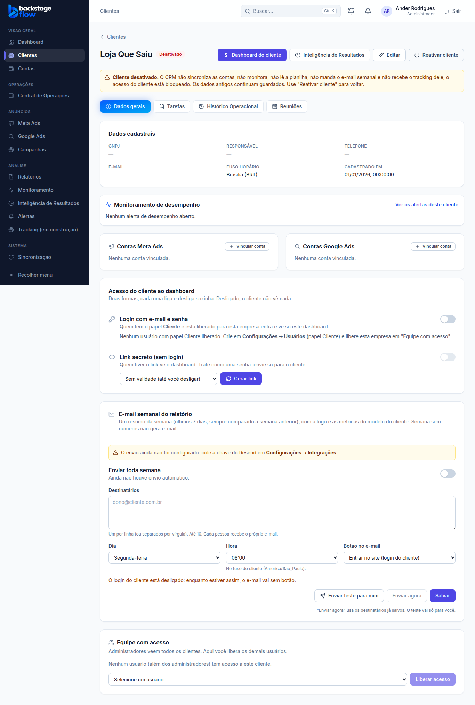
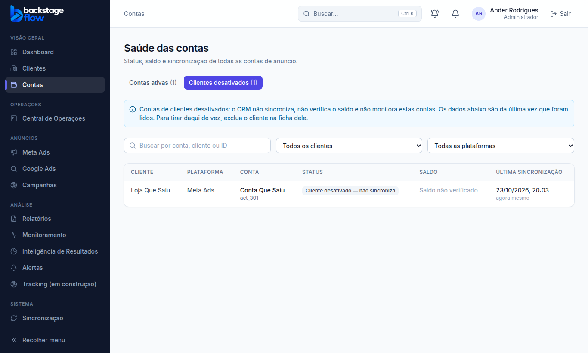
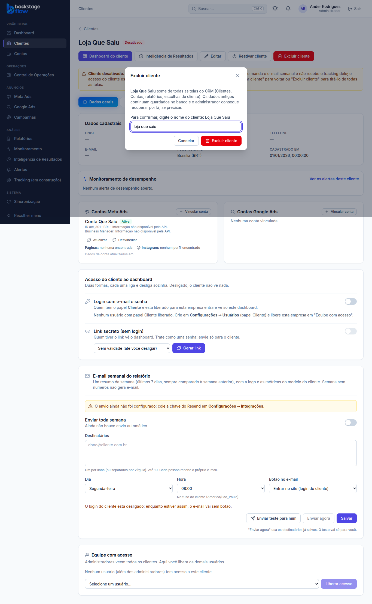

# Desativar cliente (23/10/2026)

> Ander: "Crie um botão para desabilitar clientes, tudo que envolve isso."
> Respostas dele: o tracking deve parar; os períodos passados continuam no Dashboard.
> **Ponto de volta criado antes** (ver `docs/PONTO-DE-RESTAURACAO.md`).

## Como usar
- Na ficha do cliente, o administrador vê **"Desativar cliente"** (pede confirmação) ou, se já estiver desativado, **"Reativar cliente"**.
- A situação "Encerrado" virou **"Desativado"** (é a mesma no banco). No formulário "Editar" ela não aparece: só pelo botão.
- Quem não é admin não vê o botão; o banco recusa a mudança por qualquer outro caminho.

## O que para quando o cliente é desativado
| O quê | Como |
|---|---|
| Sincronização automática do Meta/Google e recuperação do histórico | as contas do cliente não entram na fila (`sync_claim_due`, `sync_claim_backfill`) |
| Monitoramento e alertas | as contas ficam fora da avaliação; os alertas abertos são encerrados com o motivo "cliente desativado" |
| Leitura automática da planilha | a leitura do cliente é recusada (`ri_read_claim`) |
| E-mail semanal de relatório | o cliente sai da lista de envio (`client_report_email_due`) |
| Acesso do cliente | link secreto recusado ("Link inválido ou desativado") e login do cliente sem acesso aos dados (`can_view_client` e `visible_client_ids`; ver a correção abaixo) |
| Tracking do site e WhatsApp | eventos recusados (`tracking_ingest`, `tracking_whatsapp_register`, `tracking_whatsapp_inbound`) |
| Envio à API de Conversões do Meta | a fila do cliente não sai (`tracking_capi_claim`); com mais de 7 dias o Meta não aceita mais e os eventos são descartados |
| Central de Operações | repetições de tarefas/reuniões do cliente param ("Parada automaticamente: o cliente foi desativado") |
| Tela Contas | a conta vai para a aba **"Clientes desativados"** com a etiqueta "Cliente desativado — não sincroniza"; fica fora da contagem e do "Verificar status e saldo" |
| Telas do dia a dia | some da escolha de cliente (Dashboard, Campanhas, Relatórios, Meta/Google, Comparativo, Executivo, Monitoramento, Inteligência de Resultados, Tracking, Alertas). Continua na lista de Clientes (aba "Desativado"), no Histórico e nos Logs |

## O que não muda
- **Nada é apagado.** Métricas, histórico, campanhas, planilha, tarefas e alertas antigos continuam guardados.
- Os **números de períodos passados** continuam no Dashboard (pedido do Ander).
- Ao **reativar**, tudo volta a funcionar e a sincronização roda logo (a recuperação de lacunas busca os dias que faltaram).
  As repetições da Central que pararam **não voltam sozinhas** (reative-as na Central, se quiser).
- Desativar e reativar ficam no histórico de auditoria (`client.deactivate` / `client.reactivate`).

## Banco
- Migração `20261023125125_clientes_desativar.sql`. **Nenhuma tabela nova.**
  - `private.client_is_active(cliente)`: regra única usada por todas as checagens.
  - Gatilhos em `clients`: `clients_status_guard` (só admin desativa/reativa) e `clients_status_effects` (encerra alertas, para repetições, auditoria, sincroniza ao reativar).
- Ponto de volta: as versões anteriores ficaram em `private.*_antes_2026_10_23`; `supabase/rollback/voltar_clientes_desativar_2026_10_23.sql` desfaz tudo.

## Testes
- SQL: `supabase/tests/clientes_desativar.sql` — 11 verificações OK no banco real (desfeito no fim).
- Navegador: `e2e/client-deactivate.mjs` — confirmação, etiqueta, alertas encerrados, some do Dashboard, aba Desativado, reativar, gestor sem botão e recusado.

---

# Contas ativas × desativadas e Excluir cliente (23/10/2026, à tarde)

> Ander: "se eu desativo um cliente, ele tem que sair de Contas. Ou pelo menos ter contas ativas e contas desativadas...
> E quando eu excluir esse cliente, aí some." Caminho escolhido: abas em Contas + botão Excluir.

## Tela Contas
- Duas abas: **Contas ativas** (padrão) e **Clientes desativados**, cada uma com a quantidade.
- Os contadores de status e o botão **"Verificar status e saldo"** só valem para as contas ativas.
- Na aba de desativados aparece o aviso de que essas contas não sincronizam e a etiqueta "Cliente desativado — não sincroniza".

## Excluir cliente

- Só o **administrador**, e só para cliente **já desativado** (o botão aparece ao lado de "Reativar cliente").
- Para confirmar, é preciso **digitar o nome do cliente** (maiúsculas/minúsculas não importam).
- O cliente **some de todas as telas**: lista de Clientes (até em "Todos"), Contas, relatórios, escolhas de cliente, ficha.
- **Nada é apagado de verdade**: o banco só marca a data da exclusão (`excluded_at`) e quem excluiu (`excluded_by`).
  Recuperar é feito pelo banco (limpando `excluded_at`), se um dia precisar.
- Fica no histórico de auditoria como `client.exclude`.
- Pontos de atenção:
  - o **CNPJ** do cliente excluído continua reservado: cadastrar outro cliente com o mesmo CNPJ dá "Já existe um cliente com este CNPJ";
  - tarefas antigas da Central de Operações ligadas a ele continuam guardadas.

## Correção encontrada ao fazer isto (honestidade)
Na entrega da manhã, a parte "login do cliente bloqueado" **não estava valendo de verdade**: as regras de acesso (RLS) do
banco continuavam usando a versão antiga da checagem, e a lista de clientes visíveis não olhava a desativação.
Na prática, só o link secreto estava bloqueado. Corrigido nesta migração: as 12 regras de acesso agora usam a checagem nova,
e um usuário com papel "cliente" de uma empresa desativada não vê mais nada.

## Banco
- Migração `20261023195405_clientes_excluir.sql`. **Nenhuma tabela nova**; duas colunas novas em `clients`:
  - `excluded_at` (quando foi excluído) e `excluded_by` (quem excluiu, ligado a `auth.users`). Guardadas para sempre.
- `private.client_exclude_impl` (confere admin, cliente desativado e nome) chamada pela função fina `public.client_exclude`.
- `private.can_view_client` e `private.visible_client_ids`: cliente excluído some para todos; desativado some para o papel "cliente".
- Volta: `supabase/rollback/voltar_clientes_excluir_2026_10_23.sql` (rodar **antes** do `voltar_clientes_desativar`).

## Testes
- SQL: `supabase/tests/clientes_excluir.sql` — 13 verificações OK no banco real (desfeito no fim).
- Banco real, como admin, numa transação desfeita: excluir "Abraço de Algodão" tirou a conta dela de Contas (1 → 0) e o cliente da lista (1 → 0).
- Navegador: `e2e/client-deactivate.mjs` agora com 23 verificações (abas de Contas, verificar saldo só das ativas, excluir com nome errado/certo, some de Clientes e Contas, gestor recusado).

---

# Correção de 25/10/2026: a Abraço de Algodão ainda aparecia no Dashboard

- **Causa:** a sincronização automática estava parada, mas o botão **"Sincronizar agora"** (manual) ainda puxava a conta do cliente desativado: 6 sincronizações manuais entre 23 e 25/10 trouxeram dados até o dia 25.
- **Banco:** `20261025164801_clientes_desativar_sync_manual.sql` — a trava de execução (`sync_lock`) pula cliente desativado. Testado no banco real: conta da Abraço recusada, conta de cliente ativo aceita.
- **Telas:** sem filtro de cliente, Dashboard, Meta/Google, Relatórios, Comparativo e Saldo **não somam** cliente desativado, e a conta dele sai da escolha de "Conta". O **Histórico** continua mostrando o passado de todos (decisão de 23/10).
- **Testes de navegador:** `client-deactivate` (25), `dashboard` (39), `history` (23), `balance` (32), `health` (33), `reports` (28), `comparison` (38), `meta-view` (44), `google-view` (31) — todos OK.
