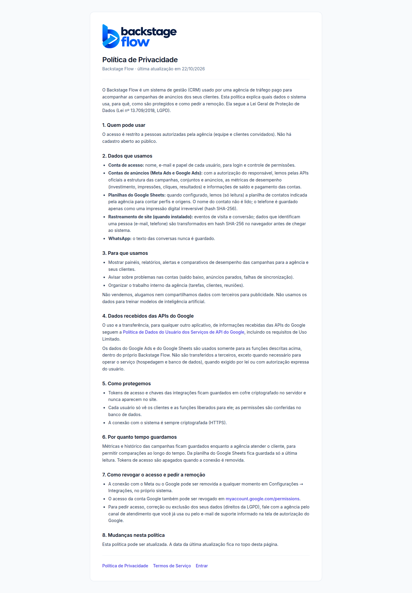

# Política de Privacidade e Termos de Serviço (22/10/2026)

> Pedido do Ander: criar na tela inicial do CRM os links da Política de Privacidade e dos Termos de Serviço
> (exigidos pelo Google na tela de autorização do app), com texto genérico.

## O que foi criado
- **https://www.backstageflow.com.br/privacidade**: Política de Privacidade (abre sem login).
- **https://www.backstageflow.com.br/termos**: Termos de Serviço (abre sem login).
- Links "Política de Privacidade · Termos de Serviço" no rodapé da tela de entrada.

## Conteúdo (genérico, mas fiel ao que o CRM faz)
- Dados usados: conta de acesso; Meta Ads e Google Ads pelas APIs oficiais; Google Sheets só leitura (nome não lido,
  telefone só em hash SHA-256); tracking em hash; texto do WhatsApp nunca guardado.
- Declaração de **Uso Limitado** da Política de Dados do Usuário dos Serviços de API do Google (pedida pelo Google).
- Proteção (cofre, permissões no banco, HTTPS), retenção, como revogar o acesso e direitos da LGPD.
- Contato: "canal de atendimento da agência ou e-mail de suporte da tela de autorização do Google"
  (o e-mail do Ander não fica no código, regra de segurança do projeto).

## Onde colar no Google Cloud
Google Auth Platform → **Branding** (ou Tela de consentimento OAuth):
- Página inicial do aplicativo: `https://www.backstageflow.com.br`
- Link da Política de Privacidade: `https://www.backstageflow.com.br/privacidade`
- Link dos Termos de Serviço: `https://www.backstageflow.com.br/termos`
- Domínios autorizados: `backstageflow.com.br`

## Testes
- Navegador: `e2e/legal.mjs` (abre sem login, declaração de Uso Limitado, links na entrada, sem rolagem lateral no celular).
- Arquivos: `apps/web/src/features/legal/LegalPages.tsx`, rotas em `src/app/router.tsx`, links em `LoginPage.tsx`.
