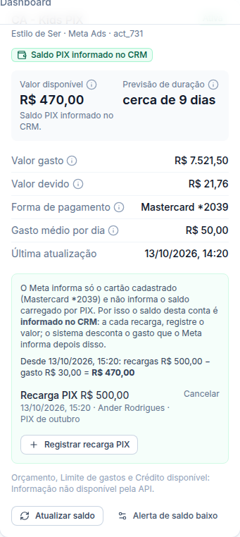

# Correção de 13/10/2026: saldo PIX informado no CRM (Estilo de Ser Kids)

> **Status:** pronta.
> **Pedido do Ander:** a conta "CA - Estilo de Ser Kids" tem cartão cadastrado, mas as campanhas rodam com saldo carregado por PIX. O CRM mostrava "Cartão de crédito · R$ 0,00". Ele pediu para usar o saldo PIX, **só nesse cliente**.

## O que o Meta informa (conferido no banco em 13/10/2026)
- **Forma de pagamento em uso:** cartão (tipo 1), "Mastercard \*2039".
- **Conta pré-paga:** não.
- **Saldo PIX:** nenhum campo da API traz esse valor.
- **Valor devido:** sobe durante o dia e é cobrado todo dia por volta das 6h–7h (horário de Brasília).

Por isso a correção automática não era possível. O Ander escolheu a opção (a): ele informa as recargas no CRM.

## A regra (só para contas marcadas)
- **Disponível** = ponto de partida + recargas registradas depois dele − gasto que o Meta informa depois dele.
- **Ponto de partida:** o último "Saldo atual (conferido no Meta)" informado. Se não houver nenhum, é a primeira recarga, partindo de R$ 0.
- **Gasto:** vem do gasto diário da conta, atualizado a cada sincronização (mais ou menos de hora em hora). No dia do registro, só conta o que foi gasto **depois** dele: o sistema guarda quanto já tinha sido gasto no dia na hora do registro.
- **Sem nenhum registro:** o disponível aparece como "—", nunca R$ 0,00 inventado.
- **Gasto maior que o saldo:** R$ 0,00 e alerta "Sem saldo".
- **Previsão de duração e alertas de saldo baixo e sem saldo** passam a valer para a conta, como numa conta pré-paga.
- **Registro errado:** é cancelado e fica no histórico riscado. Nunca é apagado.
- **Outras contas:** nenhuma mudança. A outra conta da Estilo de Ser continua como cartão.

## Na tela
O card de saldo da conta mostra:
- a etiqueta "Saldo PIX informado no CRM";
- o cálculo ("Desde dd/mm hh:mm: recargas R$ … − gasto R$ … = R$ …");
- as últimas recargas;
- o botão **Registrar recarga PIX**, com duas opções:
  - "Recarga PIX": soma ao saldo;
  - "Saldo atual (conferido no Meta)": substitui o saldo, bom para começar ou acertar diferenças.

## Quem pode
- **Ver:** a equipe que vê o cliente. O cliente não vê.
- **Registrar e cancelar:** administrador, e gestor do cliente.
- A permissão é conferida no banco, e cada registro e cada cancelamento vai para os Logs.

## Banco
- **Campo novo:** `ad_accounts.manual_prepaid` (liga ou desliga por conta). Ligado só em `act_920458724035388`.
- **Tabela nova:** `account_manual_balance_entries`.
  - **Para quê:** recargas PIX e saldos informados no CRM.
  - **Campos principais:** conta, cliente, tipo (`recarga` ou `saldo`), valor, moeda, data e hora, dia na conta, gasto do dia até o registro, observação, quem registrou, cancelamento (quando, quem, motivo).
  - **Ligações:** `ad_accounts` e `clients`.
  - **Índice:** por conta e data.
  - **Retenção:** permanente. Não se apaga, só se cancela.
  - **Segurança:** RLS ligado; leitura só para a equipe dos clientes liberados; escrita só pelas funções.
- **Funções:**
  - `private.manual_prepaid_state` faz o cálculo;
  - `public.manual_balance_status`, `public.manual_balance_add` e `public.manual_balance_void` são usadas pela tela e chamam as `private.*_impl`;
  - `public.account_balances` usa o saldo informado nas contas marcadas. A saúde das contas, os alertas e o dashboard leem dela.
- **Migrations:** `20261013151217_balance_manual_pix`, `20261013151406_balance_manual_pix_invoker`.
- **Teste:** `supabase/tests/correcao_saldo_pix_informado.sql`, com 20 verificações.

## Para ligar em outra conta
Hoje só por pedido, com uma linha no banco: `update ad_accounts set manual_prepaid = true where …`. Não há botão na tela porque o pedido foi só para esta conta.
