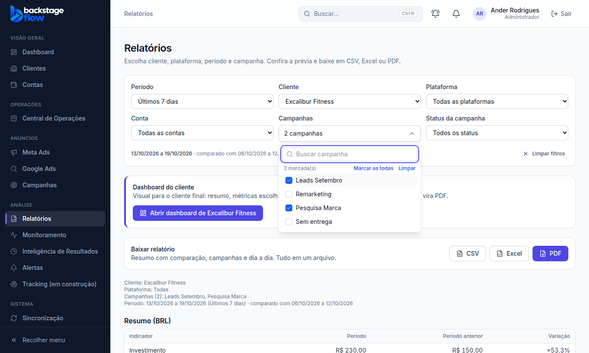
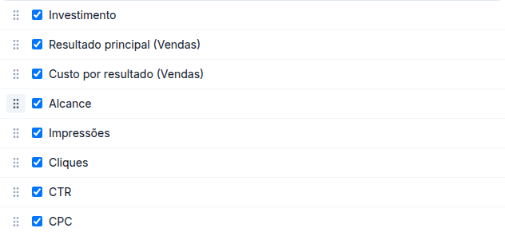

# Correção 20/10/2026 — Relatório com várias campanhas e "Personalizar" por arrastar

Pedido do Ander (com prints): (1) escolher **mais de uma campanha** no Relatórios; (2) no **Personalizar** do relatório do cliente, ordenar as métricas **arrastando**, sem setas.

## 1. Várias campanhas no Relatórios

- O campo "Campanha" virou **"Campanhas"**: abre uma lista com **busca** e caixa de marcar em cada campanha, mais "Marcar as todas/encontradas" e "Limpar".
- Nada marcado = todas as campanhas (como antes). O botão mostra o nome (uma) ou "N campanhas".
- Resumo, campanhas e dia a dia do relatório (tela, CSV, Excel e PDF) usam só as campanhas marcadas. O cabeçalho lista: "Campanhas (2): Leads Setembro, Pesquisa Marca".
- As campanhas marcadas ficam no endereço (`?campanhas=...`), então o link guarda a escolha. Máximo de 100 por vez.
- Trocar de cliente, conta ou plataforma limpa a escolha. **As outras telas (Dashboard, Comparação etc.) continuam com uma campanha só.**
- Banco e servidor não mudaram (as funções já aceitavam uma lista de campanhas).

## 2. "Personalizar" por arrastar

- Em **Dashboard do cliente → Personalizar → Métricas dos cartões**, cada métrica tem a alça **⠿**: é só arrastar para cima ou para baixo. As setas saíram.
- Funciona com mouse, no celular (dedo) e pelo teclado (Espaço para pegar, setas para mover, Espaço para soltar).
- Marcar/desmarcar a métrica continua igual.

## Testes
- Navegador: `e2e/reports.mjs` (uma campanha, busca, duas campanhas, endereço, cabeçalho) e `e2e/client-report.mjs` (sem setas, arrastar Alcance para antes de Impressões, ordem salva).
- Unitários: regra de mover o item na lista (`sortable-list.test.ts`).
