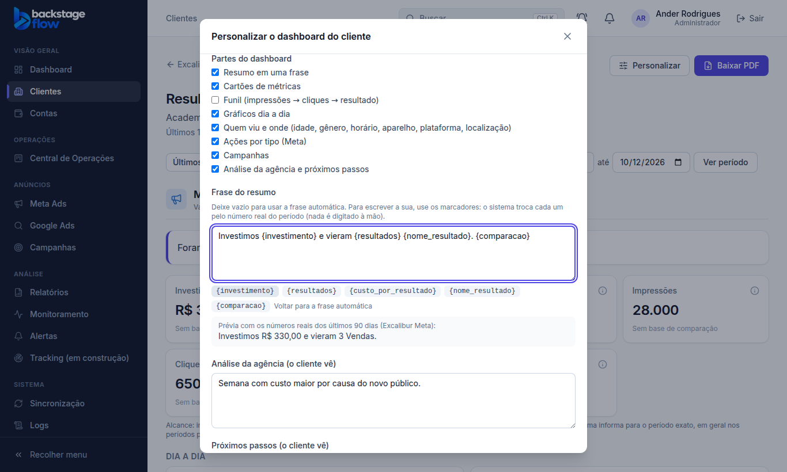

# Correção de 13/10/2026 — frase do resumo editável ou opcional

> **Status:** pronta.
> **Pedido do Ander:** a frase do resumo nos relatórios ("Foram investidos R$ 348,42 e gerados 28 lead (end form), a R$ 12,44 cada.") deve ser opcional ou editável. Ele aprovou as três partes (A, B e C). Pela proposta, a frase vale por cliente.

## O que mudou

**A) Frase editável por cliente**
- Fica em **Personalizar → Frase do resumo**.
- Você escreve a frase com marcadores, e o sistema troca cada um pelo número real do período:

  | Marcador | O que entra no lugar |
  |---|---|
  | `{investimento}` | valor investido |
  | `{resultados}` | quantidade do resultado principal |
  | `{custo_por_resultado}` | custo por resultado |
  | `{nome_resultado}` | nome do resultado |
  | `{comparacao}` | comparação com o período anterior; fica vazio quando não há base |

- **Números:** nenhum é digitado à mão. O que a plataforma não informa aparece como "—".
- **Na tela:**
  - um botão para cada marcador, que o coloca no texto;
  - uma prévia com os números reais dos últimos 90 dias;
  - "Voltar para a frase automática".
- **Campo vazio:** volta a frase automática.
- **Onde vale:** dashboard, PDF, link do cliente e e-mail semanal.

**B) Desligar a frase também no e-mail semanal**
- O e-mail passou a respeitar "Resumo em uma frase" de **Partes do dashboard**. Antes, só o dashboard, o PDF e o link respeitavam.
- Com o resumo desligado, o campo da frase some da tela de Personalizar.

**C) Nome do resultado como foi escrito**
- **Antes:** a frase automática punha o nome em minúsculas ("28 lead (end form)").
- **Agora:** o nome escolhido em Personalizar fica exatamente como foi escrito ("28 Lead (End Form)").
- **Exceção:** os nomes padrão ("Leads", "Conversas iniciadas", "Conversões") continuam em minúsculas no meio da frase ("50 leads").

## Banco
- **Tabela nova:** nenhuma.
- **Campo novo em `client_report_settings`:** `summary_template` (texto, até 500 caracteres; vazio = frase automática). As regras de acesso são as da tabela: lê quem vê o cliente; altera só admin e gestor.
- **Link do cliente:** recebe o campo pela função que já existia (`client_report_public`).
- **Migration:** `20261013154724_client_report_summary_template`.
- **Avisos de segurança do Supabase:** só os antigos.

## Servidor
- **Edge Function `client-report-email` publicada** (versão 2) com as regras novas.
- **Conferência:** o código publicado foi lido de volta e comparado. Uma chamada de teste com pedido inválido respondeu normalmente ("Pedido inválido").
- **E-mail real:** não foi enviado nenhum.

## Arquivos
- **Regra compartilhada:** `packages/shared/src/reports/email.ts` (frase, marcadores, e-mail) e `clientReport.ts` (campo novo no modelo).
- **Tela:**
  - `ReportSettingsModal.tsx`: campo "Frase do resumo" com marcadores e prévia;
  - `AccountReport.tsx`;
  - `api.ts` (salvar).
  - `components/ui/field.tsx`: a caixa de texto aceita referência.
- **Servidor:** `supabase/functions/client-report-email/index.ts`.

## Testes
- **Regra compartilhada:** 202 testes, todos passaram. Os 3 novos cobrem:
  - o nome como foi escrito;
  - os marcadores, o "—" e a comparação vazia;
  - o resumo desligado no e-mail e a frase editável no e-mail.
- **Funções do servidor:** 118 testes, todos passaram; checagem de tipos sem erro.
- **Navegador:** os testes passaram em todos os roteiros:

  | Roteiro | Verificações |
  |---|---|
  | `client-report.mjs` | 52 (8 novas) |
  | `client-email.mjs` | 52 |
  | `client-portal.mjs` | 35 |
  | `client-breakdowns.mjs` | 19 |
  | `reports.mjs` | 23 |
  | `demo.mjs` | 18 |

  As 8 novas do `client-report.mjs` conferem:
  - os botões de marcador e a prévia;
  - que a frase é salva e usada no dashboard;
  - que, com o resumo desligado, a frase some do relatório.
- **Não conferido:** no site publicado e num e-mail semanal real.
