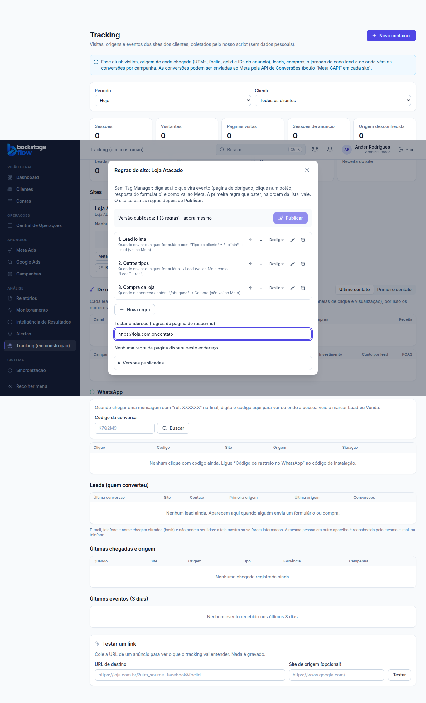
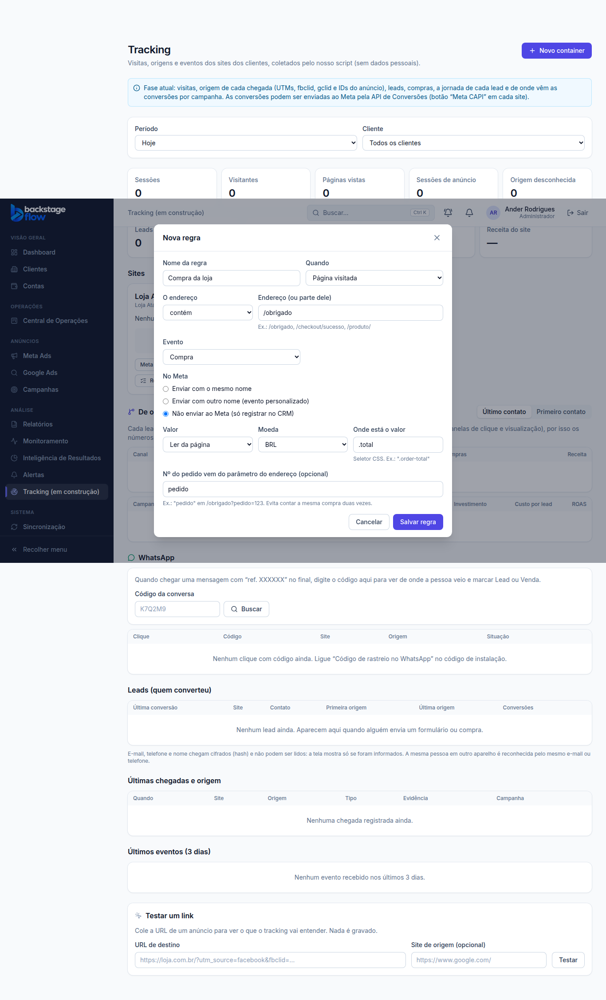

# Tracking T2 — Regras do site sem Tag Manager (23/10/2026)

> Status: **pronta**. Faz parte do plano novo (`REANALISE-2026-10-23.md`), aprovado com "pode".
> Ponto de volta: `../PONTO-DE-RESTAURACAO.md` · banco: `supabase/rollback/voltar_tracking_regras_2026_10_23.sql`.

## 1. Para que serve
Sem Tag Manager e sem código novo no site, você diz **no CRM** o que vira evento e como vai ao Meta:

| Tipo de regra | Exemplo | Vira |
|---|---|---|
| **Formulário com resposta** | campo "Tipo de cliente" = **Lojista** | **Lead** (vai ao Meta e treina a campanha) |
| Formulário (qualquer outro) | sacoleiro, cliente final, outro | Lead no CRM, mas vai ao Meta como **"LeadOutros"** (não treina o Lead) |
| **Página visitada** | endereço contém `/obrigado` | Compra, Cadastro, Agendamento… |
| **Clique** | botão com o texto "Agendar visita", link que contém "calendly.com" ou seletor CSS | Agendamento, Contato… |

- **A primeira regra que bater, na ordem da lista, vale** (setas ↑ ↓ mudam a ordem). Por isso a regra do lojista fica **acima** da regra "outros".
- **No Meta**, cada regra escolhe: enviar com o mesmo nome, enviar com outro nome (evento personalizado) ou **não enviar** (só registrar no CRM).
- **Compra de loja virtual** (Nuvemshop, Shopify…): a loja já manda a compra ao Meta. Use **"Não enviar ao Meta"**: o CRM registra a compra para saber de qual campanha ela veio, sem contar em dobro.
- **Valor**: sem valor, fixo ou **lido da página** (ex.: o total na página de obrigado, "R$ 1.234,56"). **Compra sem valor encontrado não é enviada** — nada de valor inventado.
- **Nº do pedido** pode vir do endereço (ex.: `/obrigado?pedido=123`): evita contar a mesma compra duas vezes.

## 2. Rascunho → Publicar → Voltar versão
- O que você edita é um **rascunho**. O site só passa a usar depois de **Publicar** (em até 5 minutos).
- Aparece **"Mudanças não publicadas"** quando o rascunho mudou depois da última publicação.
- Cada publicação vira uma **versão guardada para sempre**. Em "Versões publicadas", **Voltar para esta** publica de novo uma versão antiga.
- Regras tiradas da lista são **arquivadas**, nunca apagadas.
- **Testar endereço**: cole um endereço e veja quais regras de página disparam nele (sem gravar nada).

## 3. Como o site entende o formulário
- O campo é achado pelo **rótulo** que aparece na tela ("Tipo de cliente"), pelo nome técnico, pelo `id` ou pelo texto de ajuda. Contém já basta ("Tipo de cliente *" também vale).
- Funciona com **lista de opções** (select), **rádio** e caixas de marcar. Maiúscula e acento não importam ("Lojísta" = "Lojista").
- O que vai junto do evento é só a **opção da regra** (ex.: `resposta: "Lojista"`) — nunca um texto digitado pela pessoa.
- E-mail e telefone do formulário continuam indo **só em hash (SHA-256)**, feitos no navegador.
- **Sem regras publicadas, nada muda no site** (o automático de antes continua igual).

## 4. Regras
- Nunca inventar: compra sem valor na página não sai; sem resposta que bata, a regra não dispara.
- A lista "Eventos enviados" do Meta CAPI de cada site **continua valendo** (pelo nome do evento no CRM).
- O Pixel do navegador (opção do código de instalação) segue a mesma escolha da regra: mesmo nome, outro nome ou não dispara.
- Cliente desativado: o site não recebe regras.
- Quem pode: **admin e gestor** criam, editam, arquivam e publicam; operador e visualizador **só veem**; o perfil cliente não vê. O banco confere.
- Publicar e voltar versão ficam na auditoria (`tracking.rules_publish`); criar e editar regra também (`tracking_rule`).

## 5. Tabelas novas
| Tabela | Para quê | Campos principais | Ligações | Índices | Por quanto tempo |
|---|---|---|---|---|---|
| `tracking_rules` | Rascunho das regras de cada site | nome, tipo (página/clique/formulário), condição (endereço, botão, campo e respostas), evento, como vai ao Meta, valor (fixo/da página, moeda), parâmetro do nº do pedido, ligada, ordem, arquivada em | site (`tracking_containers`), cliente | por site e ordem (só as não arquivadas); por cliente | **Para sempre** (arquivar não apaga) |
| `tracking_rule_versions` | Cada publicação (o que o site usa) | nº da versão, regras publicadas (cópia), quantidade, "volta da versão", quem e quando | site, cliente | por site + versão (única); por cliente | **Para sempre** |

Também mudou: `tracking_containers.rules_version` (versão no ar) e a fila do Meta (`private.tracking_capi_enqueue`) passou a aceitar o nome do Meta vindo da regra ou "não enviar".

## 6. Servidor e script
- `track` (Edge Function): `GET ?k=<chave do site>` devolve só a **versão publicada** (público, como a chave; guardado 5 min pelo navegador).
- `t.js`: lê as regras e aplica em página (inclusive troca de página sem recarregar), clique e envio de formulário. Duplo clique conta uma vez.

## 7. Arquivos
- Banco: `supabase/migrations/20261023210112_tracking_regras.sql`, `20261023210319_tracking_regras_permissao.sql`, `20261023220501_tracking_regras_permissao_servidor.sql`; teste `supabase/tests/tracking_regras.sql`; volta `supabase/rollback/voltar_tracking_regras_2026_10_23.sql`.
- Regras compartilhadas: `packages/shared/src/tracking/rules.ts` (+ testes).
- Servidor: `supabase/functions/track/index.ts`. Script: `apps/web/public/t.js`.
- Tela: `apps/web/src/features/tracking/RulesModal.tsx`, `api.ts`, `TrackingPage.tsx` (botão "Regras" no card do site).
- Simulador e teste de navegador: `apps/web/src/demo/mockBackend.js`, `apps/web/e2e/tracking-rules.mjs`.

## 8. Testes
- **Banco** (`tracking_regras.sql`): **13 verificações OK** no banco real (desfeito no fim) — cliente da regra vem do site, compra sem valor e personalizado sem nome recusados, rascunho não muda o site, publicar, desligar, voltar versão (antigas arquivadas), auditoria, visualizador só vê, cliente desativado sem regras, fila do Meta com nome da regra / "não enviar" / lista de eventos respeitada.
- **Regras compartilhadas**: 7 testes (endereço, campo e resposta, valor em real e dólar, nome no Meta, resumo, validação).
- **Navegador** (`tracking-rules.mjs`): **26 verificações** — tela (criar, validar, publicar, testar endereço, ordem, desligar, voltar versão, visualizador) e script (lojista → Lead com Pixel, sacoleiro → LeadOutros, rádio com acento, clique, troca de página → compra com valor e pedido sem Pixel, compra sem valor não sai, sem regras nada muda).
- O teste antigo do tracking (`tracking.mjs`, 114 verificações) continua passando.
