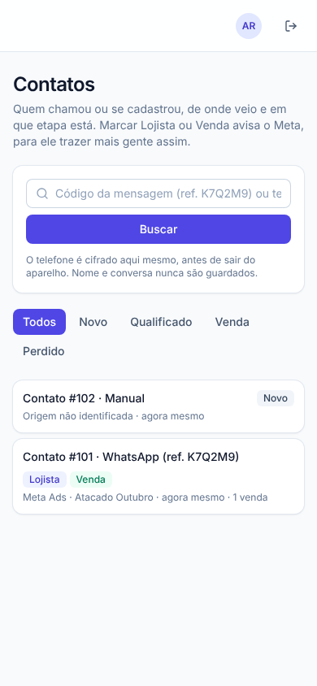
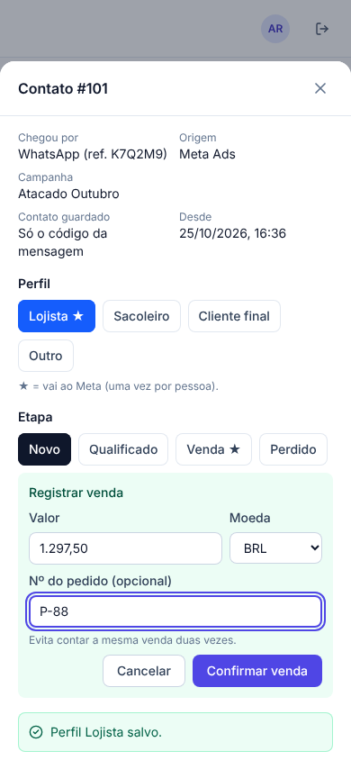
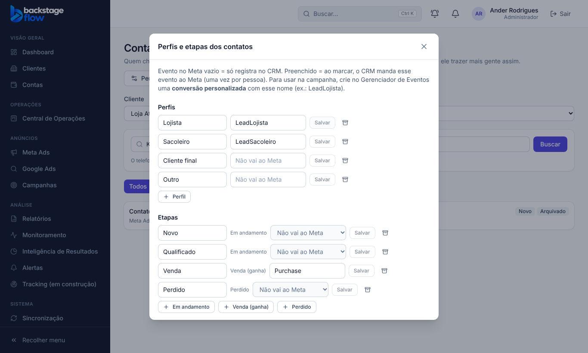

# Tracking T3.1 — Contatos no CRM e papel Vendedor (23 a 25/10/2026)

> Status: **pronta**. Plano: `T3-PLANO.md` (respostas do Ander: quem marca = **equipe do cliente**; etapas padrão aprovadas).
> Ponto de volta: `../PONTO-DE-RESTAURACAO.md` · banco: `supabase/rollback/voltar_contatos_vendedor_2026_10_23.sql`.

## 1. O que mudou
- Tela nova **Contatos** (`/contatos`): a lista de contatos de cada cliente, no lugar da planilha.
- Papel novo **Vendedor (do cliente)**: a equipe de vendas do cliente entra no CRM e **só vê e marca os contatos** dos clientes liberados para ela.
- Sem item novo no menu: a agência abre pelo botão **Contatos** no Tracking e na ficha do cliente. O vendedor cai direto nos Contatos e não tem menu.

## 2. De onde vêm os contatos
| Origem | Como |
|---|---|
| **Site** | Todo lead do site (formulário, regra da T2) vira contato sozinho. Se o formulário respondeu "Lojista", o contato já chega com o perfil Lojista |
| **WhatsApp com código** | O vendedor digita o código da mensagem ("ref. K7Q2M9"): o contato nasce com a origem do anúncio (canal e campanha) |
| **Manual** | O vendedor digita o telefone: ele é **cifrado no próprio aparelho** (SHA-256) antes de sair. Mesmo telefone = mesmo contato |

Nome e texto da conversa **nunca** são guardados. A tela mostra só: origem, campanha, perfil, etapa, vendas e se há telefone/e-mail (cifrado).

## 3. Marcar (perfil, etapa e venda)
- **Perfil**: Lojista ★, Sacoleiro, Cliente final, Outro. ★ = vai ao Meta.
  - Lojista vai ao Meta como **`LeadLojista`**, **uma vez só por pessoa** (marcar de novo não reenvia; quem chegou pelo site já como Lojista não é reenviado).
- **Etapa**: Novo → Qualificado → **Venda ★** / Perdido.
  - **Venda** pede valor e moeda (nº do pedido opcional) e vira **Compra** no Meta, com o valor. Mesmo nº de pedido não conta duas vezes.
- Tudo vai pelo mesmo caminho do tracking: entra nos leads, compras, jornada e atribuição por campanha, e na fila do Meta (Meta CAPI do site).
- **Honestidade na tela**: depois de marcar aparece o que aconteceu ("Evento preparado para o Meta", ou "não foi para o Meta: o cliente não tem site no Tracking").

## 4. Perfis e etapas por cliente
- Admin e gestor mudam nomes, criam perfis/etapas e escolhem **o nome do evento no Meta** (vazio = só registra). Arquivar, nunca apagar.
- Padrão de todos os clientes (aprovado): só **Lojista** (`LeadLojista`) e **Venda** (`Purchase`) vão ao Meta.
- Para usar na campanha: no Gerenciador de Eventos, criar a **conversão personalizada** "LeadLojista".

## 5. Quem pode
| Papel | Ver contatos | Marcar | Arquivar | Perfis e etapas |
|---|---|---|---|---|
| Admin | todos os clientes | sim | sim | sim |
| Gestor | clientes liberados | sim | sim | sim |
| Operador | clientes liberados | sim | sim | não |
| Visualizador | clientes liberados | não | não | não |
| **Vendedor** | **só os clientes liberados** (cliente desativado some) | sim | não | não |
| Cliente / Equipe | não | — | — | — |

**O vendedor não vê mais nada do CRM** (anúncios, números, contas, clientes, Central): o banco trata ele como o papel "Equipe" em todas as outras regras. Conferido no teste do banco.

Como dar acesso: Configurações → Usuários → criar com o papel **Vendedor (do cliente)** → na ficha do cliente, "Equipe com acesso" → liberar a pessoa.

## 6. Tabelas novas
| Tabela | Para quê | Campos principais | Ligações | Índices | Por quanto tempo |
|---|---|---|---|---|---|
| `tracking_contacts` | Um contato por pessoa e cliente | origem, telefone/e-mail **só em hash**, código "ref.", perfil, etapa, vendas, eventos já enviados ao Meta, arquivado em | cliente, site, lead do site, clique do WhatsApp | telefone por cliente (único), clique (único), lead (único), lista por cliente e data | **Para sempre** (arquivar, nunca apagar) |
| `tracking_contact_profiles` | Perfis de cada cliente | nome, ordem, evento no Meta, arquivado em | cliente | nome por cliente (único) | Para sempre |
| `tracking_contact_stages` | Etapas de cada cliente | nome, ordem, tipo (em andamento / venda / perdido), evento no Meta (só venda), arquivado em | cliente | nome por cliente (único) | Para sempre |
| `tracking_contact_history` | Cada mudança: quem, quando, etapa, perfil, venda (valor, moeda, pedido), evento para o Meta | — | contato, cliente | por contato e data; por cliente e data | **Para sempre** |

A tela **não lê** o hash do telefone/e-mail (permissão por coluna). Gravar só pelas funções do banco (`contact_create`, `contact_update`, `contact_archive`), que conferem quem pode.

## 7. Correções achadas pelos testes (antes de chegar ao Ander)
1. Criar contato manual (sem código) dava erro no banco → corrigido (`contatos_vendedor_correcao`).
2. As permissões padrão do Supabase davam a tabela inteira para quem está logado, e a regra "esconder o hash do telefone" não valia → corrigido para os contatos **e para as tabelas de regras da T2** (`contatos_permissoes_colunas`).

## 8. Arquivos
- Banco: `20261023224158_papel_vendedor.sql`, `20261023224612_contatos_vendedor.sql`, `20261023224922_contatos_vendedor_correcao.sql`, `20261023225049_contatos_permissoes_colunas.sql`; teste `supabase/tests/contatos_vendedor.sql`; volta `supabase/rollback/voltar_contatos_vendedor_2026_10_23.sql`.
- Regras compartilhadas: `packages/shared/src/constants/roles.ts` e `permissions.ts` (papel e 3 permissões novas).
- Tela: `apps/web/src/features/contacts/` (`ContactsPage.tsx`, `SetupModal.tsx`, `api.ts`); rota em `app/router.tsx`; vendedor em `ClientHome.tsx`, `navigation.ts`, `AppLayout.tsx`, `UserFormModal.tsx`; atalhos no Tracking e na ficha do cliente.
- Simulador e testes: `apps/web/src/demo/mockBackend.js`, `apps/web/e2e/contacts.mjs`, `e2e/permissions.mjs`.

## 9. Testes
- **Banco** (`contatos_vendedor.sql`, no banco real, desfeito no fim): **14 verificações OK** — padrões, vendedor só vê o cliente liberado (e não o desativado), vendedor não vê nada do resto do CRM, contato pelo código (com origem), manual pelo telefone, outro cliente recusado, código inválido, Lojista → LeadLojista uma vez só (com o fbc do clique), Sacoleiro não vai, venda sem valor recusada, venda vira compra e vai ao Meta, pedido repetido recusado, histórico, vendedor não arquiva nem lê o hash, lead do site vira contato Lojista já enviado, admin arquiva.
- **Navegador** (`contacts.mjs`): **23 verificações** — vendedor no celular (entra direto, sem menu, código, Lojista, venda, telefone cifrado, não arquiva, não abre outras telas), admin (atalho, arquivar, perfis/etapas), visualizador só vê.
- Testes unitários: papéis e permissões (vendedor só vê e marca contatos) e menu (vendedor sem itens).
- **Não testado**: um vendedor de verdade usando no celular dele, e o envio real ao Meta (depende do cliente piloto com Pixel e token).
