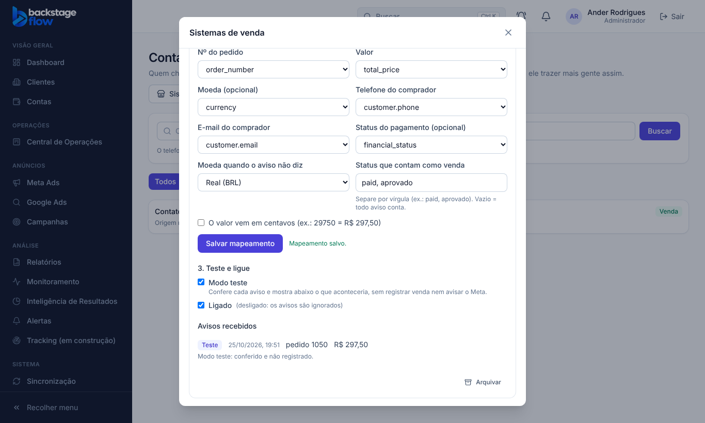

# Tracking T3.2 — Vendas pelo webhook do sistema de vendas (25/10/2026)

> Status: **pronta**. Respostas do Ander: (1) funcionar com **qualquer sistema que tenha webhook**; (2) **sim**: o telefone/e-mail que chega do sistema pode ser cifrado no servidor, na chegada.
> A Inteligência de Resultados **continua lendo da planilha** (T3.3 não foi feita, a pedido).
> Ponto de volta: `../PONTO-DE-RESTAURACAO.md` · banco: `supabase/rollback/voltar_vendas_webhook_2026_10_25.sql`.

## 1. O que mudou
- Nos **Contatos**, botão novo **Sistemas de venda** (admin e gestor). Cada sistema do cliente (loja virtual, plataforma de pagamento, ERP…) ganha um **endereço de webhook**.
- A cada venda, o sistema avisa o CRM. O CRM então:
  - acha o contato pelo telefone/e-mail cifrados, ou cria um com a origem **"Sistema de vendas"**;
  - se a pessoa veio de um lead do site, herda a origem dele;
  - marca a etapa **Venda** e soma a venda;
  - manda a **Compra ao Meta** com valor e moeda (pela API de Conversões, como as outras marcações).
- Ninguém precisa marcar a venda à mão quando ela já passou pelo sistema.

## 2. Funciona com qualquer sistema
- Cada sistema manda o aviso num formato. No CRM, a agência **diz onde está cada dado** ("mapeamento"): nº do pedido, valor, moeda, telefone, e-mail, status.
- O 1º aviso (em **modo teste**) mostra **os nomes dos campos** recebidos. O botão **"Sugerir pelos campos recebidos"** preenche o mapeamento pelos nomes mais comuns (order_id, total_price, amount, valor, phone, email, status…). A agência confere e salva.
- Aceita JSON ou formulário. Valor com vírgula ("1.297,50") ou ponto ("1297.50"); opção "valor em centavos".
- **Status que contam como venda** (ex.: `paid, aprovado`): os outros avisos (pendente, cancelado) são ignorados.
- Moeda: a do aviso. Se o aviso não diz, vale a escolhida no CRM (BRL padrão). **Nunca soma BRL com USD.**

## 3. Segurança
- A **chave** do endereço aparece **uma vez** ao criar (ou ao gerar nova). O banco guarda só o hash; a tela nunca a recebe de volta.
  - O sistema manda a chave no cabeçalho `x-webhook-key` ou no próprio endereço (`&k=`).
  - Chave errada = recusado (401).
- **Telefone e e-mail do comprador** são cifrados (SHA-256) **no servidor, na chegada**. O número legível nunca é guardado nem vai para log.
- O corpo do aviso **não é guardado**: só os nomes dos campos (para o mapeamento) e o resultado.
- Limite de 120 avisos por minuto por endereço; aviso maior que 64 KB é recusado.

## 4. Modo teste, ligar e desligar
- Endereço novo nasce em **modo teste**: confere cada aviso e mostra o que aconteceria, **sem registrar venda nem avisar o Meta**.
- Depois de conferir, desmarcar "Modo teste". "Ligado" desmarcado = avisos ignorados. **Arquivar** tira o endereço (o histórico das vendas fica).
- Cliente desativado: avisos ignorados.

## 5. O que acontece com cada aviso (registro na tela)
| Resultado | Quando |
|---|---|
| Venda registrada | Venda nova ligada a um contato (que já existia ou foi criado) |
| Repetido | Já há venda com esse nº de pedido neste cliente (não conta duas vezes, nem no Meta) |
| Ignorado | Status que não conta, endereço desligado ou cliente desativado |
| Recusado | Faltou nº do pedido ou valor, formato desconhecido, ou cliente sem etapa de venda |
| Teste | Modo teste: conferido e não registrado |

## 6. Quem pode
| Papel | Ver sistemas e avisos | Criar, mapear, trocar chave, arquivar |
|---|---|---|
| Admin | sim | sim |
| Gestor | clientes liberados | sim |
| Operador / Visualizador | não aparece na tela (o banco permite ler) | não |
| Vendedor / Cliente / Equipe | não | não |

## 7. Tabelas novas
| Tabela | Para quê | Campos principais | Ligações | Índices | Por quanto tempo |
|---|---|---|---|---|---|
| `tracking_sales_webhooks` | Um endereço por sistema de vendas do cliente | nome, **hash da chave** (a tela não lê), final da chave, ligado, modo teste, mapeamento, último aviso (quando, resultado, motivo, **nomes** dos campos), arquivado em | cliente | por cliente | **Para sempre** (arquivar, nunca apagar) |
| `tracking_sales_webhook_log` | Cada aviso recebido e o que aconteceu | quando, resultado, motivo, nº do pedido, valor, moeda, contato, se o contato já existia. **Sem telefone/e-mail** | endereço, cliente, contato | por endereço e data; por cliente e data | **Para sempre** (não tem dado pessoal) |

Também: os contatos ganharam a origem `sistema` ("Sistema de vendas").

## 8. Testes
- **Banco** (`supabase/tests/vendas_webhook.sql`, no banco real, desfeito no fim): **11 verificações OK**.
  - chave nova em modo teste;
  - a tela não lê o hash; visualizador não cria;
  - chave certa/errada; modo teste não registra e guarda só os nomes dos campos;
  - sem pedido/sem valor recusado; status ignorado;
  - venda ligada ao contato existente (compra, fila do Meta, histórico); pedido repetido;
  - contato novo "sistema"; desligado ignora; registro sem dado pessoal; trocar chave.
- **Servidor** (Deno): 3 testes (credenciais, hash do telefone/e-mail, formatos). **Regras** (vitest): 6 testes (formatos, nomes dos campos, sugestão, extração, status, nada inventado).
- **Ao vivo** (servidor publicado, endereço de teste depois arquivado): venda de teste → 200 "teste" com R$ 297,50; chave errada → 401; status "pending" → "ignorado". O registro guardou só os nomes dos campos.
- **Navegador** (`e2e/sales-webhooks.mjs`): **16 verificações**.
- **Não testado:** um sistema de vendas real do cliente mandando avisos (depende do cliente piloto), e a venda chegando ao Meta de verdade (depende do Pixel e do token do piloto).

## 9. Arquivos
- Banco: `20261025185406_vendas_webhook.sql`; teste `supabase/tests/vendas_webhook.sql`; volta `supabase/rollback/voltar_vendas_webhook_2026_10_25.sql`.
- Regras: `packages/shared/src/tracking/salesWebhook.ts` (+ teste).
- Servidor: `supabase/functions/sales-webhook/` (publicado, sem login do Supabase; a chave do endereço é a proteção).
- Tela: `apps/web/src/features/contacts/SalesSystemsModal.tsx`, `api.ts`, `ContactsPage.tsx`.
- Simulador e teste: `apps/web/src/demo/mockBackend.js`, `apps/web/e2e/sales-webhooks.mjs`.

## 10. Como ligar no cliente piloto
1. Contatos → escolher o cliente → **Sistemas de venda** → dar um nome → **Criar endereço** → copiar endereço e chave.
2. No sistema de vendas do cliente, cadastrar o webhook de **pedido pago** com esse endereço (método POST) e a chave.
3. Fazer uma venda de teste → voltar ao CRM → **Sugerir pelos campos recebidos** → conferir → **Salvar mapeamento**.
4. Conferir o registro ("Teste" com pedido e valor certos) → desmarcar **Modo teste**.
