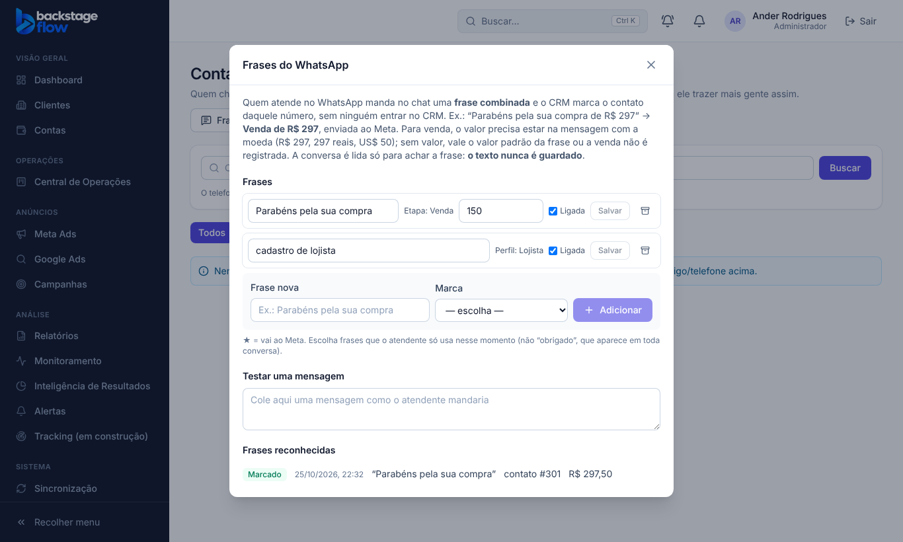

# Tracking T4.1 — Frases do WhatsApp, como no Tintim (25/10/2026)

> Status: **pronta**. Pedido do Ander: sem usuário Vendedor. Quem atende no WhatsApp marca direto na conversa, e vale pelo **número** do cliente.
> Escolhas (as recomendadas, porque o "pode fazer" veio sem escolher): ligar o WhatsApp pela **Coexistence oficial do Meta**, e **frases-gatilho** como no Tintim.
> Ponto de volta: `../PONTO-DE-RESTAURACAO.md` · banco: `supabase/rollback/voltar_whatsapp_frases_2026_10_25.sql`.

## 1. Como funciona
- Para cada cliente, a agência cadastra **frases**. Cada frase marca um **perfil** (ex.: Lojista) ou uma **etapa** (ex.: Venda).
- Quem atende manda a frase no chat, por exemplo "Parabéns pela sua compra de R$ 297". O CRM:
  - acha o contato **daquele número**, ou cria um com a origem da conversa (anúncio de WhatsApp, código do site ou direto);
  - marca o perfil ou a etapa;
  - na venda, **lê o valor da própria mensagem** e manda a **Compra ao Meta**.
- Contato que veio de **anúncio de WhatsApp** vai ao Meta como `business_messaging`, com o `ctwa_clid` do anúncio, para o Meta ligar a venda ao anúncio. Isso vale também para a marcação feita na tela de Contatos.
- **O texto da conversa é lido só na memória do servidor, para achar a frase. Nunca é guardado.**

## 2. Regras
- A frase é comparada sem acento, maiúscula ou pontuação, e vale só inteira (não pega pedaço de palavra).
- **Valor da venda:** só vale com a moeda junto ("R$ 297", "297 reais", "US$ 50"). Um número solto (nº do pedido, telefone) nunca vira valor.
  - Sem valor na mensagem: usa o **valor padrão** da frase, se houver. Se não houver, a venda **não é registrada** e aparece como "Venda sem valor". Nada inventado.
- No máximo **uma venda por mensagem**. Aviso repetido pelo Meta não conta duas vezes.
- **Lojista** (ou outro perfil com evento) vai ao Meta **uma vez só por pessoa**, como na T3.1.
- **Número sem o 9:** o WhatsApp às vezes manda celular brasileiro sem o 9. O CRM põe o 9 de volta e acha o contato digitado com o 9, sem duplicar.
- Frase desligada ou arquivada não vale. Cliente desativado ou WhatsApp desligado: nada acontece.

## 3. A tela
- **Contatos → Frases do WhatsApp** (admin e gestor). Lá você:
  - cadastra, edita, liga, desliga e arquiva as frases;
  - define o valor padrão nas frases de venda;
  - **testa uma mensagem**: cola um texto e vê o que o CRM faria, sem marcar nada;
  - vê as **frases reconhecidas** (data, frase, contato, valor, resultado).
- Quando o cliente ainda não tem WhatsApp ligado, a tela avisa. As frases ficam salvas e passam a valer quando ligar.
- Na ligação da API do WhatsApp (Tracking → WhatsApp API), a instrução agora pede para assinar também o campo `smb_message_echoes` (mensagens que o atendente manda).

## 4. O que precisa para funcionar de verdade
- O número do cliente ligado ao CRM de um destes jeitos:
  - **Coexistence** (recomendado): o número continua no app WhatsApp Business do celular, e o Meta avisa o CRM das mensagens enviadas e recebidas.
    - Exige que o app da agência no Meta esteja no programa **Tech Provider** (verificação da empresa e aprovação do app).
    - O botão para ligar por Coexistence é a **T4.2**.
  - **API oficial** com ferramenta de atendimento: o CRM lê pelo campo `message_echoes`.
- No app do Meta, o webhook precisa assinar `messages` e `smb_message_echoes`.

## 5. Quem pode
| Papel | Ver frases e reconhecidas | Cadastrar, editar, arquivar |
|---|---|---|
| Admin | sim | sim |
| Gestor | clientes liberados | sim |
| Operador / Visualizador | não aparece na tela (o banco permite ler) | não |
| Cliente / Equipe | não | não |

**Sem usuário Vendedor**, a pedido do Ander. O papel continua no sistema sem uso, e a pendência de criar esses usuários foi retirada.

## 6. Tabelas novas e mudanças
| Tabela | Para quê | Campos principais | Ligações | Índices | Por quanto tempo |
|---|---|---|---|---|---|
| `tracking_wa_triggers` | Frases de cada cliente | frase, perfil **ou** etapa, valor padrão, moeda, ordem, ligada, arquivada em | cliente, etapa/perfil (do mesmo cliente) | frase por cliente (única, sem maiúscula); por cliente e ordem | **Para sempre** (arquivar, nunca apagar) |
| `tracking_wa_trigger_log` | Cada frase reconhecida e o que aconteceu | quando, resultado (marcado, repetido, venda sem valor, sem mudança), motivo, valor, moeda, contato. **Sem texto da mensagem e sem telefone** | cliente, conexão do WhatsApp, frase, contato | por cliente e data; único por mensagem e frase (não conta duas vezes) | **Para sempre** (sem dado pessoal) |

Também mudou:
- `tracking_contacts.wa_hash`: o número como o WhatsApp manda, só em hash. A tela não lê essa coluna.
- `private.contact_send`: contato de anúncio de WhatsApp vai ao Meta com o `ctwa_clid`.

## 7. Testes
- **Banco** (`supabase/tests/whatsapp_frases.sql`, no banco real, desfeito no fim): **11 verificações OK**.
  - frase com espaços arrumada; etapa de outro cliente recusada; visualizador não cadastra; a tela não lê o hash;
  - servidor recebe só as frases ligadas;
  - contato criado pelo número (com o 9) com Lojista e Venda;
  - Meta com `business_messaging` + `ctwa_clid`, compra de R$ 297,50 e histórico;
  - aviso repetido não conta; outra mensagem conta;
  - venda sem valor não registra; valor padrão vale;
  - contato existente ligado sem duplicar; mesma etapa = sem mudança;
  - frase arquivada; conexão desligada; registro de cada frase.
- **Regras** (vitest): 6 testes. **Servidor** (Deno): 3 testes novos (7 no webhook do WhatsApp).
- **Ao vivo** (servidor publicado, versão 8 do `whatsapp-webhook`, conexão de teste apagada depois):
  - aviso assinado como o Meta faz, com a frase e "R$ 123,45" → 200, contato criado com o número completo, etapa Venda, R$ 123,45;
  - assinatura errada → 401.
- **Navegador** (`e2e/wa-phrases.mjs`): **15 verificações**.
- **Conjunto completo de testes de navegador** (fim da fase): **65 roteiros, 1.907 verificações, nenhuma falha**.
- **Não testado:** um número real ligado por Coexistence (depende do Tech Provider do Meta, na T4.2) e a venda chegando ao Meta de verdade (depende do Pixel e do token do piloto).

## 8. Arquivos
- Banco: `20261025220520_whatsapp_frases.sql`; teste `supabase/tests/whatsapp_frases.sql`; volta `supabase/rollback/voltar_whatsapp_frases_2026_10_25.sql`.
- Regras: `packages/shared/src/tracking/waTriggers.ts` (+ teste).
- Servidor: `supabase/functions/whatsapp-webhook/` (lê `smb_message_echoes` e `message_echoes`).
- Tela: `apps/web/src/features/contacts/WhatsAppPhrasesModal.tsx`, `api.ts`, `ContactsPage.tsx`; instrução em `tracking/WhatsAppApiModal.tsx`.
- Simulador e teste: `apps/web/src/demo/mockBackend.js`, `apps/web/e2e/wa-phrases.mjs`.
