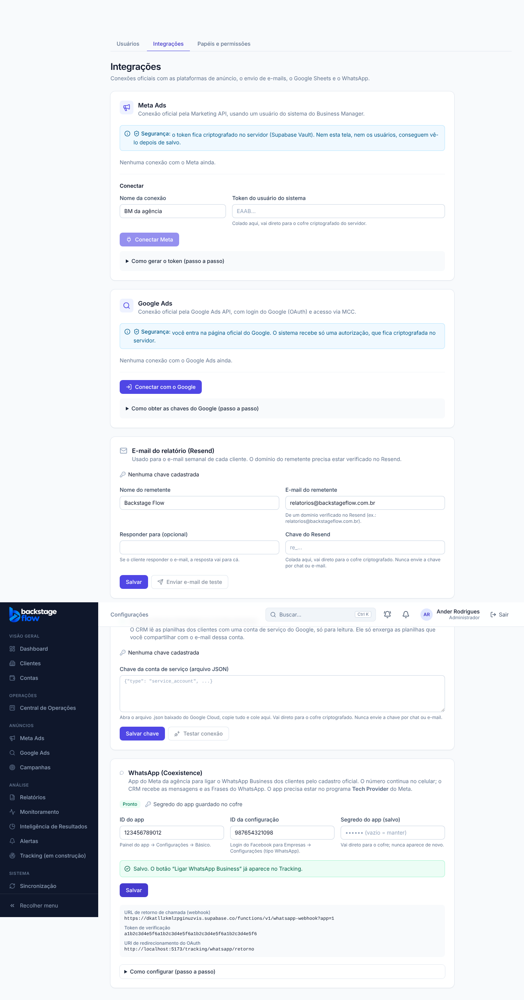
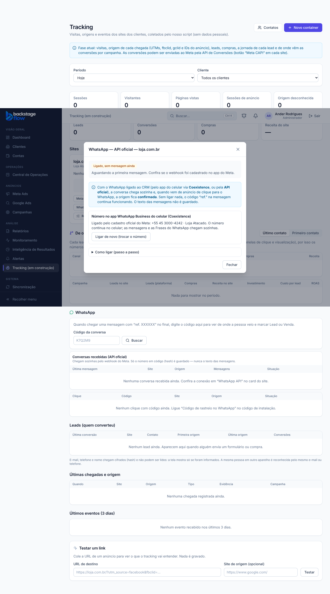

# Tracking T4.2 — Ligar o WhatsApp pelo cadastro oficial do Meta (Coexistence), 25 e 26/10/2026

> Status: **pronta no CRM**. Funciona de verdade só quando o app do Meta da agência estiver no **Tech Provider** e configurado (ver seção 4).
> Ponto de volta: `../PONTO-DE-RESTAURACAO.md` · banco: `supabase/rollback/voltar_whatsapp_coexistencia_2026_10_25.sql`.

## 1. O que mudou
- **Configurações → Integrações → WhatsApp (Coexistence)** (só admin). Ali entram:
  - o ID do app do Meta da agência e o ID da configuração;
  - o segredo do app, que vai direto para o cofre.
- O card mostra, para colar no Meta: endereço do webhook, token de verificação e endereço de retorno.
- **Tracking → card do site → WhatsApp API** (admin e gestor): botão **"Ligar WhatsApp Business"**.
  - A pessoa entra com o Facebook de quem administra o WhatsApp do cliente e escolhe o número.
  - O número **continua no app do celular**. O CRM passa a receber:
    - as mensagens recebidas (origem do anúncio, como na 34.5-W2);
    - as mensagens que o atendente manda, para as **Frases do WhatsApp** (T4.1).
- Depois de ligado, a janela mostra o número e o nome verificado e esconde o formulário manual. Dá para ligar de novo para trocar o número.
- Sem o app da agência configurado, o botão **não aparece**: a janela diz para falar com o administrador.

## 2. Como funciona por dentro
- O site tem regra de segurança que não deixa carregar scripts de fora. Por isso o cadastro é **por redirecionamento**, sem o script do Meta na página (o mesmo jeito do Google Ads):
  1. o CRM gera o endereço do cadastro oficial (app da agência + configuração + modo "app WhatsApp Business");
  2. o Meta devolve um código para `/tracking/whatsapp/retorno`;
  3. o servidor troca o código pelo token, acha a conta e o número, e liga o webhook do app nessa conta.
- O **token** do número vai para o cofre. Nunca aparece na tela nem no registro.
- Um **webhook só** para o app da agência (`whatsapp-webhook?app=1`). A assinatura é conferida com o segredo do app, e cada aviso vai para a conexão do número certo.
- O endereço de retorno fica no Tracking, e não em Configurações, porque o **gestor** também liga números e não abre Configurações.

## 3. Segurança
- Segredo do app, token de verificação e token de cada número: **só no cofre (Vault)**.
- A tabela do app (`wa_app_settings`) não é lida pela tela: só pelas funções do banco, que conferem se é admin.
  - O aviso "RLS sem regra" dos avisos de segurança do Supabase para ela é **de propósito**, como em `private.rate_limits`.
- O código do Meta sai do endereço do navegador assim que chega.
- O retorno só aceita o próprio endereço do CRM. A autorização vale 10 minutos, uma vez só, e só para quem começou.
- **Achado no teste do banco e corrigido antes da entrega:** sem usuário logado, a conferência "só administrador" deixava passar (o papel vinha vazio). Correção `20261025225637`: papel vazio = recusado.

## 4. O que você precisa fazer no Meta (uma vez)
1. No app da agência em developers.facebook.com: adicionar **WhatsApp** e **Login do Facebook para Empresas**.
2. Entrar no **Tech Provider** (verificação da empresa e aprovação do app pelo Meta).
3. Em Login do Facebook para Empresas → Configurações: criar uma configuração do tipo **WhatsApp (Cadastro incorporado)** e copiar o ID.
4. No CRM, em Integrações → WhatsApp (Coexistence): colar o ID do app, o ID da configuração e o segredo do app, e salvar.
5. No Meta:
   - colar a **URI de redirecionamento** mostrada no card;
   - em WhatsApp → Webhook, colar a URL e o token de verificação, e assinar `messages` e `smb_message_echoes`.
6. No Tracking, em cada cliente: **Ligar WhatsApp Business**.

## 5. Quem pode
| Papel | Configurar o app da agência | Ligar o número do cliente |
|---|---|---|
| Admin | sim | sim |
| Gestor | não | sim (clientes liberados) |
| Operador / Visualizador / Cliente | não | não |

## 6. Tabelas novas e mudanças
| Tabela | Para quê | Campos principais | Ligações | Por quanto tempo |
|---|---|---|---|---|
| `wa_app_settings` | App do Meta da agência para o WhatsApp (uma linha só) | ID do app, ID da configuração, versão da API, referências do cofre (segredo e token de verificação), quem alterou | — | Enquanto a agência usar (alterações ficam no registro de auditoria) |

Também mudou:
- `tracking_whatsapp_connections` ganhou o modo (manual ou Coexistence), a referência do token no cofre (a tela não lê), o número exibido, o nome verificado e a data da ligação.
- `oauth_states` ganhou um campo de contexto: para qual site o número vai.

## 7. Testes
- **Banco** (`supabase/tests/whatsapp_coexistencia.sql`, desfeito no fim): **6 + 2 verificações OK**.
  - visualizador e "sem usuário" não configuram; a tela não lê a tabela;
  - dados inválidos recusados; sem segredo não fica pronto;
  - a tela nunca recebe o segredo; o servidor lê as credenciais;
  - número ligado com o token no cofre (e nunca no registro); ligar de novo troca o token sem duplicar;
  - o mesmo número em outro site é recusado;
  - o webhook acha a conexão pelo número; a tela não lê a referência do token;
  - o botão só aparece pronto e para admin ou gestor.
- **Servidor** (Deno): 4 testes do cadastro (endereço do Meta, retorno só do CRM, contas liberadas, troca do código com o Meta simulado) e 1 do webhook do app.
- **Ao vivo** (servidor publicado; configuração, site e número de teste apagados depois):
  - verificação do Meta com o token certo → 200 e devolve o desafio; token errado → 403;
  - aviso assinado com o segredo do app → 200, indo para o número certo, frase reconhecida e venda de R$ 88,00;
  - assinatura errada → 401.
- **Navegador** (`e2e/wa-coex.mjs`): **15 verificações** (Meta simulado). Tracking (`e2e/tracking.mjs`): 114, sem falha.
- **Não testado (depende do Meta):** o cadastro de verdade no Facebook, com app Tech Provider aprovado, e um número real. Em especial, falta confirmar com um número real que o Meta aceita o modo "app WhatsApp Business" pelo cadastro por redirecionamento (a documentação oficial descreve o cadastro pelo script).

## 8. Arquivos
- Banco: `20261025225457_whatsapp_coexistencia.sql`, `20261025225637_whatsapp_coexistencia_correcao.sql`, `20261025235336_whatsapp_coexistencia_pronto.sql`; teste `supabase/tests/whatsapp_coexistencia.sql`; volta `supabase/rollback/voltar_whatsapp_coexistencia_2026_10_25.sql`.
- Servidor:
  - `supabase/functions/tracking-whatsapp/coex.ts` (+ teste) e `index.ts` (ações `coex_start` e `coex_complete`), versão 11;
  - `supabase/functions/whatsapp-webhook/` (modo `?app=1`), versão 9.
- Tela:
  - `apps/web/src/features/integrations/WhatsAppAppCard.tsx`;
  - `features/tracking/WhatsAppApiModal.tsx`, `WhatsAppCallbackPage.tsx`, `api.ts`, `logic.ts`;
  - rota em `app/router.tsx`.
- Simulador e teste: `apps/web/src/demo/mockBackend.js`, `apps/web/e2e/wa-coex.mjs`.
