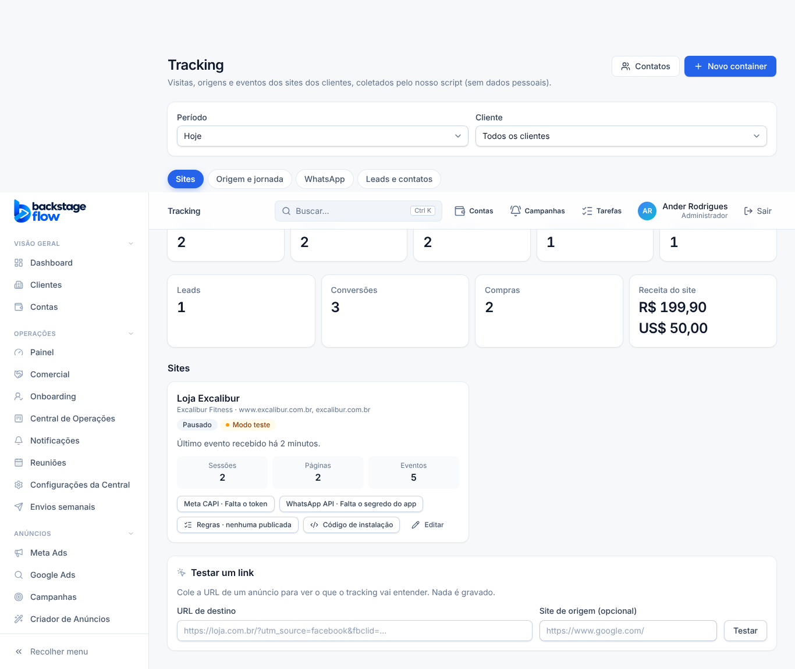

# T5.1 — Tracking organizado em abas (08/11/2026)

Só tela. Banco, regras, permissões e rotas **não mudaram**. O item do menu continua um só: **Tracking** (saiu o "(em construção)").

## O que mudou
- Filtros de período e cliente ficam no topo, valem para todas as abas.
- Abas (guardadas no endereço, `?aba=`):
  - **Sites:** resumo, conversões, cartões de cada site (Meta CAPI, WhatsApp API, regras, instalação) e "Testar um link".
  - **Origem e jornada:** atribuição por campanha, últimas chegadas e últimos eventos.
  - **WhatsApp:** cliques, conversas e busca por código.
  - **Leads e contatos:** leads recentes e atalho para a tela de Contatos.
- Removido o aviso "Fase atual…" (texto antigo).

## Testes
- typecheck, lint, 275 unitários: passaram.
- Navegador: `tracking` (ajustado às abas), `tracking-rules`, `wa-coex`, `contacts`, `wa-phrases`, `sales-webhooks`, `design`, `permissions`: passaram. Suíte completa: ver relatório.
