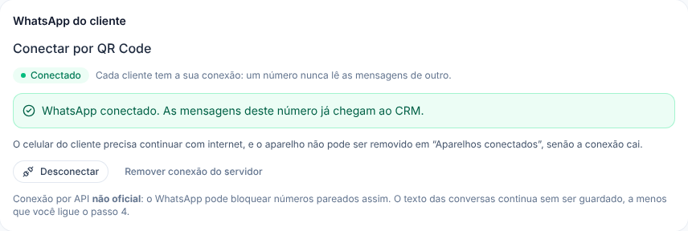

# T5.38 — Account Manager conecta o WhatsApp dos clientes dele — 16/11/2026

Decisão do Ander (16/11/2026): "pode dar ao account também". O Account Manager (papel Equipe) não vê a página do Tracking; em vez de abrir o Tracking inteiro, o QR Code ganhou um **cartão dentro da ficha do cliente no Onboarding**, onde ele já trabalha.

## O que existe
- Na ficha do cliente (Onboarding → cartão do cliente), cartão **"WhatsApp do cliente"** com os mesmos botões do Tracking: Conectar por QR Code / por código, estado ao vivo, Desconectar, Remover conexão do servidor.
- O cartão **só aparece para quem pode**: administrador, gestor com acesso ao cliente e Account Manager **daquele** cliente (`ops_client_ops.am_user_id`). Para os demais, some.
- **O Account Manager não cadastra o número.** Se o cliente ainda não tem número cadastrado, o cartão diz para pedir ao administrador ou ao gestor (Tracking → Configurações).
- Não aparece chave, token nem segredo: a função devolve só id, número do WhatsApp do cliente, nome da conexão, estado, ligado e última mensagem.

## Regras e segurança
- Quem pode é decidido no banco (`wa_instance_minha_conexao` para mostrar o cartão; `wa_instance_can` para cada ação da função `wa-instance`). Outro AM, gestor sem acesso, operador, desconhecido e visitante: recusados.
- Nenhuma tela nova nem item de menu novo (a ordem do menu não mudou).

## Tabelas novas
Nenhuma. Uma função nova em `public` (fina) chamando `private.wa_instance_minha_conexao_impl`; migração `20261116230000_wa_instancia_cartao_cliente.sql`.

## Testes
- Banco: `supabase/tests/wa_instancia_cartao_cliente.sql` — **4 verificações OK** (desfeitas): administrador, gestor com acesso e AM do cliente podem; não vaza segredo; gestor sem acesso, operador, AM de outro cliente, desconhecido e cliente inexistente não; visitante não executa.
- Navegador: `e2e/wa-qr-ficha.mjs` (cartão aparece, conecta por QR, liga sozinho; sem número explica o que fazer). `wa-qr`, `wa-servidor`, `onboarding-ficha`, `ops-clients` e `ops-onboarding-subtarefas` rodados de novo, OK. `typecheck`, `lint`, `npm test` (294) e `check:secrets` OK.
- **Não testado no navegador:** o login de um Account Manager de verdade (o simulador reconhece o AM por uma lista; no banco, a regra foi testada). **Não testado** com o servidor de WhatsApp real.

## Depende do Ander
Publicar a função `wa-instance` (`supabase.cmd functions deploy wa-instance --remote=dkatllzkmlzpginuzvis --use-api --yes`). O cartão chama essa função.
