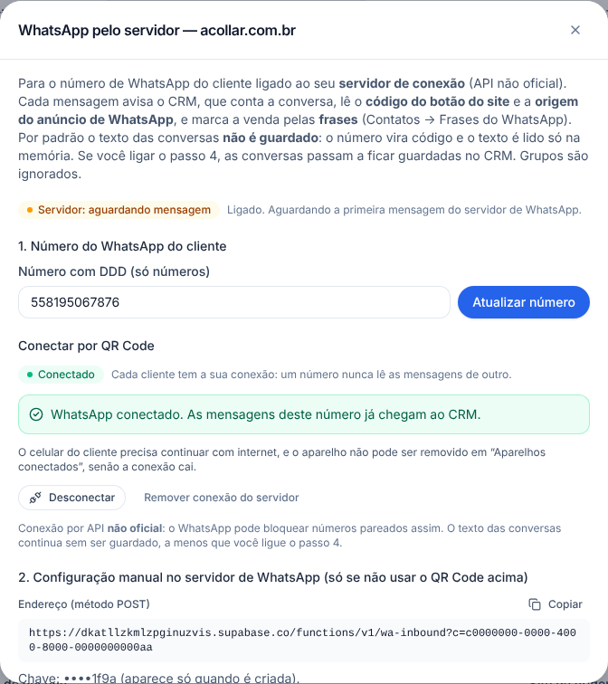

# T5.38 — Fase B: botão "Conectar por QR Code" no Tracking — 16/11/2026

Continuação da fase A (banco e função `wa-instance`). Aprovado pelo Ander ("pode", 16/11/2026).

*(O quadrado do QR nas imagens é uma imagem de teste do simulador, não um QR real.)*

## O que existe
Em **Tracking → Configurações → "WhatsApp pelo servidor"** (janela de cada cliente) há uma seção nova, **"Conectar por QR Code"**:
- **Conectar por QR Code:** mostra o QR e a instrução para quem está com o celular do cliente (WhatsApp → Configurações → Aparelhos conectados → Conectar um aparelho), com o número do chip em destaque.
- **Conectar por código:** usa o número já cadastrado e mostra um código de pareamento.
- **Estado ao vivo:** confere a cada 3 s; o QR se renova a cada 40 s (o do WhatsApp vence em cerca de 1 min). Ao conectar, o QR some, a conexão **liga sozinha** e a tela avisa que as mensagens já chegam ao CRM.
- **Desconectar** (desliga a conexão) e **Remover conexão do servidor** (contatos e conversas continuam guardados). Ambos pedem confirmação.
- Se o servidor **recusar o aviso automático**, a tela avisa que as mensagens não chegam ao CRM (não finge que deu certo).
- A configuração manual antiga (endereço e chave) continua, agora rotulada como "só se não usar o QR Code".
- Só vê quem pode configurar o WhatsApp do site: **administrador e gestor**. O QR só é mostrado como imagem PNG/JPEG/WebP em base64 e nunca é guardado nem vai para log.

## Tabelas novas
Nenhuma (usa as colunas da fase A).

## Testes
- Navegador: `e2e/wa-qr.mjs` (administrador: QR, conectar sozinho, desconectar, código, remover; servidor recusa o aviso; gestor conecta; operador não vê). `wa-servidor`, `tracking` e `wa-coex` rodados de novo, OK.
- `typecheck`, `lint`, `npm test` (294) e `check:secrets` OK.
- **Não testado:** com o servidor de WhatsApp **real** e um celular de verdade (o QR da tela vem do simulador). O primeiro teste real é o Acollar.

## Limite conhecido (decisão pendente)
O **Account Manager** (papel Equipe) não vê a página do Tracking. O banco já deixa ele conectar o WhatsApp dos clientes dele, mas a tela ainda não. Proposta: na fase C (ou antes), dar a ele um acesso só à conexão do WhatsApp dos clientes dele.

## Atualização (16/11, mais tarde) — botão direto na linha do cliente
O Ander não achou o QR Code: ele estava dentro da janela "Configurar", abaixo do passo 1. Agora, em **Tracking → Configurações → "Site e/ou WhatsApp"**, a linha de cada cliente com número cadastrado no servidor próprio tem:
- o botão azul **"Conectar por QR Code"**, que abre uma janela **só com o QR** (sem os outros passos);
- o estado ao lado: **"QR: conectado / aguardando a leitura / desconectado"** (aparece depois da primeira tentativa).
Cliente sem número cadastrado continua com o botão **"Ligar"** (primeiro cadastra o número). Só quem gerencia o Tracking vê o botão (administrador e gestor).
O QR dentro da janela "Configurar" e o cartão da ficha do Onboarding (Account Manager) continuam.

Teste: `e2e/wa-qr-linha.mjs` (botão na linha, janela só do QR, conecta, estado na linha, cliente sem número sem botão, visualizador sem botão). Sem mudança no banco nem tabela nova.

## Erro corrigido (16/11, depois do primeiro teste real do Ander)
**Sintoma:** a janela mostrava "Criar conexão" e "não ligado" mesmo com o Acollar cadastrado; nenhuma conexão de WhatsApp aparecia na tela (nem a do Excalibur).
**Causa (minha):** a tela passou a pedir as colunas novas `instance_name` e `gateway_state`, mas a tabela tem permissão de leitura **por coluna** e eu não liberei essas colunas. O banco recusou a consulta inteira. Os dados nunca foram perdidos.
**Correção:** migração `20261116240000_wa_instancia_libera_leitura.sql` (só leitura dessas 3 colunas, que não são segredo). Conferido no banco como administrador: as 4 conexões voltam a aparecer.
**Para não repetir:** o teste SQL agora confere que a tela pode ler essas colunas e que o hash da chave continua sem leitura. Os testes de navegador usam um banco simulado e **não pegam** esse tipo de erro; por isso ele passou.

## Atualização (16/11, 2ª) — "Conectar por código" não gerava o código
**Sintoma:** ao pedir o código, a tela ficava em "esperando" sem mostrar nada. Os registros mostraram que a função respondeu 200 e a conexão ficou "aguardando leitura": o servidor devolveu o QR, mas **não o código de pareamento**, e a tela escondia o QR nesse modo.
**Prováveis causas:** o WhatsApp só gera o código para o número exato (o cadastrado, 55 81 95067876, tem 8 dígitos depois do DDD; celulares do Brasil existem com e sem o 9) e/ou o servidor de WhatsApp ignora o número numa instância criada antes por QR.
**O que mudou:**
- Campo **"Número do chip para o código"** (já vem com o cadastrado; dá para corrigir o 9 sem mexer no cadastro) e botão **Gerar código**.
- Se o servidor não devolve o código, o CRM **tenta a outra forma do número** (com/sem o 9), uma vez, e mostra **para qual número** o código foi gerado.
- Se nenhuma forma funciona, a tela **avisa** e mostra o **QR de reserva** (em vez de ficar esperando).
- Servidor: 3 testes novos (12 no total), suíte de funções 228 ok. Navegador: `wa-qr` ampliado (número editável, número usado, QR de reserva).
**Precisa publicar de novo** a função `wa-instance` (o código do servidor mudou).
**Não testado:** com o servidor de WhatsApp real; não sei se a versão dele devolve o código de pareamento por esse caminho.

## Atualização (16/11, 3ª) — só QR Code, mais rápido, janela mais limpa
Pedido do Ander: "preciso que seja conectado via QR Code; o código não gera; o QR tem que sair mais rápido; se o de cima não serve, arranca fora; aceite com ou sem o 9".
**Por que estava lento (medido nos registros):** cada chamada da função levava de 3 a 55 s (o servidor de WhatsApp demora) e a tela fazia **várias chamadas ao mesmo tempo**: conferia a cada 3 s sem esperar a anterior e renovava o QR a cada 40 s por cima.
**O que mudou:**
- **Código de pareamento removido.** Só QR Code. (Os campos "número do chip" e "Gerar código" saíram.)
- **QR mais rápido:** uma chamada a menos ao servidor (pede o QR direto; se a instância não existe, cria já pedindo o QR); o aviso automático é configurado **em paralelo**; se o servidor ainda não gerou o QR, tenta de novo até 4 vezes (1,5 s) em vez de falhar.
- **Conferência sem empilhar:** a próxima conferência só começa depois que a anterior termina; o QR só é renovado perto de vencer (50 s).
- **Abrir já gera:** a janela do botão da linha do cliente pede o QR ao abrir, sem clicar; ao cadastrar o número, o botão **"Gerar QR Code"** cria a conexão e já mostra o QR.
- **Janela "Configurar" limpa:** o QR vem primeiro; o formulário do número só aparece para cliente **sem** conexão (e vira "Trocar o número cadastrado", recolhido, para quem já tem); a configuração manual (endereço e chave) ficou recolhida em "avançado" (continua para conexões antigas como a do Excalibur).
- **Número com ou sem o 9:** o cadastro aceita as duas formas (10 a 15 dígitos; 10 ou 11 ganham o 55). O QR não depende do número.
**Testes:** servidor 11 (suíte de funções 227), navegador `wa-qr`, `wa-qr-linha`, `wa-qr-ficha` e `wa-servidor` atualizados e OK, `typecheck`, `lint`, 294 testes e `check:secrets` OK.
**Precisa publicar de novo** a função `wa-instance`.
**Não testado:** velocidade real com o servidor de WhatsApp (o tempo de cada chamada depende dele).
**Observação:** o mesmo número com e sem o 9 conta como dois números diferentes (por exemplo 55 67 8105-6623 e 55 67 98105-6623).

## Correção (16/11, 4ª) — o código de pareamento VOLTOU
Na atualização anterior eu entendi errado o pedido e **tirei o "Conectar por código"**. O Ander queria manter os dois (QR e código) e só queria o QR mais rápido; o que ele pediu para tirar era o formulário de cadastro do número que ficava em cima. Corrigido:
- **QR Code e código convivem na mesma seção**: botão "Conectar por QR Code" e, logo abaixo, o campo "número do chip (DDD, com ou sem o 9)" com o botão **Gerar código**. O campo já vem com o número cadastrado e dá para corrigir sem mexer no cadastro.
- O código é pedido direto ao servidor com o número; se o servidor devolver só o QR, o CRM tenta **a outra forma do número** (com/sem o 9), uma vez, e mostra **para qual número** o código foi gerado. Se nenhuma forma gerar código, avisa e mostra o QR de reserva.
- **Mantido** o que ficou mais rápido: uma chamada a menos, aviso em paralelo, novas tentativas se o QR demorar, conferência uma de cada vez, janela que já abre gerando, janela "Configurar" mais limpa (formulário do número só para cliente sem conexão; configuração manual recolhida).
- Testes: servidor 17 (suíte de funções 233), navegador `wa-qr` (QR + código + QR de reserva), `wa-qr-linha`, `wa-qr-ficha`, `wa-servidor`; `typecheck`, `lint`, 294 testes e `check:secrets` OK.
- Precisa publicar a função `wa-instance` de novo.

## Achado importante (16/11, 5ª) — a função publicada era o código ANTIGO
Os registros mostraram `wa-instance` nas versões 4 a 8, todas com o **mesmo hash da versão 3** (a primeira). Ao baixar o código publicado, ele ainda tinha o fluxo antigo (conferia o estado antes de pedir o QR; sem retentativas; sem a tentativa com/sem o 9). Ou seja, o computador do Ander **não tinha as últimas mudanças** (faltou `git pull` antes de publicar), e cada publicação subiu de novo o código velho. Por isso o QR continuava lento e o código não vinha, mesmo depois das correções.
**Correção:** publiquei a versão atual direto pelo painel do Supabase (versão 9, hash novo). Também acrescentei um registro de diagnóstico: quando se pede o código e ele não vem, a função grava **só os nomes dos campos** da resposta do servidor de WhatsApp (nunca valores), para sabermos o que ele devolve.
**Para publicar sem depender do computador do Ander:** a publicação pode ser feita pelo painel/ferramenta; pelo terminal, antes de publicar, rodar `git pull` e conferir `git log -1` (deve mostrar o commit mais recente).

## Atualização (16/11/2026) — código de pareamento: função v10

O servidor respondia ao pedido de código só com o QR (campo `pairingCode` vazio), porque essa conexão já existia sem o número.
Agora, se o código for pedido e não vier, a função **apaga a conexão do cliente no servidor e cria de novo já com o número**
(primeiro como digitado; depois, se preciso, com/sem o 9). Os contatos e conversas do CRM não são tocados. O aviso (webhook) é refeito
na conexão nova. Se nenhuma forma gerar código, o QR continua valendo e a tela explica. Testes: 19 passam (4 novos).

## Atualização (16/11/2026) — função v11: limite de tentativas e "Desconectar apaga de verdade"

- **Causa de "não deu certo" ao trocar de número:** a função usava o limite de 60 chamadas por 10 minutos (o mesmo do servidor de WhatsApp da agência).
  A tela confere a conexão a cada 3 s, então várias tentativas seguidas estouravam o limite e a função respondia "Muitas tentativas" (registrado 19:04–19:07 UTC). Agora o QR/código por cliente tem limite próprio de 600 por 10 minutos.
- **Desconectar agora apaga tudo no servidor:** sai do WhatsApp, apaga a instância (sessão, número, códigos) e limpa o cadastro da instância. A próxima conexão, de qualquer número, começa do zero. Contatos e conversas no CRM não são tocados.

## Atualização (16/11/2026) — botão "Desconectar e começar do zero" na linha do cliente

A lixeira da linha ("Limpar dados deste cliente") só apaga mensagens, telefones, nomes e sugestões no CRM; ela **não** mexe na conexão do servidor,
então o selo "QR: aguardando a leitura" continuava. Agora a linha tem o botão **Desconectar e começar do zero** (quem pode conectar o cliente), que
faz o "Desconectar" completo (sai do WhatsApp, apaga a instância no servidor e limpa o cadastro da instância). Não foi coberto por teste de navegador; os testes existentes seguem passando.

## Atualização (16/11/2026) — reorganização: código que não muda sozinho + tela em duas abas (função v12)

**Por que o código não conectava:** a tela renovava o QR a cada 50 s, e fazia o mesmo no modo código — o código passado ao cliente deixava de valer antes de ele digitar.

**Funcionamento (Fase 1):**
- O **código nunca muda sozinho**; só sai outro quando a pessoa clica em "Gerar outro código". Só o QR se renova sozinho.
- Pedir código sempre **começa do zero, uma vez**: apaga a conexão antiga no servidor e cria de novo já com o número. Acabou a tentativa automática "com/sem o 9": agora há o botão **Tentar com o 9 / sem o 9**.
- Registro simples de cada passo na função (`qr_gerado`, `codigo_gerado`, `codigo_nao_veio`, `conectado`) — sem código, sem QR e sem telefone.

**Tela (Fase 2):**
- Janela de conexão com duas abas: **"O celular está comigo (QR Code)"** e **"O celular está em outro lugar (código)"**, com o botão **Copiar mensagem para o cliente** (código + passo a passo).
- Linha do cliente: **um selo só** (Aguardando o celular / Conectado / Desconectado…) e um botão **Conectar WhatsApp**.
- Ações de apagar reduzidas a duas: **Desconectar (começar do zero)** (apaga a conexão no servidor) e a lixeira **Apagar conversas e contatos do CRM** (só administrador).
- Não foi feito: simplificar a janela "Configurar" (ela ainda mostra a seção de conexão, agora igual à da linha). Fica para uma próxima rodada.

**Testes:** 17 da função (novos: começa do zero uma vez, sem tentar outras formas do número, recusa de apagar); navegador: `wa-qr` (inclui "código não muda sozinho" e "Tentar com o 9"), `wa-qr-linha`, `wa-qr-ficha`, `wa-servidor`, `wa-gateway`.
**Não testado:** conexão com o servidor de WhatsApp real (a rede desta sessão não alcança o servidor).

## Atualização (17/11/2026) — "Apagar tudo e começar do zero", por cliente

**Por quê:** a lixeira ("Limpar dados") só apaga texto, telefones, nomes e sugestões; mantém as conversas, a conexão e o selo "funcionando". Para quem quer deixar um cliente como novo, faltava um botão de verdade.

**O que faz (só administrador, um cliente por vez):** desconecta e apaga a conexão no servidor de WhatsApp; apaga mensagens, telefones, nomes, sugestões e as conversas **sem venda**; desliga as conexões do cliente e zera o "última mensagem". **Mantém** as conversas com venda marcada (carregam a venda e as contagens dos relatórios), o cadastro do número, o site e o tracking. Confirmação em dois passos, o segundo digitando **APAGAR**. Fica no histórico de auditoria (`wa_cliente.apagar_tudo`).

**Banco (migração `20261117100000_wa_apagar_tudo_cliente.sql`):** só funções, nenhuma tabela nova — `wa_unofficial_apagar_tudo_contagem(p_id)` (passo 1) e `wa_unofficial_apagar_tudo(p_id, p_confirmar)` (passo 2), finas, chamando `private.*_impl` (security definer, conferem que é administrador). Só mexe nos dados do cliente da conexão informada.
**Tela:** botão "Apagar tudo e começar do zero" na linha do cliente (Tracking → Configurações) e na janela do WhatsApp.
**Testes:** teste SQL `supabase/tests/wa_apagar_tudo_cliente.sql` (5 verificações: contagem, palavra APAGAR, conversa com venda fica, outro cliente não é tocado, gestor não pode) — rodou e deu "R: 5 verificações OK" (transação desfeita); navegador `wa-servidor`. Avisos de segurança do banco: nenhum novo.
**Não testado:** o apagar da conexão no servidor de WhatsApp real.

## Atualização (17/11/2026) — auditoria da queda do banco e limite de conferência da tela

**Auditoria (só leitura) das tarefas automáticas do banco:** até as 16h (UTC) todas rodavam em segundos (máximo 2–14 s). As falhas aparecem só em três faixas — 17h (33), 20h–22h (59, 122 e 82) — com tarefas chegando a 2–6 minutos, sinal de banco sobrecarregado e não de uma tarefa com defeito. Não há acúmulo anormal de linhas mortas nas tabelas (autovacuum em dia). A causa de fundo (processador/memória) só aparece no painel do Supabase (Reports → Database); não deu para provar daqui.
**O que mudou:** a janela de conexão do WhatsApp **para de conferir sozinha depois de 6 minutos** esperando a leitura (antes conferia a cada 3 s para sempre, enquanto a janela estivesse aberta) e mostra o botão "Continuar conferindo". Gerar novo QR/código retoma a conferência.
**Não alterado:** nenhuma tarefa automática do banco foi mexida (espaçar/aliviar fica para depois de ver o painel do Supabase).

## Atualização (17/11/2026) — "Excluir WhatsApp" de verdade, por cliente (causa do "excluo e não some")

**Causa:** não existia nenhuma ação que excluísse a conexão do WhatsApp de um cliente. A lixeira só limpava texto/telefones, "Apagar tudo" mantinha o cadastro da conexão e "Desconectar" só desligava: a linha do cliente continuava igual, mesmo depois de recarregar (F5). E o botão "Excluir site" recusa de propósito o WhatsApp (“não é excluído por aqui”).

**O que existe agora:** botão **Excluir WhatsApp** na linha de cada cliente (administrador e gestor do cliente; confirma digitando **EXCLUIR**). Faz, só naquele cliente: desliga e apaga a conexão no servidor de WhatsApp; a conexão **some de todas as telas na hora** e continua sumida depois do F5; o **número fica livre** para outro cliente; a chave do aviso deixa de valer. **Não apaga** o histórico (conversas, vendas, contagens), o site e o tracking. Ligar o WhatsApp do cliente de novo reaproveita o cadastro antigo (sem duplicar). Fica na auditoria (`wa_cliente.excluir_whatsapp` / `wa_cliente.religar_whatsapp`).
**Banco (migração `20261117200000_wa_excluir_conexao.sql`):** 2 colunas novas em `tracking_whatsapp_connections` (`excluded_at`, `excluded_by`, guardadas por tempo indeterminado, como o resto do cadastro) + funções `tracking_whatsapp_exclude` e a `wa_unofficial_save` atualizada para reaproveitar o cadastro excluído. Nenhuma tabela nova.
**Organização da linha do cliente:** só ficam "Conectar WhatsApp", "Configurar" e "Excluir WhatsApp". As ações de apagar dados (limpar texto/telefones e "Apagar tudo e começar do zero") ficam **dentro de Configurar**.
**Testes:** SQL `supabase/tests/wa_excluir_conexao.sql` (5 verificações OK, transação desfeita: gestor sem acesso barrado, palavra EXCLUIR, histórico intacto, outro cliente intacto, religar reaproveita); navegador `wa-servidor` (inclui recarregar a página e conferir que continua excluído), `wa-qr*`, `wa-gateway`, `excluir-site`, `tracking*`.

## Atualização (17/11/2026) — Tracking organizado: o WhatsApp do cliente aparece em UM lugar só

**O que estava repetido:** o WhatsApp do mesmo cliente aparecia na lista "Clientes: site e/ou WhatsApp" **e de novo** em "Detalhes de cada cliente" (três blocos: servidor, API oficial e "sem configurar"), com os mesmos botões.
**Agora:**
- **Lista "Clientes: site e/ou WhatsApp"** = o único lugar do WhatsApp de cada cliente: um selo por tipo, e a mesma linha traz o aviso "Sem uso desde…", "Guardando as conversas / IA" e o detalhe do estado. Botões da linha: **Conectar WhatsApp**, **Configurar** e **Excluir WhatsApp**.
- **"Detalhes dos sites de cada cliente"** = só os sites (instalação, Meta, regras). Sem WhatsApp repetido.
- As ações de apagar dados (limpar texto/telefones e "Apagar tudo e começar do zero") ficam dentro de **Configurar**.
- O link "Ligar ou configurar o WhatsApp →" do Painel leva direto à lista de clientes.
**Mudança de comportamento a conhecer:** quem não é administrador/gestor (visualizador/operador) deixou de ter, em Configurações, a janela só-leitura da API oficial por site. A situação do WhatsApp continua visível no Painel (aba WhatsApp).
**Testes de navegador atualizados:** `excluir-site`, `tracking`, `tracking-painel`, `tracking-acabamento`, `wa-coex`, `wa-qr`, `wa-servidor` (e demais `wa-*` e `tracking-*` rodados, sem falhas).

## Atualização (17/11/2026) — Tela "Clientes: site e/ou WhatsApp" refeita (computador e celular, lista grande)

Imagens: `docs/etapa-34-tracking/imagens/ux-clientes-computador.png` e `ux-clientes-celular.png`.

**Computador (a partir de 1280 px):** **uma linha por cliente**, em colunas com cabeçalho — Cliente · Site · WhatsApp (servidor próprio) · API oficial. Cada linha tem ~53 px. Na coluna do WhatsApp: situação (Funcionando / Aguardando a leitura / Desligado / Erro no servidor), o número formatado `(81) 99506-7876`, ícones pequenos de "guardando conversas" e "IA", e as ações na ponta: **Conectar** (vira **Reconectar** quando já está conectado), ⚙ Configurar e 🗑 Excluir. "Não ligado" é texto cinza discreto e **Ligar** é um botão leve, para não poluir a lista de quem ainda não tem WhatsApp.
**Celular e telas médias:** cada cliente vira um **cartão** com três linhas rotuladas (Site · WhatsApp · API oficial), com os mesmos botões, sem rolagem lateral.
**Lista grande (centenas ou milhares de clientes):** busca por cliente ou site, filtros com contagem (Todos · Conectados · Precisam de atenção · Sem WhatsApp · Sem site), **30 por vez** com "Mostrar mais", sem barra de rolagem dentro da lista. Testado com 240 clientes.
**"Detalhes dos sites de cada cliente":** cada cliente é uma linha que abre (com a quantidade de sites e uma seta), busca e "Mostrar mais 15"; antes tudo era montado de uma vez.
**Código:** o componente saiu do `TrackingPage.tsx` para `ClientesSiteWhatsApp.tsx` (arquivo próprio, mais fácil de manter).
**Testes:** `ux-clientes-whatsapp` (novo: 240 clientes, 30 por vez, mostrar mais, busca, filtros, uma linha só de 53 px, sem erros — computador e celular) e `ux-tracking-telas` (gera imagens); `wa-*`, `tracking*`, `excluir-site` ajustados e passando.
**Não alterado:** as abas do Painel (já estavam organizadas) e as demais telas fora do Tracking.

## Atualização (18/11/2026) — "toda primeira vez dá erro de chave" (função v13)

**Causa:** na primeira vez de um cliente, a conexão dele ainda não existe no servidor de WhatsApp, e esse servidor responde **401/403** (não só 404) ao pedir/apagar uma conexão inexistente. A função tratava isso como "chave de acesso recusada" e mostrava o erro; na segunda tentativa a conexão já existia e funcionava.
**Correção:** (1) ao pedir o QR, 401/403/404 passam a significar "ainda não existe" → cria a conexão; (2) ao pedir o código, o "apagar a conexão antiga" tolera 401/403/404 e segue para criar. Se a **chave estiver errada de verdade**, o erro volta no passo de criar, com a mensagem certa (coberto por teste). Só erro do próprio servidor (5xx) interrompe.
**Na tela:** a resposta de um pedido antigo não sobrescreve mais o resultado do pedido mais novo (defesa extra; não era a causa).
**Testes:** função com 20 testes (3 novos: 1ª vez com 403 no QR, 1ª vez com 403 ao apagar no código, chave errada de verdade ainda aparece); navegador `wa-qr*`, `wa-servidor` passando. Não testado contra o servidor de WhatsApp real.

---

## Atualização 18/11/2026 — Pixel por cliente e "Lead qualificado"

**Pedido do Ander:** cada cliente tem um pixel. Quando a venda é marcada (à mão, ao confirmar a sugestão da IA, ou pela frase do atendente no WhatsApp), a compra vai para o pixel **daquele cliente**. O evento personalizado **LeadQualificado** também é enviado. Marcou venda = marcou lead qualificado. A IA **não** sugere lead qualificado.

**Como funciona agora**
- **Pixel do cliente:** o evento usa o pixel do recipiente onde aconteceu (site). Se esse recipiente não tem pixel (ex.: cliente só-WhatsApp), usa o pixel do cliente (o de qualquer recipiente dele, ligado e com token). Cada cliente continua isolado: nunca usa o pixel de outro.
- **LeadQualificado:** a etapa "Qualificado" de todos os clientes passou a enviar o evento `LeadQualificado` (vai ao Meta como evento personalizado, uma vez por pessoa). Ao **marcar venda**, o CRM envia o `LeadQualificado` (se ainda não foi enviado para aquela pessoa) e **depois** a Compra (Purchase).
- **Aviso na tela:** se o cliente não tem pixel ligado, o "Marcar venda" e a tela de Contatos avisam que o evento ficou só registrado no CRM e não foi ao Meta.
- **Configurações → Clientes: site e/ou WhatsApp:** nova coluna **Pixel do Meta** ("Sem pixel" / "Ligado ···1234" / "Incompleto") com o botão **Ligar** ou o ícone de configurar. Abre a mesma tela do Meta (ID do pixel + token), mesmo para cliente sem site.
- **Banco:** a regra que só deixava a etapa de venda ter evento foi aberta para etapas "abertas" (a etapa "Perdido" continua sem evento). Migração `20261118100000_pixel_por_cliente_lead_qualificado.sql` (aplicada em 3 partes no Supabase).

**Importante saber**
- Nenhuma tabela nova. O pixel e o token continuam onde já estavam (tabela de destinos do Meta; token só no cofre).
- Quem não tem pixel ligado no momento da marcação **não recebe depois** o evento daquela pessoa (o registro fica no CRM). Ligue o pixel antes de marcar.
- Em "Eventos enviados" do pixel, os eventos "Lead" e "Compra" precisam estar marcados (é o padrão): o LeadQualificado sai como um "Lead" com nome personalizado.
- Para o Meta usar o LeadQualificado em otimização, o evento precisa aparecer no Gerenciador de Eventos do cliente depois do primeiro envio (pode levar alguns minutos).

**Testes**
- SQL (transação desfeita): `supabase/tests/pixel_por_cliente.sql` → 5 verificações OK (sem pixel não enfileira e avisa; com pixel envia LeadQualificado; não duplica; venda envia Compra sem duplicar; venda de quem nunca foi qualificado envia os 2). `supabase/tests/whatsapp_frases.sql` → 11 verificações OK (inclui LeadQualificado pelas frases do atendente).
- Navegador: `apps/web/e2e/pixel-por-cliente.mjs` + os testes das telas de Tracking, Contatos e Conversas (todos passaram). Testados só com Supabase **simulado**; o envio real ao Meta com token de verdade **não** foi testado.

### Acabamento visual da lista (19/11/2026)
- Cada coluna agora é um grupo: o status e os botões de cada uma ficam **juntos** (WhatsApp do servidor: situação, número, Conectar/Reconectar, configurar e excluir; API oficial: situação + Ligar/Configurar; Pixel: situação + configurar). Antes os botões ficavam no canto direito, longe da situação.
- Linhas finas separam os grupos, e o pixel não quebra mais de linha.
- Colunas só a partir de **1400 px** de largura da janela. Abaixo disso a lista vira um cartão por cliente (Site / WhatsApp / API oficial / Pixel), sem nada sobreposto.

### Origem "Orgânico" que não era (19/11/2026)
**Caso:** uma conversa de anúncio de clique para o WhatsApp (Prata e Pérola) apareceu como "Orgânico".
**O que o banco mostrou:** a conversa ficou com origem "desconhecida" (sem código de anúncio, sem ID do anúncio, sem código do site). A tela traduzia "desconhecida" como "Orgânico", o que era uma informação que o CRM não tem. Ligar o pixel depois **não** interfere: a origem é gravada na hora em que a mensagem chega.
**Pista forte:** o aviso daquela mensagem curta chegou com ~15 KB, tamanho típico de mensagem de anúncio (traz a miniatura do anúncio). Ou seja, os dados do anúncio provavelmente chegaram e o leitor não os achou.

**O que foi feito**
- **A. Texto:** "Orgânico", "Direto no WhatsApp" e "Sem origem (orgânico ou direto)" viraram **"Sem origem identificada"** (lista de conversas, conversa aberta, aba WhatsApp). O aviso do "Marcar venda" também deixou de dizer "orgânico".
- **B. Diagnóstico:** a função `wa-inbound` (versão 7) grava no registro do servidor, a cada mensagem recebida, **só contagens e nomes de campos** (quantas vieram com contexto, com dados de anúncio, com código `ctwa`, e quais nomes de campo existem). Nunca valores, texto, nome ou telefone.
- **C. Leitura:** o leitor passou a procurar os dados do anúncio também em `contextInfo` fora da mensagem (jeito de alguns servidores estilo Evolution v2). É uma hipótese a confirmar com o próximo clique em anúncio; não é garantida.

**Limite honesto:** a conversa da josicleide **não** pode ser corrigida para trás (o conteúdo original não é guardado), então continua "sem origem identificada". Vale para as próximas.
**Como confirmar:** clicar num anúncio do cliente e mandar a mensagem. Se vier como "Anúncio", está certo. Se não, o registro `wa_inbound_ad` mostra o que o servidor entregou.

---

## Fase 1 visual (20/11/2026) — acabamento global, sem mexer em lógica
Só aparência e usabilidade, com a estrutura atual preservada (rotas, menu, permissões, dados, os três sinos de notificação separados).
- **Menu lateral:** o item ativo deixou de ser a pílula preta e virou azul suave com barra lateral; títulos de grupo e rodapé com mais respiro. Ordem e nomes do menu intactos.
- **Estados vazios:** componente novo `components/ui/empty-state.tsx` (ícone em quadrado azul suave + título + explicação + ação). A tela de Clientes já usa; as demais telas (ícone cinza antigo) ganharam o mesmo visual por uma regra global em `index.css`.
- **Campos, botões e janelas:** relevo sutil nos campos e no botão secundário; fundo levemente desfocado atrás das janelas; título da janela maior.
- **Global:** barras de rolagem finas, títulos equilibrados, textos sem linha solta.
- **Lista "Clientes: site e/ou WhatsApp":** o layout em colunas passou a depender da **largura da própria lista** (container query), e não da janela: em caixa estreita ela vira cartões e nada é cortado.
- **Testes de navegador:** 118 arquivos; 3 testes antigos corrigidos (menu esperado sem "Criar campanhas"; "Campanhas" ambíguo com "Criar campanhas"). Continua falhando, **desde antes desta fase**: `ads-builder` (o Instagram ligado direto na conta não aparece na lista do simulador); não é visual.

### Fase 1 visual — leva 2 (20/11/2026): filtros e abas
- Abas/filtros ativos (Campanhas, Contas, Alertas, Contatos, detalhe da entidade) passaram de **preto** para o **azul da marca**, igual ao resto do sistema.
- Rótulos da barra de filtros (Dashboard e telas parecidas) ficaram menores e discretos, para os campos ganharem destaque.
- Testes: 13 arquivos de telas afetadas passaram; `history.mjs` oscila (falha também no código anterior a esta leva, por sessão que cai no `page.goto`), não é efeito destas mudanças.

### Fase 1 visual — leva 3 (20/11/2026): Operações e correção de um defeito da leva 1
- **Defeito corrigido (causado pela leva 1):** a regra global `p { text-wrap: pretty }` anulava o "cortar com …" (`truncate`) de todos os parágrafos, e o título do cabeçalho passou a quebrar em duas linhas ("Central de / Operações"). Agora a regra usa só `text-wrap-style` (balance/pretty), que não mexe no modo de quebra, e os textos com `truncate` voltaram a ficar numa linha.
- As telas de Operações (Painel, Comercial, Onboarding, Central de Operações, Reuniões, Envios semanais) foram revistas com dados de demonstração: já estavam consistentes com o novo padrão (estados vazios, abas e filtros em azul); nada mais precisou mudar.
- Testes: 28 arquivos de Operações, menu e Tracking passaram.

### Fase 1 visual — leva 4 (20/11/2026): Configurações, janelas e celular
- Telas de Configurações (Usuários, Integrações, Papéis e permissões) e a janela "Novo cliente" revistas com dados de demonstração: já estavam consistentes; nada a mudar.
- **Celular (≤ 639 px):** o título da seção no cabeçalho aparecia cortado (só um pontinho entre o menu e a lua, defeito antigo). Agora fica escondido no celular (o título da página já aparece logo abaixo) e o espaço é livre. No computador não mudou.
- Conferido o celular (390 px) de Dashboard, Clientes, Campanhas, Contas, Tracking, Painel, Tarefas, Comercial e Integrações: nenhuma rolagem lateral.
- Testes: design, responsive, ops-notifications, dashboard, clients e permissions passaram.

---

## Auditoria — parte 1 e 2 (20/11/2026): envio ao Meta
**Parte 1 (números "Com erro" / "Não enviados" da tela do Meta):** conferida, **não era defeito**. A contagem "Com erro" mostra só os eventos que **ainda estão em nova tentativa**; eles saem desse estado quando são enviados ou descartados (na 6ª falha). Não cresce para sempre, ao contrário do que a auditoria dizia. O "Não enviados (24 h)" usa a data de criação do evento (e não a do descarte) porque a tabela não guarda a data do descarte; fica como está (impacto pequeno).

**Parte 2 (erro de token/permissão) — feita:**
- Antes: token inválido/expirado, sem permissão, Pixel não encontrado ou sem token gastava as 6 tentativas em ~9 h e o evento virava "descartado" (**perdido**), mesmo que o token fosse trocado logo depois.
- Agora: nesses casos o evento fica guardado (status "erro"), **não gasta tentativa** e tenta de novo a cada **30 minutos** até a pessoa corrigir o token. Vale o limite de 7 dias que já existia. Erro comum (Meta instável, dado inválido) continua como antes (6 tentativas).
- Onde: migração `20261120100000_capi_erro_de_credencial_guarda_evento.sql` (função `tracking_capi_finish`, sem tabela nova), `supabase/functions/_shared/capi/sender.ts` (marca `auth`), função `capi-sender` publicada (versão 10).
- Testes: Deno 237 OK (inclui o novo), SQL `capi_erro_de_credencial.sql` 3 verificações OK (desfeito). Avisos de segurança do Supabase: nenhum novo. **Não testado com o Meta de verdade** (precisaria de um token vencido real).

## Auditoria — parte 3 (20/11/2026): desligar o envio ao Meta segura a fila
- Antes: eventos já enfileirados continuavam saindo para o Meta depois de desligar o envio de um site.
- Agora: o envio só pega eventos de destino **ligado**. Os eventos desligados ficam guardados (nada é apagado) e saem se o envio for religado dentro de 7 dias (a regra de descartar eventos com mais de 7 dias continua).
- Onde: migração `20261120110000_capi_destino_desligado_segura_a_fila.sql` (função `tracking_capi_claim`, sem tabela nova). Teste SQL `capi_destino_desligado.sql`: 2 verificações OK (desfeito). Nenhuma função de servidor mudou.

## Auditoria — parte 5 (21/11/2026): aviso de envio ao Meta com erro
- **Decisão:** o sistema de alertas é ligado a contas de anúncio e aos três sinos (que o Ander pediu para continuar separados). Por isso o aviso **não** entrou nos sinos nem em tabela nova: aparece na **lista de clientes do Tracking** (Configurações → Clientes), sem mexer no banco.
- **O que aparece:** na coluna "Pixel do Meta", quando o último erro do Meta é **mais novo** que o último envio com sucesso (e tem até 7 dias), o selo vira vermelho "Com erro no envio" (o motivo aparece ao passar o mouse). Também há o filtro **"Pixel com erro"** com a contagem, para achar rápido entre muitos clientes. Quando um envio volta a dar certo, o aviso some sozinho.
- **Parte 4 (limpeza automática):** **não feita**: a aprovação no Supabase não foi respondida a tempo (duas vezes) e o ganho agora seria nulo (a fila tem 89 eventos recentes). A migração pronta ficou guardada fora do projeto; pode ser retomada quando o Ander quiser.
- Testes: `e2e/pixel-por-cliente.mjs` (estendido) e as telas do Tracking passaram.

### Fase 1 visual — leva 5 (21/11/2026): títulos e detalhes
- **Cabeçalho:** as telas **Contatos**, **Visão executiva** e **Hoje** apareciam com o título do cabeçalho **vazio** (a rota não está no menu); agora mostram o nome (e o nome da aba do navegador também).
- **Busca do topo:** o campo "Buscar…" ficou mais estreito entre 640 e 1535 px de largura, para o título do cabeçalho caber inteiro (antes "Inteligência de Resultados" era cortado em "Inteligência d…").
- **Monitoramento:** a caixa vazia de "Mais urgentes" ganhou o mesmo espaçamento da caixa ao lado.
- Revistas com dados de demonstração: Relatórios, Monitoramento, Inteligência de Resultados, Contatos, Visão executiva, Sincronização: consistentes.
- Testes: 26 arquivos de navegador passaram (monitoramento, resultados, contatos, executivo, hoje, busca, design, responsivo). **`history.mjs` falha** (também no código anterior a esta leva; o visualizador cai em /login): problema do teste/simulador, não investigado.

### Fase 1 visual — leva 6 (21/11/2026): ficha do cliente e painel do Tracking
Revisadas com dados de demonstração: a ficha do cliente (Resumo, abas, botões) e o painel do Tracking já estavam consistentes. Único ajuste: o rótulo "Período" do painel do Tracking passou a usar o mesmo estilo discreto das outras barras de filtro. Com isso, a Fase 1 visual cobriu todas as telas principais (Dashboard, Clientes, Contas, Campanhas, Alertas, Relatórios, Monitoramento, Resultados, Contatos, Tracking, Operações, Configurações). Testes: tracking, tracking-painel e clients passaram.

---

## Menu — etapas 1 e 2 (21/11/2026, aprovadas pelo Ander)
- **Nomes mais claros:** "Painel" → **Painel operacional** (não confundir com o Dashboard de anúncios); "Contas" → **Contas de anúncio**; "Inteligência de Resultados" → **Resultados** (a tela mantém o título completo).
- **Contatos ganhou item próprio** no menu (grupo Operações, ao lado do Comercial), para admin, gestor, operador e visualizador. O papel **Vendedor continua sem menu** (abre direto nos Contatos).
- **Operações na ordem do dia a dia:** Painel operacional · Central de Operações · Reuniões · Onboarding · Comercial · Contatos · Envios semanais · Notificações · Vendas sugeridas · Configurações da Central (esta última sai na etapa 3).
- Nenhum endereço, permissão ou tela mudou; os três sinos continuam separados. Testes (unitários e de navegador) atualizados para os nomes e a ordem novos.

## Menu — etapa 3: Configurações unificada (21/11/2026, aprovada pelo Ander)
- **Sincronização, Logs e Configurações da Central saíram do menu lateral** e viraram **abas dentro de Configurações**: Usuários · Integrações · Papéis e permissões · Central de Operações · Sincronização · Logs.
- **Cada pessoa vê só as abas que já podia abrir** (nada de permissão nova): Usuários/Integrações/Papéis = administrador; Central de Operações = quem tem a permissão de administrar a Central; Sincronização = quem vê contas (admin, gestor, operador, visualizador); Logs = admin e gestor. O item "Configurações" aparece para quem pode abrir pelo menos uma aba.
- **Endereços antigos continuam funcionando** (`/sincronizacao`, `/logs`, `/config-central`): levam à aba nova mantendo `?filtros`. Os avisos e atalhos internos já apontam para o endereço novo.
- A proteção real continua no banco; a tela só esconde o que a pessoa não pode usar.
- Teste novo de navegador: `e2e/settings-unificada.mjs`. Testes unitários e outros testes de navegador ajustados (menu, permissões, smoke).

---

## Fase C — conferência automática do WhatsApp de cada cliente (21/11/2026)
**Problema:** o estado "conectado / desconectado" só mudava quando alguém abria a tela. Se o WhatsApp de um cliente caísse de madrugada, ninguém sabia e as mensagens (contatos, vendas) deixavam de chegar ao CRM.

**O que passou a acontecer:** a cada 5 minutos o CRM pergunta ao servidor de WhatsApp o estado da conexão de cada cliente que está ligada por QR Code e anota na lista de clientes. Se ficar fora por **10 minutos**, sai **um** aviso no sino ("WhatsApp de <cliente> sem conexão"), que leva direto ao Tracking do cliente. Quando volta, sai outro ("voltou"). Se continuar fora, repete só depois de 6 horas.
- **Quem recebe (decisão final do Ander, 21/11):** **somente** os administradores e o Account Manager do cliente. O gestor **não** recebe (ele chegou a ser incluído e foi retirado a pedido, pela migração `20261121110000_wa_saude_clientes_so_admin_e_am.sql`).
- **Limite honesto:** o sino só existe para quem tem a Central de Operações. Um Account Manager sem ela não recebe o aviso no sino, mas vê o estado vermelho na lista de clientes.
- **Conexão desligada de propósito** (botão Desconectar) não é conferida e não gera aviso.
- **Se o problema for do servidor de WhatsApp** (fora do ar, chave recusada, erro interno), o estado dos clientes não é mexido e não saem avisos por cliente (evita dezenas de avisos de uma vez); esse caso já é coberto pelo aviso da conexão da agência (T5.17).
- **Privacidade:** só o estado é lido. Nenhuma mensagem, telefone ou chave vai para log, histórico ou aviso.

**Banco (migração `20261121100000_wa_saude_clientes.sql`, já aplicada):** nenhuma tabela nova. Três colunas em `tracking_whatsapp_connections` (`health_since`, `health_alert_sent`, `health_alert_at`; guardadas enquanto a conexão existir), duas funções finas (`wa_client_health_list` e `wa_client_health_apply`, só para o servidor interno), o agendador `wa-health-clientes` (a cada 5 min) e a regra do link do sino, que agora também aceita `/tracking`. Os avisos usam os tipos `whatsapp.caiu` e `whatsapp.voltou`, que já existiam, e ficam guardados como os demais avisos.
**Servidor:** Edge Function `wa-health` (publicada). Teste automático: `supabase/functions/wa-health/logic_test.ts` (4 testes). Teste SQL escrito em `supabase/tests/wa_saude_clientes.sql`.

**O que NÃO foi testado:** o teste SQL não rodou (a execução foi negada na janela do Supabase) e a função não foi chamada ao vivo. A primeira conferência real acontece no próximo ciclo de 5 minutos.

## Menu — etapa 4: "Criar" (21/11/2026, aprovada pelo Ander: "Junte")
- **"Criar campanhas" e "Criador de Anúncios" viraram um item só no menu: Criar** (grupo Anúncios, logo depois de Campanhas), com **duas abas**: **Criar campanhas** (rascunhos) e **Criador de Anúncios**.
- As duas telas continuam exatamente como eram (nada foi mudado dentro delas), com a mesma permissão de antes (administrador, gestor e operador; o Criador continua em aberto, como o Ander pediu).
- Endereços novos: `/criar/campanhas`, `/criar/campanhas/<id>` e `/criar/anuncios`. Os antigos (`/criar-campanhas`, `/criar-campanhas/<id>`, `/criador-de-anuncios`) continuam funcionando e levam ao novo.
- Teste novo de navegador: `e2e/criar-unificado.mjs`. Testes unitários e de navegador ajustados (menu, permissões, design).

## Criador de Anúncios — opção A: mais simples (21/11/2026, escolhida pelo Ander)
- O Criador continua sendo o **gerador do pedido para o Claude** (nada é criado no Meta pela tela). Só ficou mais simples de usar.
- Os campos que quase nunca mudam (**nome dos anúncios, status, recursos de IA da Meta e observações**) agora ficam dentro de **"Opções avançadas"**, recolhidas e já com valores prontos (status Pausado, IA desligada). O resumo aparece na barra mesmo recolhida (e o aviso em âmbar se o status for ATIVO). Se algo já foi mexido (rascunho salvo, pedido duplicado), a seção abre sozinha.
- Texto do topo mais direto. Nenhuma regra, validação ou conteúdo do pedido mudou.
- Conhecido e antigo: em cerca de 1 de cada 4 execuções do teste `ads-builder.mjs` a lista de Instagram do simulador vem sem o perfil ligado direto na conta. Foi visto que a busca no Meta é chamada duas vezes ao escolher a conta; não foi corrigido nem investigado a fundo.

## Conversas do WhatsApp no celular (21/11/2026, relato do Ander)
**Problema:** no celular, ao tocar numa conversa da lista (Tracking → Conversas), a conversa aparecia **embaixo da lista** e muito abaixo do cabeçalho; parecia que nada abria. No computador, lista e conversa ficam lado a lado, por isso funcionava lá.
**Correção (só tela, nada de banco):** no celular passa a ser uma coisa de cada vez. Tocou na conversa → a lista some e a conversa abre em tela cheia, já rolada até o topo dela (nome, origem — anúncio ou não —, botões e as mensagens), com o botão **"← Voltar às conversas"**. No computador nada mudou.
Teste novo no `e2e/conversas-whatsapp.mjs` (tela de 390 px): sem espaço vazio embaixo da lista, texto da conversa na primeira tela, lista some, Voltar traz a lista de novo.

## Leva visual de 21/11/2026 (auditoria nova, só aparência)
- **Criar campanhas:** o subtítulo falava de "editor completo e publicação nas próximas fases" (promessa velha, o editor já existe). Agora diz só: "Monte e guarde rascunhos de campanha. Nada é criado no Meta por aqui."
- **Configurações:** a aba "Central de Operações" repetia o nome do item do menu; virou **"Central"**.
- **Cabeçalho:** a bolinha vermelha dos três sinos (Contas, Campanhas, Tarefas) encostava no texto "Contas"; agora fica no canto do ícone.
- **Celular:** as abas de Configurações e de Criar passavam da largura da tela sem pista; agora a ponta direita esvanece enquanto há mais abas para deslizar (componente novo `components/ui/scroll-tabs.tsx`, usado nas duas telas).
- Revisadas as 20 fotos (10 telas no computador e no celular, modo demonstração). Sem outros problemas visíveis. Sugestão **não aplicada** (depende do Ander): mover os 4 botões de configuração da tela Contatos (Frases do WhatsApp, Formulários, Sistemas de venda, Perfis e etapas) para dentro de Configurações.

## Contatos: botões de ajustes num menu só (21/11/2026)
Os 4 botões do topo da tela Contatos (Frases do WhatsApp, Formulários de outros sistemas, Sistemas de venda, Perfis e etapas) viraram **um botão "Ajustes"** com menu. As quatro janelas são as mesmas de antes; só mudou onde se clica. Quem não tem permissão de configurar continua sem o botão. Vale também para a aba "Contatos e vendas" da ficha do cliente (mesma tela).
**Não foram movidos para Configurações**: essas janelas dependem do cliente escolhido na própria tela de Contatos (e de perfis e etapas dele); mover exigiria um seletor de cliente novo em Configurações. Fica como possível próxima etapa, se o Ander quiser.
Testes de navegador ajustados (contacts, lead-webhook, sales-webhooks, wa-phrases): clicam em "Ajustes" antes.

## "Abrir a conversa e marcar a venda" abre a conversa de verdade (22/11/2026, relato do Ander)
**Problema:** em Tracking → Vendas sugeridas, o link azul "Abrir a conversa e marcar a venda" só levava à lista de conversas do cliente; a pessoa tinha que procurar a conversa sozinha (e, no celular, a conversa nem aparecia — corrigido antes, ver seção acima).
**Correção (só tela, sem banco):**
- O link agora leva **quem é a pessoa**: o contato (se a sugestão tem), o final do telefone e o nome (`?contato=&final=&nome=`).
- A tela de conversas abre já filtrada por essa pessoa e **seleciona a conversa certa sozinha**. Se houver duas pessoas com o mesmo final de telefone, usa o nome para não abrir a errada; se ainda assim for ambíguo, **não adivinha** (mostra a lista filtrada).
- Aparece um aviso "Conversa da sugestão da IA aberta" com o botão **"Ver todas as conversas"**. Se a conversa não existe mais na lista (telefone ou nome mudaram), a tela avisa em vez de ficar em silêncio.
- Funciona também para sugestões **já decididas** ("Já decididas"), como no print do Ander. (A lista de conversas só marca a sugestão pendente, por isso a identificação é por contato, final do telefone e nome, e não pelo código da sugestão.)
- O redirecionamento `/clientes/<id>/conversas` para o Tracking agora **mantém esses dados**. Lógica em `conversationTarget.ts` (7 testes). Teste de navegador novo: `e2e/sugestao-abrir-conversa.mjs` (celular, sugestão decidida, duas pessoas com o mesmo final, conversa inexistente).
- **Não testado:** como Account Manager (papel Equipe, tela só de conversas) e em celular real. O caminho do Account Manager usa a mesma tela e o mesmo endereço, mas não foi exercitado.

## Vendas sugeridas: o botão "Houve venda" saiu; agora é "Marcar a venda" (22/11/2026, caso Gabriela Miranda)
**O que o Ander perguntou:** "quando marco venda realizada no lead, ele marca o quê no pixel?" — e citou a Gabriela Miranda (Prata e Pérola).
**O que o banco mostrou (só leitura):** a Gabriela tinha 117 mensagens e **2 sugestões da IA "confirmadas"**, mas o cliente tinha **0 contatos** e **nenhuma venda marcada**. Nos últimos 5 dias saíram 34 eventos *Contact* para o Meta, e **nenhum *Purchase*** nem *LeadQualificado*. Ou seja: o Pixel funciona; a venda é que nunca foi marcada.
**Causa:** o botão **"Houve venda"** da lista só **anotava a decisão** ("confirmada") — não registrava a venda nem enviava nada ao Meta. O nome induzia ao erro. A venda só vai ao Pixel quando é marcada na conversa ("Marcar venda", com valor e moeda): aí sai o *LeadQualificado* (uma vez por pessoa) e depois a *Compra*.
**Conferência das outras:** 3 sugestões confirmadas sem venda marcada em todos os clientes (Gabriela Miranda ×2 — a mesma pessoa — e Josefa, final 8022), todas do Prata e Pérola. As duas pessoas continuam **sem a venda no Meta**; o Ander precisa marcar.
**Correção (só tela, sem banco):**
- Na lista, **"Houve venda" foi substituído por "Marcar a venda"**: abre a conversa da pessoa **já com a janela de marcar venda**. Marcar a venda na conversa **já confirma a sugestão** (comportamento que já existia). "Descartar" continua.
- Nas **já confirmadas**, aparece "**Conferir se a venda foi marcada**" (abre a conversa com a marcação).
- **Proteção contra venda dobrada:** se a pessoa **já tinha venda marcada**, a janela **não abre sozinha**; a tela avisa ("já tinha venda marcada") e deixa "Marcar venda" manual caso seja outra venda.
- Textos explicativos atualizados (a venda só vai ao Pixel quando marcada). O link antigo ficou como "Só abrir a conversa".
Testes: `vendas-sugeridas.mjs` ajustado; `sugestao-abrir-conversa.mjs` agora cobre marcar a venda (confirma a sugestão e enfileira a Compra) e a proteção contra venda dobrada.

## "Marcar venda" sem valor: só qualifica o lead (22/11/2026, pedido do Ander)
**Pedido:** "hoje ele me obriga a colocar o preço; se passar para salvar sem o preço, só marque o LeadQualificado".
**Como ficou (só tela, sem banco):** na janela "Marcar venda" (conversa do Tracking), o **valor passou a ser opcional**.
- **Com valor:** igual a antes — registra a venda e envia **LeadQualificado** (uma vez por pessoa) e depois a **Compra**, com valor, moeda e nº do pedido.
- **Sem valor:** o botão vira **"Só qualificar (sem venda)"** e o sistema marca a pessoa na etapa **Qualificado**, enviando **somente o LeadQualificado** ao Meta. **Não registra venda, não envia Compra.** A sugestão da IA continua **pendente** (a venda ainda não foi marcada).
- Usa o que o banco já fazia ao mover para uma etapa com evento (uma vez por pessoa). Mensagens claras: já estava Qualificado / sem pixel / sem site / entrou na fila.
- **Proteções:** se a pessoa **já tem venda marcada**, o modo "só qualificar" fica desligado (não faria a etapa "voltar" de Venda para Qualificado); se o cliente **não tem a etapa Qualificado com evento**, a tela explica e pede o valor.
- O restante (Contatos, frases do WhatsApp) não mudou: a etapa Venda continua exigindo valor e moeda lá.
Testes: `sugestao-abrir-conversa.mjs` (botão muda conforme o valor; LeadQualificado na fila, sem Compra, 0 vendas, sugestão pendente, histórico) e suíte vizinha. O simulador passou a devolver o resultado do envio ao mover para etapa com evento, como o banco real.
**Não testado:** contra o banco real (nenhum LeadQualificado de venda real saiu ainda) e em celular real.

## Conversas no celular: lista cortada à direita (22/11/2026, print do Ander)
**Problema:** no celular, a lista de conversas do Tracking passava da largura da tela e ficava cortada à direita (caixa de busca, período e linhas).
**Causa (reproduzida no teste: a lista passava 570 px da tela):** prévias com **endereço comprido e sem espaço** (ex.: o link do catálogo que o atendente mandou). Numa grade de uma coluna só, a coluna crescia até o tamanho do texto mais comprido em vez de encolher.
**Correção (só tela):** a coluna agora pode encolher (`minmax(0, 1fr)`), com `min-w-0` nos cartões e nas linhas, e a prévia é cortada com reticências. A conversa aberta já quebrava o texto comprido; foi conferida também.
Teste novo em `e2e/conversas-whatsapp.mjs` (tela de 390 px, conversa com endereço comprido na prévia e dentro da mensagem): a lista e a conversa cabem na tela.
**Não verificado:** outras telas do Tracking com o mesmo padrão de grade, e celular de verdade.

## A conversa mostra a situação real da pessoa (22/11/2026, print da Gabriela Miranda)
**Dúvida do Ander:** "por que aparece 'Marcar venda' se a venda está marcada?".
**O que o banco mostrou (só leitura):** a Gabriela (contato 47) está na etapa **Qualificado**, com **0 vendas**; o **LeadQualificado foi enviado ao Meta** (fila: "enviado" — o **primeiro envio real** dessa função, funcionou). Nenhuma venda estava marcada: o botão estava certo, mas a tela **não dizia** que ela já estava qualificada, e o segundo toque em "Só qualificar" dava só "já estava como Qualificado; nada novo foi enviado" (clique sem efeito).
**Correção (só tela, sem banco):**
- **Selo no topo da conversa** com a situação: "**N venda(s) marcada(s)**" ou "**Qualificado — enviado ao Meta (sem venda)**".
- **O botão muda de nome conforme a situação:** sem nada → "**Qualificar ou marcar venda**"; já qualificada, sem venda → "**Marcar venda**"; já com venda → "**Marcar outra venda**".
- Na janela, se a pessoa **já foi enviada como lead qualificado**, "só qualificar" **deixa de ser oferecido** (não faria nada): a janela explica e pede o valor para marcar a venda.
- Marcar a venda depois **não reenvia o LeadQualificado** (uma vez por pessoa) e envia a Compra. Verificado no teste.
Resposta à ideia do Ander de "editar a marcação": não há como editar um evento já enviado ao Meta; o que a tela faz agora é mostrar o estado e oferecer o próximo passo certo.
Teste: `e2e/sugestao-abrir-conversa.mjs` (selo, nomes do botão, "só qualificar" desligado para quem já foi qualificado, Compra sai e o LeadQualificado não duplica).

## 25/11/2026 — Aviso de "WhatsApp caiu" menos repetido (pedido do Ander)
- Antes: enquanto a conexão continuava caída, o aviso se repetia a cada 6 horas (a Prata e Pérola gerou 5 avisos/e-mails numa queda só, 24–25/11).
- Agora: um aviso quando cai e um lembrete só a cada **24 horas**. O aviso de "voltou" não mudou. Quem recebe continua sendo administrador e Account Manager.
- Migration `20261125100000_wa_saude_lembrete_24h.sql` (aplicada). Sem tabela nova.
