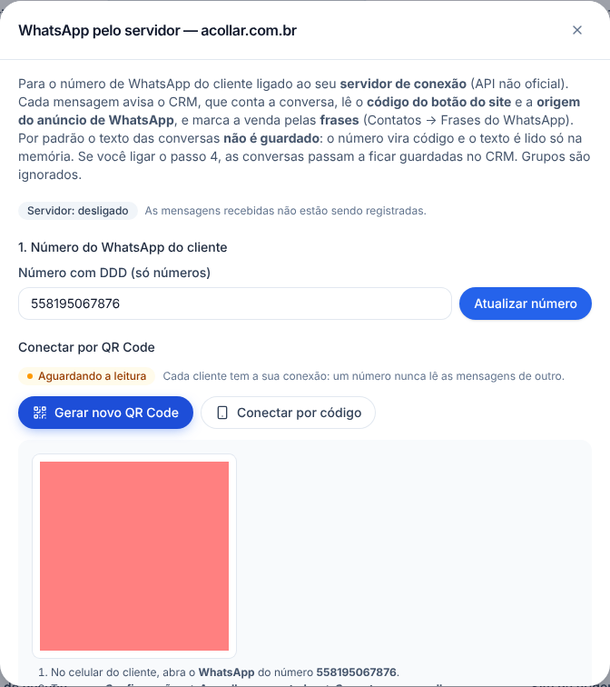
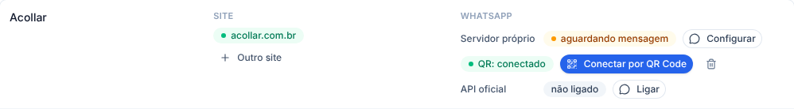

# T5.38 — Fase B: botão "Conectar por QR Code" no Tracking — 16/11/2026

Continuação da fase A (banco e função `wa-instance`). Aprovado pelo Ander ("pode", 16/11/2026).

*(O quadrado do QR nas imagens é uma imagem de teste do simulador, não um QR real.)*

## O que existe
Em **Tracking → Configurações → "WhatsApp pelo servidor"** (janela de cada cliente) há uma seção nova, **"Conectar por QR Code"**:
- **Conectar por QR Code:** mostra o QR e a instrução para quem está com o celular do cliente (WhatsApp → Configurações → Aparelhos conectados → Conectar um aparelho), com o número do chip em destaque.
- **Conectar por código:** usa o número já cadastrado e mostra um código de pareamento.
- **Estado ao vivo:** confere a cada 3 s; o QR se renova a cada 40 s (o do WhatsApp vence em cerca de 1 min). Ao conectar, o QR some, a conexão **liga sozinha** e a tela avisa que as mensagens já chegam ao CRM.
- **Desconectar** (desliga a conexão) e **Remover conexão do servidor** (contatos e conversas continuam guardados). Ambos pedem confirmação.
- Se o servidor **recusar o aviso automático**, a tela avisa que as mensagens não chegam ao CRM (não finge que deu certo).
- A configuração manual antiga (endereço e chave) continua, agora rotulada como "só se não usar o QR Code".
- Só vê quem pode configurar o WhatsApp do site: **administrador e gestor**. O QR só é mostrado como imagem PNG/JPEG/WebP em base64 e nunca é guardado nem vai para log.

## Tabelas novas
Nenhuma (usa as colunas da fase A).

## Testes
- Navegador: `e2e/wa-qr.mjs` (administrador: QR, conectar sozinho, desconectar, código, remover; servidor recusa o aviso; gestor conecta; operador não vê). `wa-servidor`, `tracking` e `wa-coex` rodados de novo, OK.
- `typecheck`, `lint`, `npm test` (294) e `check:secrets` OK.
- **Não testado:** com o servidor de WhatsApp **real** e um celular de verdade (o QR da tela vem do simulador). O primeiro teste real é o Acollar.

## Limite conhecido (decisão pendente)
O **Account Manager** (papel Equipe) não vê a página do Tracking. O banco já deixa ele conectar o WhatsApp dos clientes dele, mas a tela ainda não. Proposta: na fase C (ou antes), dar a ele um acesso só à conexão do WhatsApp dos clientes dele.

## Atualização (16/11, mais tarde) — botão direto na linha do cliente
O Ander não achou o QR Code: ele estava dentro da janela "Configurar", abaixo do passo 1. Agora, em **Tracking → Configurações → "Site e/ou WhatsApp"**, a linha de cada cliente com número cadastrado no servidor próprio tem:
- o botão azul **"Conectar por QR Code"**, que abre uma janela **só com o QR** (sem os outros passos);
- o estado ao lado: **"QR: conectado / aguardando a leitura / desconectado"** (aparece depois da primeira tentativa).
Cliente sem número cadastrado continua com o botão **"Ligar"** (primeiro cadastra o número). Só quem gerencia o Tracking vê o botão (administrador e gestor).
O QR dentro da janela "Configurar" e o cartão da ficha do Onboarding (Account Manager) continuam.

Teste: `e2e/wa-qr-linha.mjs` (botão na linha, janela só do QR, conecta, estado na linha, cliente sem número sem botão, visualizador sem botão). Sem mudança no banco nem tabela nova.
