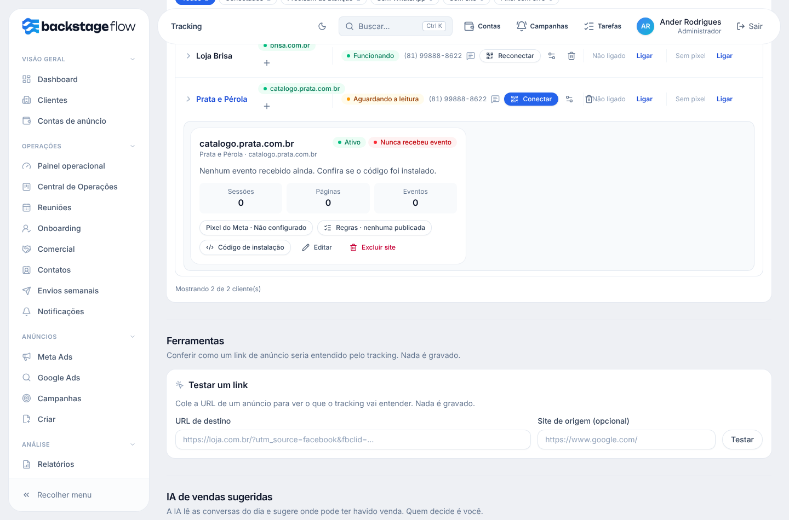
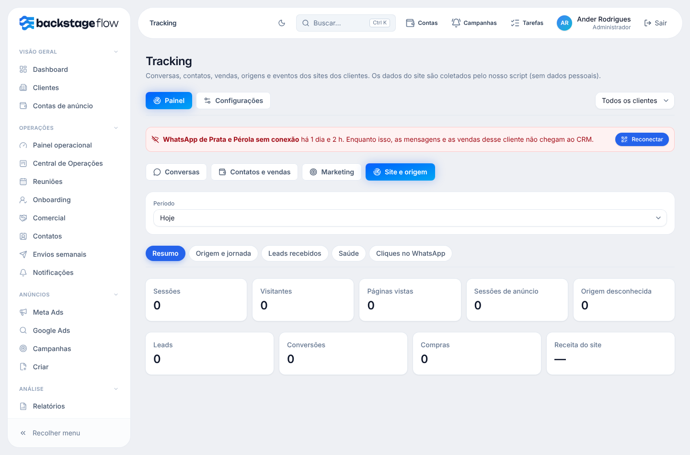
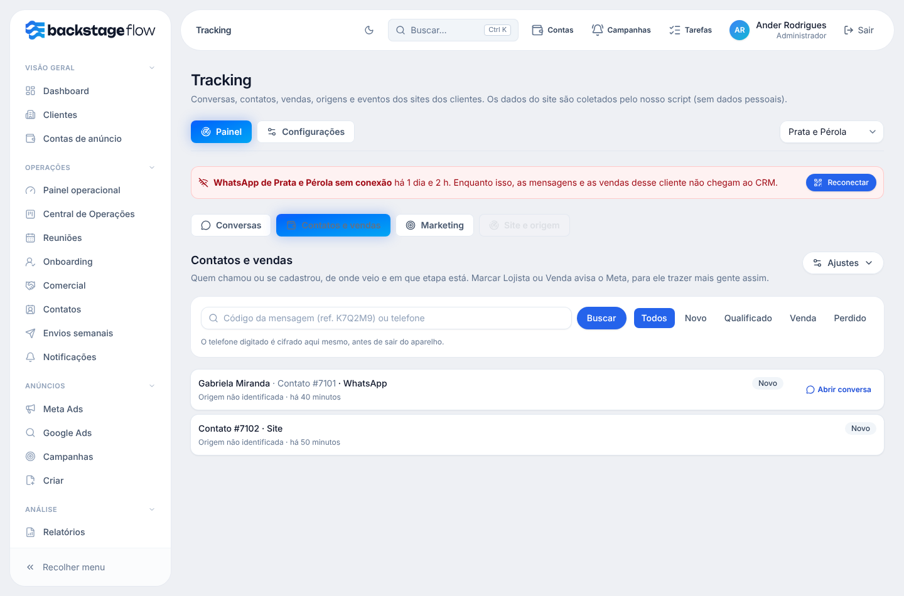

# T5.39 — Tracking mais enxuto (25/11/2026, pedido do Ander)

Ander pediu para juntar a parte de baixo com a de cima nas telas do Tracking. A análise (sem concordar por concordar) e o que foi feito:

## 1. Configurações → "Site e/ou WhatsApp"
- **Antes:** em cima, uma linha por cliente (site, WhatsApp, API oficial, pixel). Embaixo, uma seção separada "Detalhes dos sites de cada cliente" com os cartões dos sites. As duas se contradiziam: em cima "Pixel ligado ···1514" e embaixo "Meta CAPI · Desligado" (o pixel estava no WhatsApp do cliente, não no site).
- **Agora:** a seção de baixo saiu. Clicar no nome do cliente abre os sites dele **dentro da própria linha** (números, código de instalação, regras, editar, excluir). Com um cliente só na lista, já vem aberto. O cartão do site mostra o **pixel do cliente** ("Pixel do Meta · …"), o mesmo da coluna de cima.
- Por que não colocar tudo dentro da linha: a linha deixaria de ser lida de relance (e no celular ficaria enorme).
- Quem só consulta (sem permissão de configurar) continua vendo "Sites de cada cliente" em lista simples.

## 2. Painel: de 6 para 4 abas
- **Conversas · Contatos e vendas · Marketing · Site e origem.**
- **WhatsApp** deixou de ser aba: a situação da conexão virou a faixa do item 3; "limpar dados" continua nas Conversas e na janela do WhatsApp em Configurações; os cliques no WhatsApp viraram a parte **"Cliques no WhatsApp"** de Site e origem.
- **Vendas sugeridas** foram para dentro de **Conversas** (bloco que abre e fecha, aberto quando há sugestão esperando). Quem não lê conversas (operador, visualizador) continua com a aba própria; a Equipe continua com o item do menu.
- Endereços antigos (`?aba=whatsapp`, `?aba=sugestoes`) levam ao lugar novo.

## 3. Faixa de WhatsApp caído
No topo do Painel, em vermelho, quando o WhatsApp (servidor próprio) de um cliente está sem conexão: nome do cliente, há quanto tempo e o aviso de que mensagens e vendas não chegam. Administrador e gestor têm o botão **Reconectar** (abre o QR Code ali mesmo); os demais veem "peça a um administrador ou gestor". Some sozinha quando volta.

## 4. Contatos e vendas
- Busca e etapas (Todos, Novo, Qualificado, Venda, Perdido) numa **barra só**.
- O contato que veio do WhatsApp mostra o **nome da conversa** e o botão **Abrir conversa** — só para quem já lê as conversas daquele cliente (administrador, gestor e Account Manager) e só nos clientes que guardam conversas. Para os demais continua "Contato #N".
- A frase "Nome e conversa nunca são guardados" saiu (não era verdade nos clientes que guardam conversas).

## 5. Banco
- Migration `20261125110000_contatos_nome_da_conversa.sql` (aplicada): `public.contacts_wa_people(p_client)` → `private.contacts_wa_people_impl` (security definer). Devolve contato → pessoa da conversa → nome, só quando `private.wa_messages_can_read` permite; senão vazio. Telefone não sai. **Sem tabela nova.** Quem não está logado não executa.

## 6. Testes
- Novo: `e2e/tracking-unificado.mjs` (faixa, reconectar, barra única, nome e abrir conversa, linha que abre e fecha, visualizador, celular 390 px).
- Ajustados: `tracking-painel`, `tracking`, `vendas-sugeridas`, `wa-servidor`, `excluir-site`, `ux-tracking-telas`.
- Também passaram: contacts, conversas-whatsapp, marketing, sugestao-abrir-conversa, ux-clientes-whatsapp, clients, wa-qr-ficha, design, responsive, smoke, permissions, lead-webhook, dashboard, ads-builder, menu-grupos, settings-unificada; unitários 208 + 297.
- Não testado: com o banco real logado (a função foi conferida por consulta: permissões certas) e em celular de verdade.
