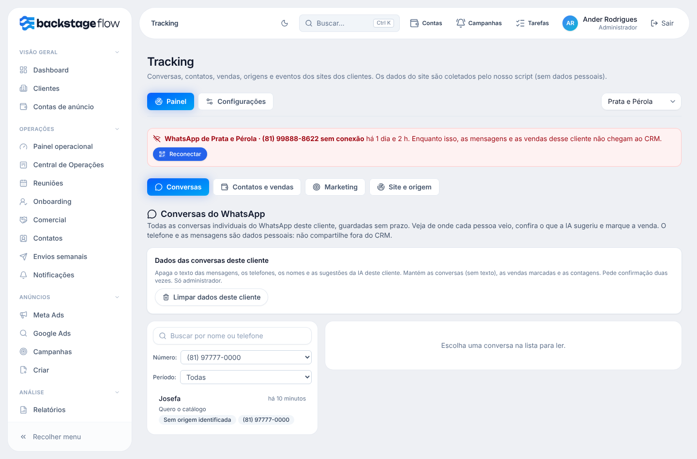

# T5.40 — Vários números de WhatsApp no mesmo cliente (25/11/2026, pedido do Ander)

## O que mudou
- **Tracking → Configurações → Site e/ou WhatsApp:** cada número do cliente aparece numa linha própria dentro da coluna "WhatsApp (servidor próprio)", com a sua situação, Conectar/Reconectar (QR Code), configurar e excluir. No fim, um **"+"** adiciona outro número (abre o cadastro: digita o número e lê o QR Code).
- **Conversas:** com mais de um número, aparece o filtro **"Número"** (Todos os números / cada número) e cada conversa mostra de qual número ela é.
- **Faixa de WhatsApp caído** e **aviso do sino**: dizem qual número caiu (no sino, "final 8622").
- O filtro "Precisam de atenção" da lista de clientes considera o pior número do cliente.

## Como funciona por dentro
- Cada número continua com a sua instância própria no servidor de WhatsApp (bf-...) e as pessoas das conversas já eram guardadas por número; nada disso mudou.
- O que faltava era o "lugar" do 2º número: cada conexão fica presa a um recipiente técnico. Agora o "+" cria mais um recipiente técnico (tipo `whatsapp`) para o cliente.
- Limite: 10 números por cliente. Um recipiente criado e não usado é reaproveitado no próximo "+".
- Pixel do Meta continua **um por cliente** (vale para todos os números e sites).
- "Limpar dados das conversas" continua valendo para o cliente inteiro (todos os números).

## Banco
Migration `20261125120000_wa_varios_numeros_por_cliente.sql` (aplicada). **Sem tabela nova.**
- `wa_novo_numero_container(p_client)` → `private..._impl` (security definer): só administrador e gestor com acesso ao cliente; registra em `audit_logs` (`tracking.whatsapp_novo_numero`).
- `wa_people_connections(p_client)` → `private..._impl`: de qual número é cada pessoa (só ids), com a mesma regra de leitura das conversas (admin, gestor, Account Manager).
- `wa_client_health_apply_impl`: o título do aviso ganha o final do número.
- Conferido por consulta: quem não está logado não executa nenhuma delas.

## Testes
- `e2e/tracking-unificado.mjs` ganhou o bloco "vários números" (dois números na linha, "+" único no fim, "+" cria o lugar do 3º número, filtro por número nas conversas).
- Também passaram: wa-servidor, ux-clientes-whatsapp, conversas-whatsapp, tracking-painel, wa-qr-ficha, excluir-site, sugestao-abrir-conversa, tracking, contacts, vendas-sugeridas, design, responsive; unitários 208 + 297.
- **Não testado:** conectar um 2º número real por QR Code no servidor de verdade.

## Correção 25/11/2026 — "bugou a geração do QR Code / código"
- **O que os registros mostraram:** às 16h03 e 16h06 o pedido de código por número falhou com "O servidor do WhatsApp recusou a chave de acesso"; segundos depois, clicando de novo, o código saiu.
- **Causa:** para gerar o código, o CRM apaga a conexão antiga no servidor e cria de novo com o mesmo nome. Logo depois de apagar, o servidor ainda está terminando de remover e recusa criar (responde 403), e a tela traduzia isso como "chave recusada". Não tinha relação com os vários números (as tentativas foram antes dessa mudança ir ao ar).
- **Correção:** quando a conexão antiga existia, o CRM espera 2 segundos e tenta criar de novo, até 3 vezes, antes de mostrar erro. Edge Function `wa-instance` publicada (versão 14). Testes novos em `wa-instance/flow_test.ts`.
