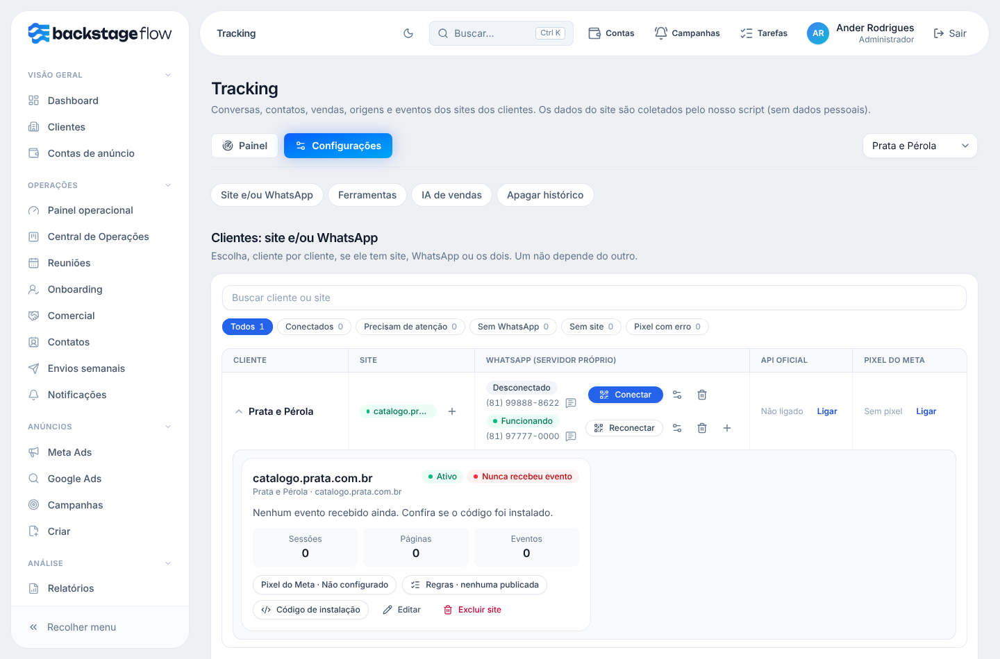
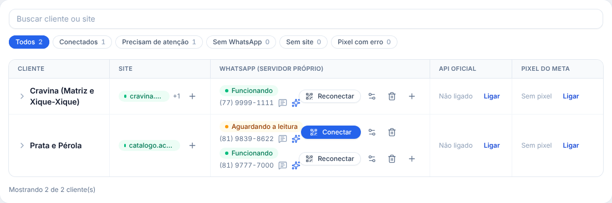
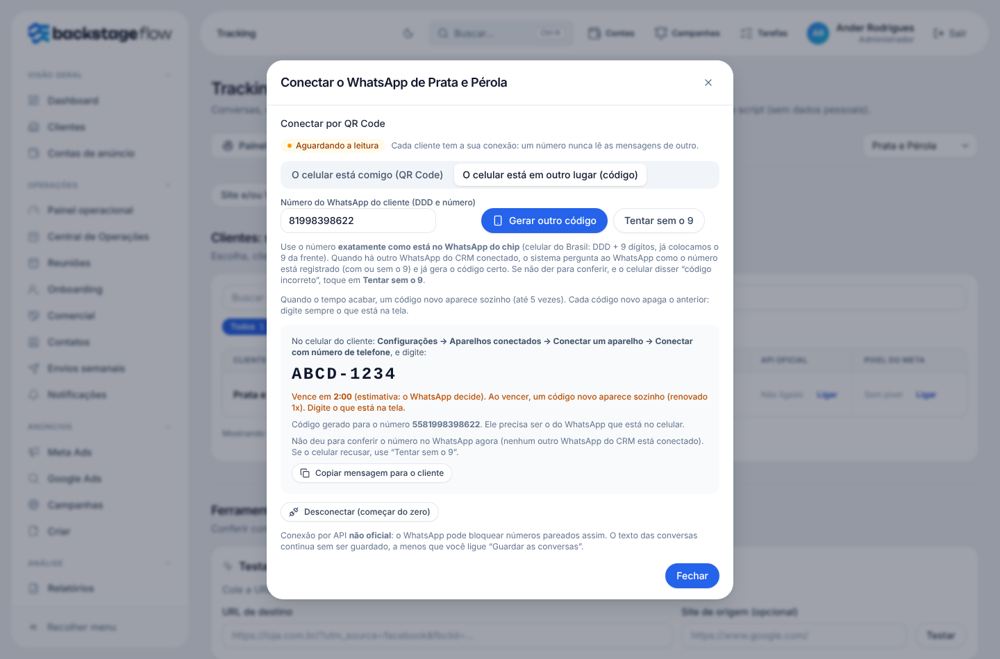

# T5.40 — Vários números de WhatsApp no mesmo cliente (25/11/2026, pedido do Ander)

## O que mudou
- **Tracking → Configurações → Site e/ou WhatsApp:** cada número do cliente aparece numa linha própria dentro da coluna "WhatsApp (servidor próprio)", com a sua situação, Conectar/Reconectar (QR Code), configurar e excluir. No fim, um **"+"** adiciona outro número (abre o cadastro: digita o número e lê o QR Code).
- **Conversas:** com mais de um número, aparece o filtro **"Número"** (Todos os números / cada número) e cada conversa mostra de qual número ela é.
- **Faixa de WhatsApp caído** e **aviso do sino**: dizem qual número caiu (no sino, "final 8622").
- O filtro "Precisam de atenção" da lista de clientes considera o pior número do cliente.

## Como funciona por dentro
- Cada número continua com a sua instância própria no servidor de WhatsApp (bf-...) e as pessoas das conversas já eram guardadas por número; nada disso mudou.
- O que faltava era o "lugar" do 2º número: cada conexão fica presa a um recipiente técnico. Agora o "+" cria mais um recipiente técnico (tipo `whatsapp`) para o cliente.
- Limite: 10 números por cliente. Um recipiente criado e não usado é reaproveitado no próximo "+".
- Pixel do Meta continua **um por cliente** (vale para todos os números e sites).
- "Limpar dados das conversas" continua valendo para o cliente inteiro (todos os números).

## Banco
Migration `20261125120000_wa_varios_numeros_por_cliente.sql` (aplicada). **Sem tabela nova.**
- `wa_novo_numero_container(p_client)` → `private..._impl` (security definer): só administrador e gestor com acesso ao cliente; registra em `audit_logs` (`tracking.whatsapp_novo_numero`).
- `wa_people_connections(p_client)` → `private..._impl`: de qual número é cada pessoa (só ids), com a mesma regra de leitura das conversas (admin, gestor, Account Manager).
- `wa_client_health_apply_impl`: o título do aviso ganha o final do número.
- Conferido por consulta: quem não está logado não executa nenhuma delas.

## Testes
- `e2e/tracking-unificado.mjs` ganhou o bloco "vários números" (dois números na linha, "+" único no fim, "+" cria o lugar do 3º número, filtro por número nas conversas).
- Também passaram: wa-servidor, ux-clientes-whatsapp, conversas-whatsapp, tracking-painel, wa-qr-ficha, excluir-site, sugestao-abrir-conversa, tracking, contacts, vendas-sugeridas, design, responsive; unitários 208 + 297.
- **Não testado:** conectar um 2º número real por QR Code no servidor de verdade.

## Correção 25/11/2026 — "bugou a geração do QR Code / código"
- **O que os registros mostraram:** às 16h03 e 16h06 o pedido de código por número falhou com "O servidor do WhatsApp recusou a chave de acesso"; segundos depois, clicando de novo, o código saiu.
- **Causa:** para gerar o código, o CRM apaga a conexão antiga no servidor e cria de novo com o mesmo nome. Logo depois de apagar, o servidor ainda está terminando de remover e recusa criar (responde 403), e a tela traduzia isso como "chave recusada". Não tinha relação com os vários números (as tentativas foram antes dessa mudança ir ao ar).
- **Correção:** quando a conexão antiga existia, o CRM espera 2 segundos e tenta criar de novo, até 3 vezes, antes de mostrar erro. Edge Function `wa-instance` publicada (versão 14). Testes novos em `wa-instance/flow_test.ts`.

## Correção 25/11/2026 (2) — botões de WhatsApp sem efeito
- **Causa real:** na faixa de "WhatsApp caído" (T5.39) a lista de conexões passou a pedir a coluna `health_since`. O site só pode ler essa tabela coluna a coluna (ela tem colunas secretas) e essa coluna não tinha permissão. Resultado: a consulta INTEIRA das conexões falhava, e os botões de WhatsApp (Conectar, Reconectar, QR Code) ficavam sem efeito. Erro meu, introduzido na entrega T5.39.
- **Correção:** migration `20261125130000_wa_health_since_leitura.sql` (aplicada): `grant select (health_since)` para quem está logado. É só uma data.
- **Proteção:** teste `packages/shared/src/tracking/colunasConexoes.test.ts` falha se alguém pedir uma coluna dessa tabela no site sem a permissão correspondente.
- O teste de navegador não pegou porque o servidor simulado não tem as permissões do banco real.

## 26/11/2026 — Lista de clientes (Configurações) com grade uniforme no computador
Pedido do Ander: organizar a distribuição das colunas.
- **Colunas proporcionais** (Cliente · Site · WhatsApp · API oficial · Pixel), com a mesma divisória vertical e o mesmo recuo em todas as linhas e no cabeçalho.
- **Cliente:** o nome longo quebra em até 2 linhas (antes era cortado).
- **Site:** o primeiro site (texto longo cortado com "…", completo no balão) e "+N" quando há mais de um; o "+" de adicionar fica na mesma linha.
- **WhatsApp:** cada número em duas linhas à esquerda (situação; telefone e ícones) e os botões à direita, **alinhados em coluna** mesmo com mais de um número (botão de largura fixa; o "+" tem o lugar reservado).
- Só visual; nada de banco. Teste `excluir-site.mjs` ajustado (a coluna mostra o 1º site e "+N").

## Correção 26/11/2026 — "código incorreto" no celular (Prata e Pérola)
- **Sintoma:** o CRM gerava o código, mas o WhatsApp do celular respondia "Código incorreto" e depois "Não foi possível conectar o dispositivo".
- **Causa provável:** o campo do código vinha preenchido com o número cadastrado, `558198398622` (só 8 dígitos depois do DDD). Celular do Brasil tem 9 (81 **9** 9839-8622). O código de pareamento só vale para o número exato do chip; com um dígito faltando, o WhatsApp recusa. Os registros do servidor confirmam que o código foi gerado com 12 dígitos.
- **Correção:** o campo agora já vem com o 9 da frente (`numeroComNove`, com testes); o botão "Tentar sem o 9" continua para o caso de a conta ser antiga. Texto de ajuda na tela explicando e avisando que o código vale poucos minutos.
- **Não confirmado:** não consegui testar com o celular real. Se continuar "incorreto" com o 9, o próximo passo é "Tentar sem o 9".

## 26/11/2026 — Contador do código de pareamento
- O código por número **vence no WhatsApp** depois de poucos minutos; o prazo exato é do WhatsApp e não chega ao CRM. O CRM não troca o código sozinho (só o QR se renova).
- Agora, ao lado do código aparece **"Vale por mais cerca de 1:40 (estimativa: o WhatsApp decide). Digite agora."**; passando de 2 minutos, o código fica riscado em cinza e aparece o aviso **"Este código provavelmente já venceu. Toque em Gerar outro código..."**. Gerar outro zera o contador.
- Os 2 minutos são uma **estimativa conservadora** (`CODE_TTL_MS`), só para avisar; não foi confirmado com o WhatsApp.
- Teste `e2e/wa-codigo-vence.mjs` (relógio adiantado) e testes unitários do formato. `wa-qr.mjs` ajustado: o campo agora vem com o 9 da frente.

## Código de pareamento renova sozinho (27/11/2026)
O código por número mostra "Vence em m:ss" (estimativa de 2 min; o prazo real é do WhatsApp). Ao chegar a zero, a tela gera outro código sozinha, com o mesmo número, até 5 vezes seguidas. Depois disso para e pede o clique em "Gerar outro código". Se o pedido falhar, não repete em laço. Teste: `apps/web/e2e/wa-codigo-vence.mjs`.

## Número conferido no WhatsApp antes do código (27/11/2026)
Ao gerar o código por número, a função `wa-instance` pergunta ao WhatsApp (pela conexão de OUTRO cliente que já está conectada) como o número está registrado, com ou sem o 9, e gera o código com esse formato. Resultados: `confirmado` (a tela diz que não precisa testar com/sem o 9 e esconde o botão), `nao_existe` (aviso, mas ainda gera o código para nunca bloquear por engano) e `indisponivel` (nenhum outro WhatsApp conectado ou o servidor não respondeu; segue como antes, com o botão "Tentar sem o 9"). Não guarda nada novo no banco. Função publicada como v15. Ainda não testado com o servidor real: a consulta `/chat/whatsappNumbers` é a do estilo Evolution API.
