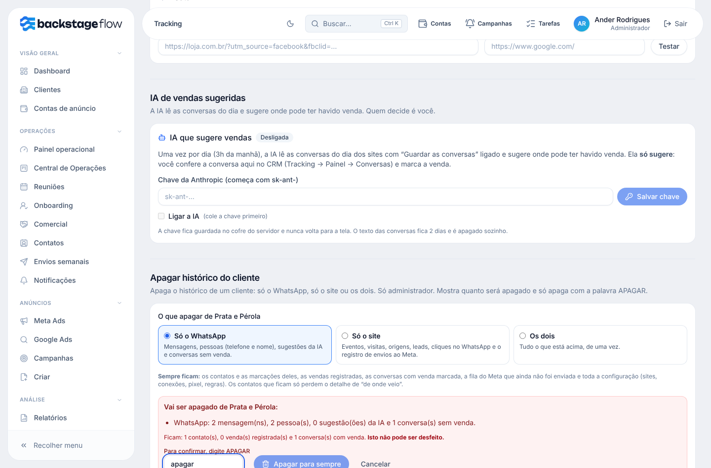

# T5.41 — Apagar o histórico de um cliente (26/11/2026, pedido do Ander)

Pergunta do Ander: "onde consigo excluir todo o histórico do cliente, só o do WhatsApp, só o do site ou os dois?". O WhatsApp já tinha "Limpar dados" e "Apagar tudo e começar do zero"; o **site não tinha nada**. Agora há um lugar só.

## Onde fica
**Tracking → Configurações → "Apagar histórico do cliente"** (só administrador; escolha o cliente no campo do topo — um cliente por vez).

## Como funciona
1. Escolher: **Só o WhatsApp**, **Só o site** ou **Os dois**.
2. **Ver o que será apagado:** mostra os números (mensagens, pessoas, eventos, visitas, leads...) e o que fica.
3. Digitar **APAGAR** (maiúsculas) e clicar em "Apagar para sempre". Fica registrado em `audit_logs` (`tracking.historico_apagar`): quem, quando e quanto.

## O que é apagado
- **WhatsApp:** texto das mensagens, pessoas (telefone e nome), sugestões da IA e conversas **sem venda** (servidor próprio e API oficial).
- **Site:** eventos (inclusive o arquivo), visitas, visitantes, origens, leads, cliques no WhatsApp e o registro de envios ao Meta já feitos.

## O que SEMPRE fica (recomendação aprovada: "faça sua recomendação")
- Contatos e as marcações deles (perfil, etapa, vendas) — só perdem o detalhe de "de onde veio".
- Compras/vendas registradas e conversas **com venda** marcada (carregam as contagens dos relatórios e o que já foi ao Meta).
- A fila de envio ao Meta que ainda está **pendente** (e os leads que ela usa).
- Toda a configuração: sites, conexões, pixel, regras. Nenhuma conexão é desligada (diferente de "Apagar tudo e começar do zero").

## Não há "desfazer".

## Banco
Migration `20261126120000_apagar_historico_cliente.sql` (aplicada). **Sem tabela nova.**
- `tracking_historico_contagem(p_client)` e `tracking_historico_apagar(p_client, p_escopo, p_confirmar)` → versões `private.*_impl` (security definer): só administrador, escopo `whatsapp|site|ambos`, palavra APAGAR obrigatória. Quem não está logado não executa.
- Ordem de apagar pensada para as ligações entre tabelas (o que fica deixa de apontar para o que sai).

## Testes
- **No banco real, sem apagar nada:** `supabase/tests/tracking_historico_apagar.sql` (bloco que sempre desfaz): rodei com a Prata e Pérola — antes 861 mensagens, 49 eventos, 2 leads; o apagar rodou sem erro de ligação; depois tudo zerado, **contatos (2) e venda (1) iguais**; conferi depois que nada foi apagado de verdade.
- Navegador: `e2e/apagar-historico.mjs` (as 3 escolhas, travas, outro cliente intocado, conversa com venda e contatos ficam, só administrador vê). Mais os testes vizinhos e unitários.
- **Não testado:** clicar o botão com seu login no site publicado.

