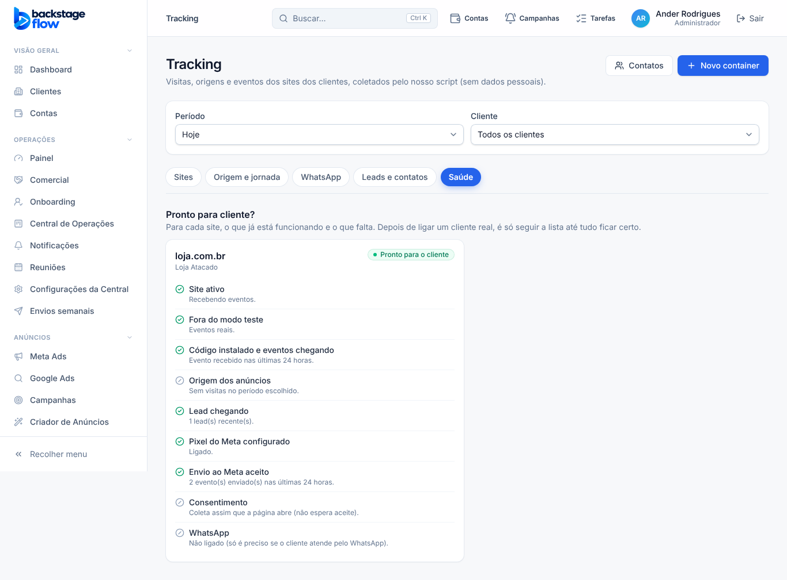

# T5.5 — Lista "pronto para cliente" (aba Saúde do Tracking) (08/11/2026)

Só tela. Banco e regras **não mudaram**. Usa apenas fatos que já estão gravados: nada é estimado.

## O que é
Em Tracking → **Saúde**, cada site tem uma lista com ✅ certo, ⚠️ atenção, ❌ falta e ⊘ não se aplica, e um resumo: **Pronto para o cliente**, **Quase pronto** ou **Faltam itens**. No dia de ligar um cliente real, é só seguir a lista de cima para baixo.

## Itens
| Item | ✅ | ⚠️ / ❌ |
|---|---|---|
| Site ativo | ativo | ❌ pausado (nada é gravado) |
| Fora do modo teste | eventos reais | ⚠️ modo teste: eventos marcados como teste; só vão ao Meta com o código de teste |
| Código instalado e eventos chegando | evento nas últimas 24 h | ❌ nenhum evento; ⚠️ último há mais de 24 h |
| Origem dos anúncios | origem identificada | ⚠️/❌ conforme a qualidade do período (com o motivo, ex.: link sem ID da campanha); ⊘ sem visitas |
| Lead chegando | há leads recentes | ⚠️ nenhum ainda |
| Pixel do Meta configurado | ligado e com token | ❌ sem Pixel ou sem token; ⚠️ desligado |
| Envio ao Meta aceito | enviados nas últimas 24 h | ❌ o Meta recusou (mostra o motivo); ⚠️ na fila ou nenhum envio ainda; ⊘ sem Pixel |
| Consentimento | (informativo) | diz se coleta na hora ou só depois do aceite |
| WhatsApp | conexão funcionando (oficial, Coexistence ou servidor) | ❌ com erro; ⚠️ desligado/aguardando mensagem; ⊘ não ligado |

"Lead chegando" e "Origem dos anúncios" usam o **período escolhido** no topo do Tracking.

## Testes
- Regras da lista: 5 testes novos em `logic.test.ts` (site pronto; site novo; modo teste e envio parado; Meta recusando, Pixel sem token e origem fraca; WhatsApp).
- Navegador: `tracking-saude.mjs` (site novo mostra o que falta; com evento, lead, Pixel e envio aceito vira "Pronto para o cliente").
- **Não testado:** com dados reais (ainda não há cliente com eventos); itens de frases do WhatsApp, webhook de lead e de venda não entram na lista desta versão.
