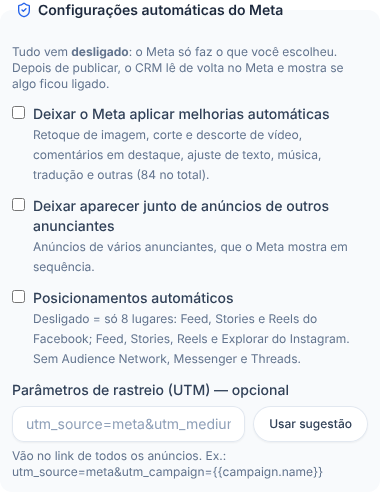

# 35.12 — Fase J.1: Controle total (automações do Meta desligadas)

> Objetivo: o que o Criador publica sai **do jeito que você montou**, sem o Meta ligar melhorias sozinho.
> Vale para o Criador de campanhas atual e para a Esteira de criativos (J.2), que vai usar a mesma peça.

## 1. O que muda para você
No passo 1 do rascunho há um painel novo, **"Controle total"**. Já vem tudo desligado:

| Opção | Padrão | O que faz |
|---|---|---|
| Melhorias automáticas do Meta | **Desligado** | O CRM manda as **84 melhorias** do criativo como desligadas (comentários em destaque, resumo, corte/ampliação de vídeo, música, retoques, troca de vídeo entre posicionamentos…). |
| Anúncios de vários anunciantes | **Desligado** | O anúncio não aparece misturado com anúncios de outras marcas. |
| Posicionamentos | **Escolhidos** | Só Feed, Explorar, Stories e Reels (Facebook e Instagram). Audience Network, Messenger e Threads ficam de fora. |
| Parâmetros de rastreio (UTM) | Vazio | Somados ao link de todos os anúncios. Botão "Usar sugestão" preenche `utm_source=meta&utm_medium=paid&utm_campaign={{campaign.name}}&utm_content={{ad.name}}`. |

Se você ligar alguma coisa, a conferência avisa (melhorias ligadas, posicionamentos automáticos). UTM mal escrita (com `?`, espaços ou fora do formato `nome=valor`) **bloqueia** até corrigir.

## 2. Conferência depois de publicar
Depois de criar, o CRM **lê de volta** no Meta:
- **criativo:** quais melhorias ficaram ligadas de verdade. Se nenhuma: selo verde "Nenhuma melhoria automática ligada". Se o Meta ligou alguma por conta própria: selo amarelo com o nome de cada uma em português (ex.: "Comentários em destaque");
- **conjunto:** se o Público Advantage+ está ligado e se os posicionamentos ficaram escolhidos ou automáticos.

## 3. Regras
- Nunca inventamos o resultado: o selo mostra só o que o Meta devolveu na leitura.
- Anúncio que usa **post que já existe no Instagram** não recebe esses campos (o Meta usa o post como está).
- O CRM **não altera conjuntos já existentes** no Meta. Isso só vale para o que o Criador cria.

## 4. Quem pode
O mesmo do Criador: administrador, gestor e operador com acesso ao cliente (conferido no banco).

## 5. Banco: coluna nova
**`publish_items.automations_check`** (jsonb, opcional, até 20 mil caracteres)
- **Para quê:** guardar a leitura de volta das automações de cada item publicado.
- **Conteúdo:** criativo `{ kind: "criativo", ligadas: [nomes] }`; conjunto `{ kind: "conjunto", advantageAudience, placements }`.
- **Ligações e acesso:** a mesma linha de `publish_items` (já ligada à publicação e ao rascunho), com o mesmo RLS que já existia.
- **Por quanto tempo:** permanente, junto com o histórico da publicação (nada é apagado automaticamente).
- Migração: `supabase/migrations/20261128120000_controle_total_automacoes.sql`.

## 6. Servidor
- Função `meta-builder` publicada na **versão 7**.
- Campos enviados ao Meta: `degrees_of_freedom_spec.creative_features_spec` (todas `OPT_OUT`), `contextual_multi_ads {enroll_status: OPT_OUT}`, `url_tags`, e no conjunto `publisher_platforms`/`facebook_positions`/`instagram_positions`.
- A lista das 84 melhorias saiu da leitura real do Meta na J.0 (`35.11`). Fica em `packages/shared/src/campaign-builder/automations.ts`.

## 7. Testes
- Unitários: site 214, regras compartilhadas 347 (novos da J.1: padrão desligado, UTM, leitura das melhorias nos dois formatos do Meta), Edge Functions 284 (3 novos: campos enviados ao Meta, desligado/ligado, leitura de volta).
- Navegador (simulador): painel com os padrões, UTM salva, Meta simulado "ligando" comentários em destaque → aparece o aviso amarelo; selos verdes nos demais.

## 8. O que NÃO foi testado
- **Publicação real no Meta com esses campos não foi feita.** Na J.0 confirmamos pela ferramenta do Meta que as melhorias desligadas são aceitas e lidas de volta; o envio pela nossa função (API direta) ainda não rodou numa conta real.
- `contextual_multi_ads` não foi testado no Meta.
- Se o Meta recusar algum nome de melhoria no futuro (ele muda a lista), a publicação falha com a mensagem do Meta e nada além do que já foi criado fica no ar (tudo pausado).
