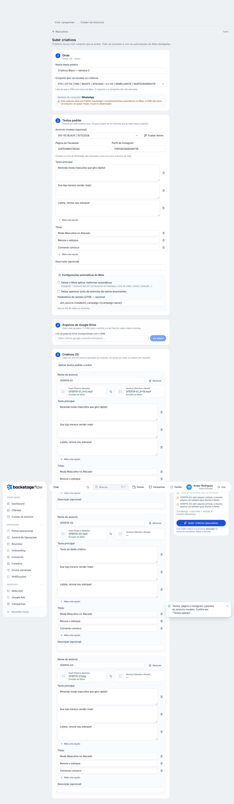

# 35.13 — Fase J.2: Esteira de criativos ("Subir criativos")

> Resolve o gargalo do dia a dia: colocar criativos novos em **conjuntos que já existem**, com 2 vídeos (Feed + vertical), 3 textos e 3 títulos, sem o Meta ligar automações.
> Tudo sai **pausado**. O conjunto e a campanha **não são alterados**.

## 1. O formato veio de um anúncio seu (Vonks, 27/11/2026)
O criativo "Moda Masculina no Atacado" (campanha CP-7.6, conta CA - Vonks) tem **2 vídeos + 3 textos + 3 títulos no mesmo anúncio**, e o Meta aceitou:
- `asset_feed_spec` com os 2 vídeos, os textos, os títulos, o link `https://api.whatsapp.com/send` e o botão `WHATSAPP_MESSAGE`;
- `optimization_type: "PLACEMENT"`;
- regra 1: vídeo vertical + textos em Stories e Reels;
- regra 2: o outro vídeo no restante.

Isso respondeu a dúvida da J.0 (seção 3). A leitura foi só de leitura: nada mudou na conta.

**O que a leitura também mostrou:** esse anúncio está com 8 melhorias do Meta **ligadas**: comentários em destaque, melhorar o botão, resumo, revelar detalhes, recomposição, troca de vídeo entre posicionamentos, tradução de texto e de narração. A esteira manda todas desligadas.

## 2. Como usar (5 passos numa tela só)
1. **Criar campanhas → "Subir criativos"**: nome e conta.
2. **Onde**: escolha o conjunto (lista do que o CRM sincroniza). O CRM lê no Meta o destino (WhatsApp, site, Messenger, Direct) e **avisa** se o conjunto está com Público Advantage+ ou posicionamentos automáticos. Ele não mexe no conjunto.
3. **Textos padrão**: escolha um anúncio que já roda no conjunto e clique em **"Copiar textos"**. Vêm página, Instagram, até 5 textos, até 5 títulos e a UTM. Dá para editar. Painel de automações (tudo desligado).
4. **Arquivos do Google Drive**: cole o link da pasta e clique em **"Ler pasta"**. O CRM junta os pares sozinho:
   - pelo **formato real** que o Drive informa: alto (9:16) vai para Stories e Reels; quadrado ou 4:5 vai para o Feed;
   - se o Drive não souber o formato, pelo **nome**: `_9x16`, `_stories`, `_reels` / `_4x5`, `_1x1`, `_feed`;
   - `OFERTA-01_9x16.mp4` + `OFERTA-01_4x5.mp4` = **um criativo**. O que não tiver par vira criativo de um arquivo só, marcado "sem par".
5. **Criativos**: cada um já vem com os textos padrão; você troca o que quiser só naquele. Botões "Inverter Feed e vertical" e "Aplicar textos padrão a todos".

Depois: **"Enviar N arquivos ao Meta"** (um por vez, com andamento; vídeo pode levar até 1 min e meio) e **"Subir criativos (pausados)"**.

## 3. O que vai para o Meta
| Caso | Formato |
|---|---|
| 2 arquivos (Feed + vertical) | Um criativo com os 2, textos e títulos, regras por posicionamento (igual ao anúncio da Vonks) |
| 1 arquivo e vários textos | `video_data`/`link_data` + "várias opções de texto" (o formato que você usa hoje, aceito na J.0) |
| 1 arquivo e 1 texto | O anúncio simples de sempre |

Em todos: as 84 melhorias desligadas, sem anúncios de vários anunciantes, UTM se preenchida. Cada criativo vira um anúncio **pausado** no conjunto escolhido.

**Depois de subir**, o CRM lê cada criativo de volta e mostra se ficou alguma melhoria ligada, com link para abrir o conjunto no Gerenciador.

## 4. Regras
- Destinos aceitos: site, WhatsApp, Messenger e Direct. Formulário no anúncio e post existente → conferência bloqueia e manda para o Gerenciador.
- Até 20 criativos por vez; até 5 textos e 5 títulos por criativo; os dois arquivos do par precisam ser do mesmo tipo.
- Vídeo até 30 MB por arquivo (vídeos maiores ficam para a J.4).
- Com dois arquivos, a **descrição não é enviada** (o formato aceito pelo Meta não tem descrição). A conferência avisa.
- A mesma esteira sobe uma vez. Para subir de novo, crie outra.
- O mesmo arquivo usado em vários criativos é enviado ao Meta só uma vez.

## 5. Quem pode
Igual ao Criador: ver (admin, gestor, operador), editar e enviar arquivos (permissão "editar"), subir (permissão "publicar"). Tudo conferido no banco; a conta passa pelo acesso ao cliente.

## 6. Banco
- **Nenhuma tabela nova.** A esteira é um rascunho do Criador (`builder_drafts.data` com `"kind": "esteira"`), com o mesmo histórico de versões e arquivamento (nunca apaga).
- O registro de cada envio usa as tabelas que já existiam (`publish_operations` e `publish_items`), guardadas para sempre. O resumo da operação passa a ter `conjunto_existente`.
- Migração `20261128150000_esteira_tipo_do_rascunho.sql`: a lista de rascunhos agora diz o tipo (campanha ou esteira), para abrir o editor certo. Avisos de segurança do Supabase: nada novo.

## 7. Servidor
Função `meta-builder` **versão 8**. Ações novas:
- `adset_info`: lê o conjunto no Meta e confere que é da conta;
- `ad_template`: lê os textos de um anúncio existente;
- `media_prepare`: envia um arquivo do Drive ao Meta.

Subir uma esteira usa a ação `publish` de sempre. O Drive passou a informar a largura e a altura dos arquivos.

## 8. Testes
- Regras compartilhadas: 355 passando (8 novos da esteira: formato, nomes, pares, conferência, leitura segura).
- Edge Functions: 290 passando (6 novos: dois vídeos com regras por posicionamento, um vídeo com vários textos, site, arquivo não enviado, ordem criativo → anúncio pausado no conjunto, anúncio-modelo).
- Site: 214 passando. Tipos e lint ok.
- Navegador (simulador), teste novo `campaign-builder-esteira.mjs`: escolher conjunto, aviso de automações do conjunto, copiar textos do anúncio-modelo, ler pasta, juntar o par, trocar texto de um só, enviar 4 arquivos, subir pausado, leitura de volta. Os testes do Criador antigos continuam passando.

## 9. O que NÃO foi testado
- **Nenhum criativo foi criado no Meta pela esteira ainda.** O formato de 2 vídeos foi copiado do anúncio real da Vonks, mas montado pela nossa função; a primeira subida real (pausada) é o teste.
- A forma exata das regras por posicionamento na API (rótulos `adlabels`, `customization_spec`) segue a documentação do Meta. A leitura de volta da Vonks mostra a forma "achatada". Se o Meta recusar, a mensagem dele aparece no item e nada fica ativo.
- Regra "resto" quando o conjunto tem posicionamentos automáticos: mandamos Facebook, Instagram, Audience Network e Messenger. Não testado no Meta.
- Messenger e Direct na esteira: montados como no Criador atual, sem teste real.
- **Mensagem de abordagem do WhatsApp**: ainda não entra no criativo (fica para a J.3, com a biblioteca).
