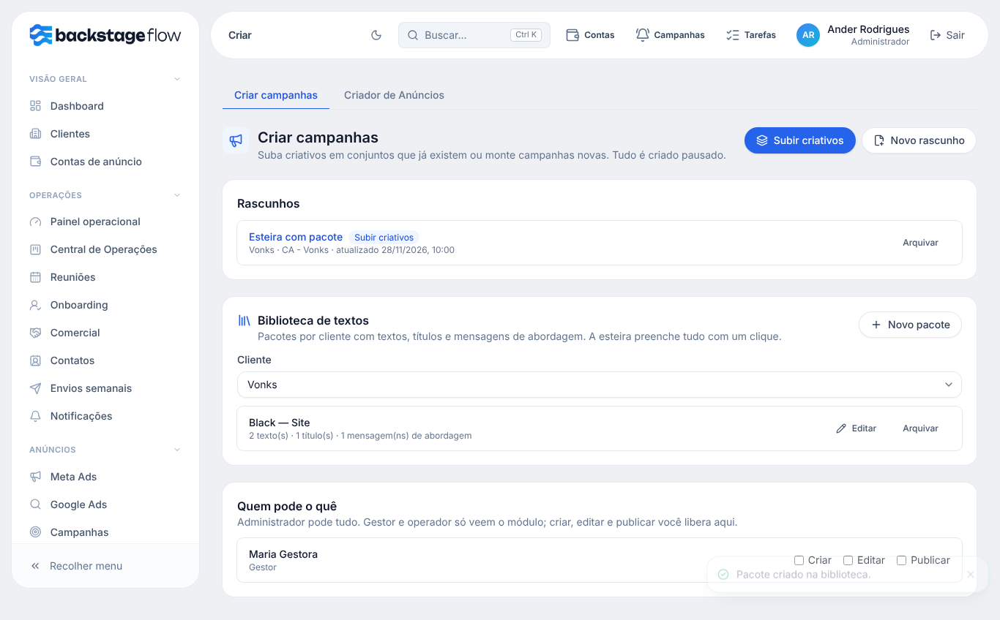

# 35.14 — Fase J.3: Biblioteca de textos (pacotes por cliente)

> Os textos "quase sempre são os mesmos": agora ficam guardados por cliente e a esteira preenche tudo com um clique.

## 1. O que mudou para você
- **Criar campanhas → "Biblioteca de textos"**: escolha o cliente e crie **pacotes**. Cada pacote tem:
  - nome (ex.: "Black — WhatsApp");
  - até 5 textos e 5 títulos;
  - descrição;
  - link e botão (só valem para conjuntos de site);
  - UTM;
  - até 10 **mensagens de abordagem** do WhatsApp.
- **Na esteira** (passo 2):
  - **"Pacote da biblioteca" → "Usar pacote"** preenche os textos padrão;
  - **"Salvar como pacote"** guarda os textos padrão atuais como pacote novo;
  - as mensagens de abordagem do pacote aparecem com botão **"Copiar"**.
- **Editar** e **Arquivar** (com **Desfazer**). Nada é apagado.

## 2. Mensagens de abordagem: o que dá e o que ainda não dá
- Hoje elas ficam **guardadas para você copiar** e colar no Gerenciador.
- Pela documentação do Meta, a mensagem que já vem escrita num anúncio de WhatsApp é cadastrada **na conta do WhatsApp Business** (sequência de boas-vindas). O criativo só aponta para ela (`asset_feed_spec.additional_data.partner_app_welcome_message_flow_id`). Não é um campo de texto do anúncio.
- Ligar isso exige acesso à conta do WhatsApp Business de cada cliente. Ficou como pendência, e a tela diz isso claramente.
- Fontes:
  - [Click to WhatsApp](https://developers.facebook.com/docs/marketing-api/ad-creative/messaging-ads/click-to-whatsapp)
  - [Welcome Message Sequences](https://developers.facebook.com/documentation/business-messaging/whatsapp/ctwa/welcome-message-sequences/)

## 3. Regras
- Nome único por cliente (entre os pacotes ativos).
- Até 5 textos, 5 títulos e 10 mensagens. Textos vazios ou repetidos são descartados.
- O link precisa começar com `https://`. A UTM não pode ter espaços nem começar com `?`.
- Senha, token ou chave em qualquer campo: recusado.
- Duas pessoas editando o mesmo pacote: a segunda é avisada para recarregar (versão).
- Na esteira, link e botão do pacote só entram se o conjunto for de **site**. A UTM entra se for válida.

## 4. Quem pode
- **Ver:** administrador, gestor e operador com acesso ao cliente.
- **Criar, editar, arquivar:** quem tem a permissão **"editar"** do Criador.

Tudo é conferido no banco.

## 5. Tabela nova: `builder_copy_sets`
- **Para quê:** pacotes de texto do Criador por cliente.
- **Campos:** `client_id`, `name`, `bodies` (textos), `titles`, `description`, `link`, `cta`, `url_tags`, `messages` (mensagens de abordagem), `version`, `archived_at`, `created_by`/`updated_by`, `created_at`/`updated_at`.
- **Ligações:** cliente (`clients`); quem criou e quem alterou (`auth.users`).
- **Índices:**
  - nome único por cliente entre os ativos;
  - cliente + data;
  - quem criou;
  - quem alterou.
- **Segurança:** RLS ligado. Leitura só para quem vê o Criador e o cliente. Escrita só pelas funções `builder_copy_set_save` e `builder_copy_set_archive`, que chamam `private.*_impl` e conferem a permissão. Criar, editar e arquivar ficam no histórico (`audit_logs`).
- **Por quanto tempo:** **sem prazo**. Só é arquivado, nunca apagado.
- **Migração:** `20261128180000_biblioteca_de_textos.sql`.
- **Avisos de segurança do Supabase:** nada novo.

## 6. Testes
- **Banco:** `supabase/tests/etapa35_j3_biblioteca.sql` (**7 verificações OK**, em transação desfeita). Cobre:
  - criar sem vazios;
  - versão;
  - nome repetido;
  - limites, link, token;
  - cliente sem acesso;
  - operador sem "editar" (lê, mas não altera);
  - arquivar e desfazer;
  - visitante bloqueado;
  - histórico.
- **Regras:** 359 passando (4 novos).
- **Site:** 214. **Edge Functions:** 290.
- **Navegador:** teste novo `campaign-builder-biblioteca.mjs` (criar pacote, cobrança do link, arquivar e desfazer, usar na esteira, mensagens para copiar, salvar como pacote, nome repetido recusado). Os testes do Criador e da esteira continuam passando.

## 7. O que não foi testado
- O uso dos pacotes numa subida real no Meta: depende da primeira subida da J.2.
- Mensagem de abordagem dentro do anúncio: não implementado (seção 2).
