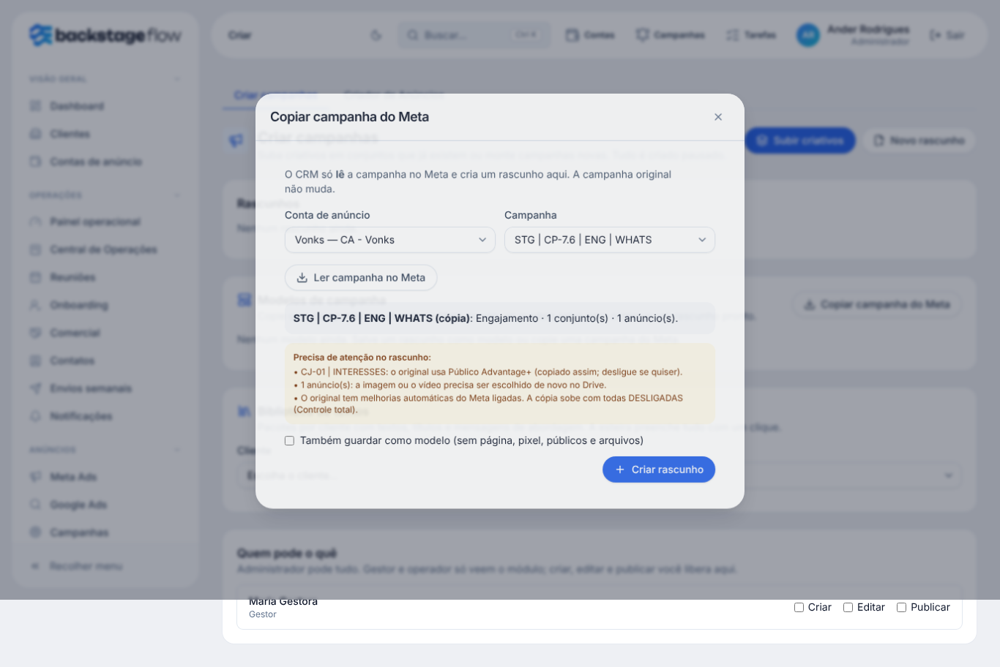

# 35.15 — Fase J.5: Modelos de campanha

> Começar uma campanha nova sem montar tudo do zero: copiar uma que já roda no Meta ou usar um modelo salvo.

## 1. O que mudou para você
Em **Criar campanhas** há um cartão novo, **"Modelos de campanha"**:
- **Copiar campanha do Meta**:
  1. escolha a conta e a campanha (lista do que o CRM sincroniza);
  2. clique em **"Ler campanha no Meta"**;
  3. o CRM mostra o resumo e **o que precisa de atenção**;
  4. **"Criar rascunho"** abre o rascunho pronto.

  Com a opção marcada, a campanha também vira **modelo**.
- **Usar modelo**: escolha a conta (pode ser **outra conta**, de outro cliente) e o rascunho é criado com a estrutura do modelo.
- **No editor do rascunho**: botão **"Salvar como modelo"**.
- **Arquivar** com **Desfazer**. Nada é apagado.

## 2. O que é copiado da campanha do Meta
| Copia | Não copia (aparece em "precisa de atenção") |
|---|---|
| Nome (com "(cópia)"), objetivo, categoria especial, orçamento da campanha ou dos conjuntos | Status (você escolhe, como sempre) |
| Conjuntos: meta, cobrança, destino (WhatsApp, site...), pixel e evento, página | Datas de início e fim |
| Público: países, cidades (raio em km), idade, gênero, interesses, públicos personalizados, Público Advantage+ (copiado como está e avisado) | Estados, CEPs, pontos no mapa, comportamentos, públicos excluídos |
| Anúncios: nome, página, Instagram, texto, título, descrição, link e botão | Imagem e vídeo (escolha de novo no Drive); só a **primeira** opção de texto quando havia várias (para várias, use a esteira) |
| — | Estratégia de lance diferente de "menor custo" |
| — | **As melhorias automáticas do original**: a cópia sobe com todas **desligadas** (Controle total) |

**Limites:** até 10 conjuntos e 30 anúncios por cópia, os mesmos do Publicar. Objetivo antigo do Meta ou meta que não combina **não é chutado**: fica em branco e é avisado.

## 3. O que o modelo guarda
- **Guarda:** a estrutura (objetivo, orçamento, conjuntos, público genérico, textos, Controle total).
- **Não guarda:** o que é de **uma conta só** (página, Instagram, pixel, públicos personalizados, formulários, posts, imagens e vídeos), nem as datas. A tela mostra o que fica de fora antes de salvar.

## 4. Quem pode
- **Ver modelos:** quem vê o Criador.
- **Copiar campanha, salvar, usar e arquivar modelos:** quem tem a permissão **"criar"** do Criador.

Tudo é conferido no banco. A leitura no Meta confere que a campanha é da conta escolhida.

## 5. Tabela nova: `builder_templates`
- **Para quê:** modelos de campanha do Criador, que valem para qualquer conta.
- **Campos:** `name`, `description`, `objective` (para a lista), `source` (`rascunho` ou `meta`), `data` (o rascunho sem o que é de cada conta, em JSON, até 200 KB), `version`, `archived_at`, `created_by`/`updated_by`, datas.
- **Ligações:** quem criou e quem alterou (`auth.users`). **Não** se liga a cliente, porque o modelo serve para todos.
- **Índices:**
  - nome único entre os ativos;
  - objetivo + nome;
  - quem criou;
  - quem alterou.
- **Segurança:** RLS ligado; escrita só por `builder_template_save` e `builder_template_archive`, que chamam `private.*_impl`. Criar, editar e arquivar ficam no histórico (`audit_logs`).
- **Por quanto tempo:** **sem prazo**. Só é arquivado, nunca apagado.
- **Migração:** `20261128200000_modelos_de_campanha.sql`.
- **Avisos de segurança do Supabase:** nada novo.

## 6. Servidor
Função `meta-builder` na **versão 9**, com a ação nova `campaign_import`. Ela lê campanha, conjuntos e anúncios no Meta (só leitura) e devolve o rascunho e as notas. **Não grava nada**: o rascunho é criado pela tela, com as regras de sempre do banco.

## 7. Testes
- **Banco:** `supabase/tests/etapa35_j5_modelos.sql` (**6 verificações OK**, em transação desfeita). Cobre:
  - criar com objetivo e origem;
  - versão;
  - nome repetido;
  - token;
  - operador sem "criar" (lê, mas não cria nem arquiva);
  - arquivar e desfazer;
  - visitante bloqueado;
  - histórico.
- **Regras:** 362 passando (3 novos: cópia fiel e notas, objetivo antigo sem chute, modelo sem o que é de uma conta).
- **Site:** 214. **Edge Functions:** 290.
- **Navegador:** teste novo `campaign-builder-modelos.mjs` (copiar do Meta com avisos, rascunho criado sem status, modelo salvo sem página e públicos, salvar como modelo pelo editor com nome repetido recusado, usar em outra conta, arquivar e desfazer). Rodado 4 vezes seguidas sem falha. Os testes do Criador, da esteira e da biblioteca continuam passando.

## 8. O que não foi testado
- **A leitura de uma campanha real** pela nossa função. A conversão foi testada com a estrutura que o Meta devolveu nas leituras de 27 e 28/11 (Vonks e Acelera), mas a chamada nova ao Meta ainda não rodou com uma conta real.
- **Campanhas com mais de 50 conjuntos ou 100 anúncios:** só a primeira página é lida (e só 10/30 são copiados).
