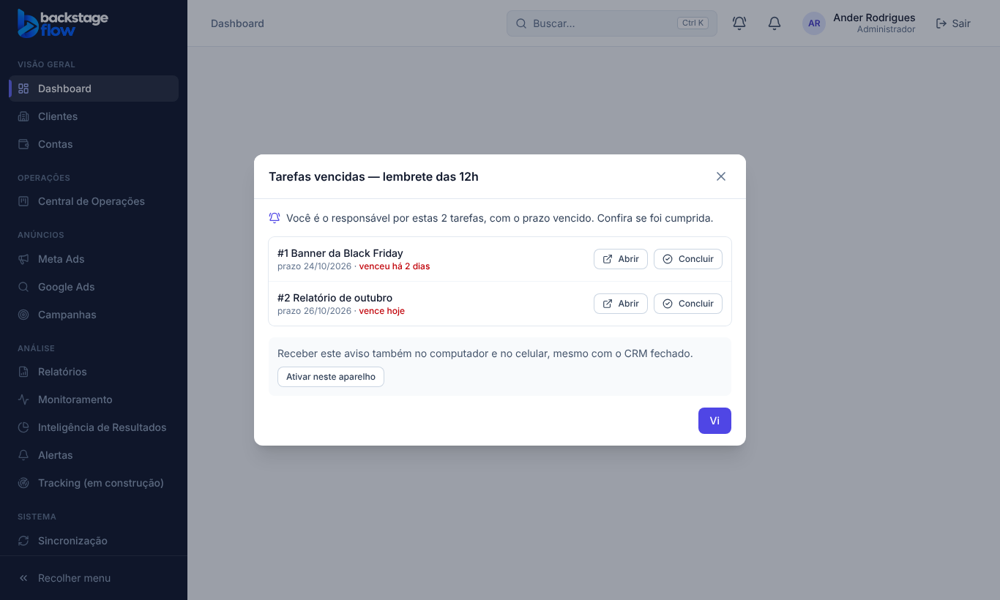
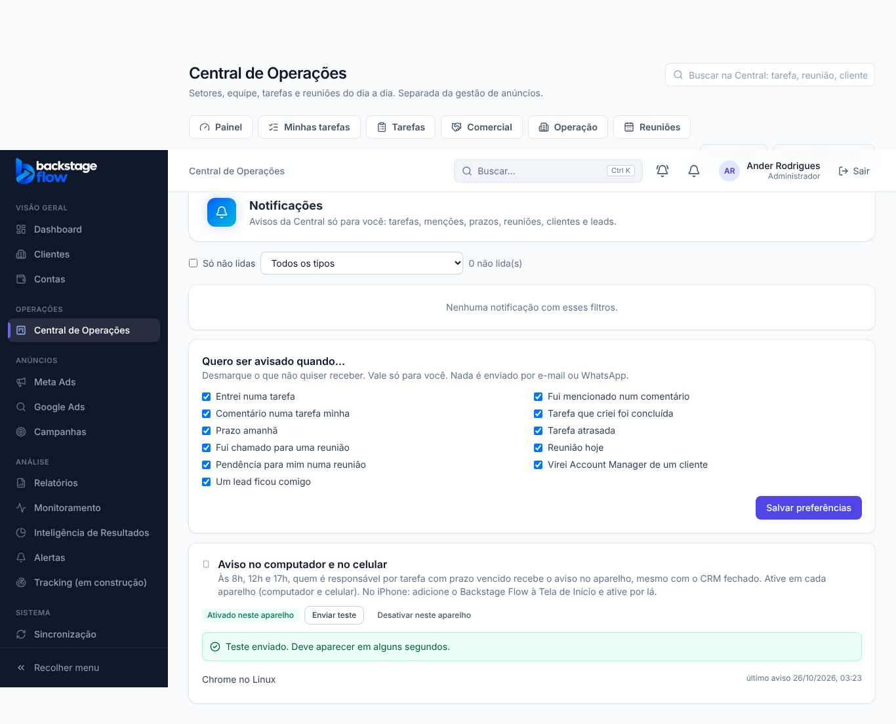

# Central 36.17 — Lembrete de tarefa vencida (8h, 12h e 17h) no CRM, no computador e no celular

**Data:** 26/10/2026 · **Pedido do Ander:** "quando a data da tarefa vencer, aparecer um pop-up pelo menos 3 vezes ao dia, às 8, ao meio-dia e às 17, até eu abrir e visualizar"; "só para quem for responsável"; "quero receber no computador, no celular e, se possível, no Chrome. Eu autorizo."

## 1. Como funciona
- Às **8h, 12h e 17h (horário de Brasília)**, quem é o **responsável** (pessoa principal) por uma tarefa **com prazo vencido ou vencendo hoje** e ainda aberta vê um pop-up em qualquer tela do CRM.
- Não entram: tarefas concluídas, canceladas, arquivadas, sem prazo, com prazo futuro, ou em que a pessoa é só "adicional".
- O pop-up fica até a pessoa clicar **Vi** (fechar no X também conta, e **Abrir** também). Vale por horário: às 12h volta mesmo que tenha visto às 8h.
- O "Vi" vale para todos os aparelhos (fica no banco). Se o CRM estiver fechado às 12h, o pop-up aparece quando abrir (até as 17h, quando já vale o lembrete das 17h).
- No pop-up: **Abrir** (vai para a tarefa) e **Concluir** (muda para o status de conclusão, seguindo as mesmas regras e permissões do quadro).

## 2. Aviso no computador e no celular (notificação do navegador)
- Botão **"Ativar neste aparelho"** no pop-up e em **Central → Notificações** (card "Aviso no computador e no celular"). O navegador pede a autorização uma vez.
- Nos mesmos horários, o servidor manda o aviso para os aparelhos ativados, **mesmo com o CRM fechado** (no computador, basta o Chrome/Edge estar aberto). Clicar no aviso abre o CRM na lista de tarefas.
- Funciona no Chrome, Edge e Firefox (Windows, Mac, Linux, Android). **iPhone:** abrir o site no Safari → Compartilhar → "Adicionar à Tela de Início" → abrir por esse ícone → Ativar.
- Só quem não viu o pop-up do horário recebe. Aparelhos que o navegador cancelou (ou com 5 falhas seguidas) são desligados (não apagados).
- Card com "Enviar teste" e "Desativar neste aparelho".

## 3. Tabelas novas
| Tabela | Para quê | Campos principais | Ligações / índices | Guardada por |
|---|---|---|---|---|
| `ops_due_reminder_views` | registra o "Vi" de cada pessoa em cada horário | `user_id`, `day`, `slot` (8/12/17), `seen_at` | usuário (profiles); chave = pessoa + dia + horário | permanente (é pequena: 3 linhas por pessoa por dia no máximo) |
| `ops_push_subscriptions` | aparelhos que recebem o aviso | `user_id`, `endpoint` (endereço do navegador, só https), chaves de cifra, `device` ("Chrome no Windows"), `last_sent_at`, `last_error`, `failures`, `disabled_at` | usuário; `endpoint` único | permanente; desativar não apaga (só preenche `disabled_at`) |

- RLS: cada pessoa vê só os próprios registros. A tela **não lê** o endereço nem as chaves do aparelho (só nome, datas e erro).

## 4. Servidor
- Migração `20261026030746_ops_lembretes_prazo.sql`: funções `ops_due_reminder`, `ops_due_reminder_seen`, `ops_push_subscribe/unsubscribe` (tela) e `ops_push_targets/mark/keys` (só servidor). Agendamento `ops-due-push` às 11h, 15h e 20h UTC (= 8h, 12h, 17h de Brasília).
- Edge Function `ops-push` (v1): Web Push padrão (cifra RFC 8291 + assinatura VAPID), conferida com o exemplo oficial da norma. As chaves VAPID são criadas **no primeiro uso** (pública em `app_settings`, privada no Vault). Nada passa pelo Google/Apple além do aviso cifrado.
- Site: `public/sw.js` (recebe o aviso e abre o CRM ao clicar) e `public/manifest.webmanifest` (para o iPhone).

## 5. Testes
- SQL `supabase/tests/etapa36_17_ops_lembretes.sql`: 5 blocos (horários, quem recebe, Vi, aparelhos e sigilo, servidor).
- Servidor: 4 testes (`webpush_test.ts`), incluindo o exemplo oficial da RFC 8291.
- Navegador `apps/web/e2e/ops-due-reminder.mjs`: 19 verificações (pop-up, só responsável, Concluir, Vi, 17h, Abrir, ativar/testar/desativar aparelho, fora do horário, sem acesso).
- Unitário: nome do aparelho (`dueReminderApi.test.ts`).
- **Não testado aqui:** aviso chegando num aparelho real (o navegador de teste não fala com o serviço do Google). Ao vivo: o envio agendado com o segredo certo respondeu 200; sem segredo/sem login, 401.

## 6. Como voltar
`supabase/rollback/voltar_ops_lembretes_2026_10_26.sql` (para o agendamento e desliga os aparelhos; nada é apagado) + reverter os commits da 36.17. Ver `docs/PONTO-DE-RESTAURACAO.md`.
