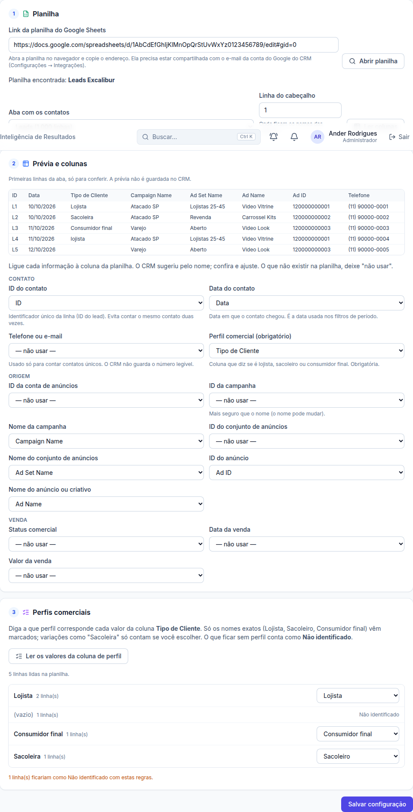

# Etapa 39.1 — Conexão com a planilha (Google Sheets)

> **Status:** pronta (17/10/2026).
> **Ainda não testada com uma planilha real.** Falta a chave da conta de serviço do Google; o passo a passo está abaixo.

## O que ficou pronto
1. **Configurações → Integrações → Google Sheets** (só administrador):
   - você cola a chave da conta de serviço (o arquivo JSON do Google). Ela vai direto para o cofre e nunca volta para a tela;
   - a tela mostra o **e-mail da conta**, com botão de copiar, para compartilhar as planilhas;
   - **Testar conexão** confere a chave no Google;
   - **Remover chave**: o CRM para de ler as planilhas até receber uma chave nova.
2. **Menu → Inteligência de Resultados** (grupo Análise, depois de Monitoramento). Escolha o cliente e o CRM abre o assistente:
   1. **Planilha:** cole o link → "Abrir planilha" → o CRM mostra o título e as abas → escolha a aba e a linha do cabeçalho → "Ler colunas".
   2. **Prévia e colunas:** as 5 primeiras linhas, só na tela, sem guardar. Em seguida, cada informação é ligada a uma coluna:
      - **Contato:** ID, data, telefone ou e-mail, **perfil (obrigatório)**;
      - **Origem:** IDs e nomes de conta, campanha, conjunto e anúncio;
      - **Venda:** status, data e valor.

      O CRM sugere pelo nome da coluna, e você confere.
   3. **Perfis comerciais:** "Ler os valores da coluna de perfil" lista cada valor que aparece na planilha, com quantas linhas tem.
      - **Já vêm marcados:** só os nomes exatos (Lojista, Sacoleiro, Consumidor final).
      - **Precisam de escolha sua:** variações como "Sacoleira" ou "Loja física".
      - **Sem perfil:** conta como **Não identificado**, e a tela avisa quantas linhas ficariam assim.
   4. **Salvar configuração.** Depois de salva, a tela mostra o resumo (planilha, aba, colunas e regras) e o botão "Editar configuração".
3. **Cada cliente tem a sua planilha.** O modelo já aceita mais de uma planilha (ou aba) por cliente.

## Quem pode
| Papel | Ver a configuração | Conectar ou editar a planilha | Chave do Google |
|---|---|---|---|
| Administrador | Sim | Sim | Sim |
| Gestor | Só clientes liberados | Só clientes liberados | Não |
| Operador e visualizador | Só clientes liberados | Não | Não |
| Cliente e Equipe | Não | Não | Não |

Tudo é conferido no banco (RLS e funções `private.*_impl`), não só na tela.

## Como o CRM lê a planilha
- **Conta de serviço:** é um "usuário robô" do Google. O CRM só enxerga as planilhas que você **compartilhar** com o e-mail dela, e **só para leitura**: a permissão pedida ao Google é `spreadsheets.readonly`.
- **Leitura no servidor:** feita pela Edge Function **`sheets`**, nunca pelo navegador.
- **Erros com a orientação do que fazer:**
  - planilha não compartilhada (a mensagem mostra o e-mail certo);
  - planilha não encontrada;
  - aba renomeada;
  - API do Sheets desligada no Google Cloud;
  - chave recusada;
  - Google pedindo pausa.
- **O que fica guardado:** nada da planilha. Só a configuração.

## Banco
- **Tabela nova `sheets_settings`** (uma linha só):
  - **para quê:** e-mail da conta de serviço, se há chave, último teste;
  - **ligações:** nenhuma;
  - **índices:** chave única;
  - **guarda:** enquanto existir;
  - **a chave fica no cofre** (`vault`, nome `google_sheets_key`), e só o servidor lê (`sheets_key_get`, permitido apenas ao service_role).
- **Tabela nova `ri_sources`** (planilha de cada cliente):
  - **campos:** cliente, ID e título da planilha, aba, linha do cabeçalho, mapeamento das colunas, regras dos perfis, ligada/desligada, quem criou ou alterou e quando;
  - **ligações:** `clients`; se o cliente for excluído, a configuração vai junto;
  - **índices:** por cliente, mais "cliente + planilha + aba" único;
  - **guarda:** enquanto existir. Nenhum dado de contato fica aqui.
- **Funções:**
  - `sheets_settings_save` e `sheets_settings_remove_key` (admin; "remover" esvazia a chave no cofre);
  - `ri_source_save` (admin e gestor do cliente, com validação de campos e perfis);
  - toda alteração vai para os **Logs**.
- **Migrations:** `20261017195919_ri_sheets_connection` e `20261017202135_ri_sheets_key_check_text`. A segunda só troca o texto que a validação procura, para a checagem de segredos não confundir o código com uma chave; o comportamento não mudou.
- **Avisos de segurança do Supabase:** só os antigos.

## Testes
- **Banco:** `supabase/tests/etapa39_1_conexao_planilha.sql`, 23 verificações, todas passaram. O teste confere:
  - chave só do admin, e só JSON válido de conta de serviço;
  - a chave no cofre e a equipe sem acesso a ela;
  - planilha salva pelo gestor do cliente e recusada em cliente não liberado;
  - aba repetida, campo desconhecido, perfil inválido e ID inválido recusados;
  - operador vê e não altera; cliente não vê;
  - remover a chave;
  - registro nos Logs.
- **Servidor (Deno):** 6 testes, todos passaram. Conferem:
  - JWT assinado com RS256 (verificado com a chave pública) e escopo só de leitura;
  - token reaproveitado e chave recusada;
  - cada erro da API com a orientação certa;
  - leitura de abas e valores.
- **Regras compartilhadas:**
  - leitura do ID da planilha pelo link;
  - normalização de texto;
  - sugestão das colunas;
  - perfis sugeridos só para os nomes exatos;
  - classificação e valores distintos;
  - matriz de permissões;
  - ordem do menu.
- **Navegador:** `e2e/results-setup.mjs`, 32 verificações, todas passaram. O teste conferiu:
  - chave colada, guardada e testada;
  - menu;
  - link inválido e planilha não compartilhada;
  - prévia, sugestões, regras e contagem de não identificados;
  - salvar e editar;
  - cliente sem planilha;
  - visualizador só vê; cliente não vê o menu;
  - celular.
- **Conjunto completo de testes do site:** 53 roteiros e 1.633 verificações, todas passaram no fim.
  - Três roteiros antigos (`monitoring`, `permissions` e `design`) conferiam a ordem do menu e o número de permissões, que mudaram de propósito com o item novo. Foram atualizados e passaram.
- **Não testado:** com uma planilha real do Google, porque a chave da conta de serviço ainda não existe.

## Passo a passo para o Ander: criar a conta de serviço do Google
1. Entre em **console.cloud.google.com** com a conta Google da agência e escolha um projeto. Pode ser o mesmo do Google Ads, ou um novo, como "Backstage Flow".
2. Menu **APIs e serviços → Biblioteca** → procure **Google Sheets API** → **Ativar**.
3. Menu **IAM e administrador → Contas de serviço** → **Criar conta de serviço**.
   - Nome: `backstage-flow-planilhas`.
   - Avance sem dar nenhum papel e clique em **Concluir**.
4. Abra a conta criada → aba **Chaves** → **Adicionar chave → Criar nova chave → JSON**. Um arquivo `.json` é baixado.
5. No CRM: **Configurações → Integrações → Google Sheets**.
   - Abra o arquivo `.json` no Bloco de Notas, copie **tudo** e cole no campo.
   - Clique em **Salvar chave** e depois em **Testar conexão**.
   - **Não mande esse arquivo por chat nem por e-mail.**
6. Em cada planilha de cliente: **Compartilhar** → cole o e-mail que o CRM mostra (termina em `.iam.gserviceaccount.com`) → **Leitor** → desmarque "Notificar" → **Compartilhar**.

## Próximas fases
- **39.2:** leitura automática às 8h, 12h e 16h, o botão "Atualizar agora" e a situação da última leitura.
- **39.3 em diante:** perfis por campanha, conjunto e anúncio, rankings, filtros, qualidade dos dados e exportação.
