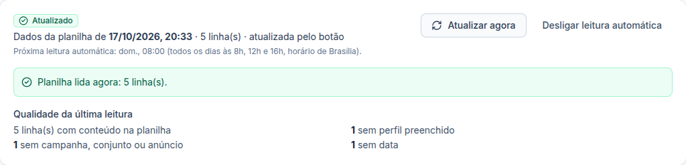
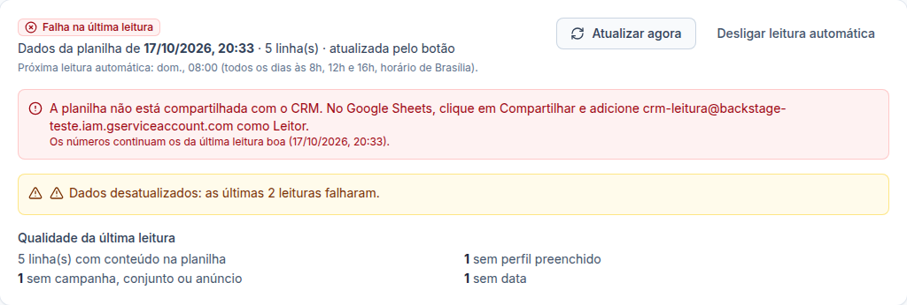

# Etapa 39.2 — Leitura da planilha (3 vezes por dia + "Atualizar agora")

> **Status:** pronta (17/10/2026).
> **Ainda não testada com uma planilha real.** Falta a chave da conta de serviço do Google (ver 39.1). Os testes usaram planilhas simuladas.

## O que ficou pronto
1. **Leitura automática todos os dias às 8h, 12h e 16h** (horário de Brasília). O CRM lê a aba configurada de cada cliente, inteira, pela Edge Function `sheets`.
2. **Botão "Atualizar agora"**, na página Inteligência de Resultados do cliente: lê a planilha na hora e mostra "Planilha lida agora: N linha(s)".
3. **Situação da leitura** no topo da página:
   - *Aguardando a primeira leitura*, *Lendo a planilha…*, *Atualizado*, *Falha na última leitura* ou *Leitura automática desligada*;
   - data e hora dos dados, quantas linhas e se veio do botão ou da leitura automática;
   - a próxima leitura automática.
4. **Qualidade da última leitura:** total de linhas e quantas estão sem perfil, sem campanha/conjunto/anúncio, sem data, com data inválida, com ID repetido (conta uma vez) ou com ID de anúncio inválido. Também avisa se uma coluna configurada sumiu da planilha.
5. **Falhas não apagam nada:** se a planilha deixar de estar compartilhada, a aba for renomeada etc., a tela mostra o motivo e o que fazer, e os números continuam os da última leitura boa. Depois de **2 falhas seguidas**, aparece o aviso "Dados desatualizados".
6. **Desligar/Ligar leitura automática** por planilha. Desligada, os dados só mudam pelo botão.

## Regras
- **A planilha é o banco de dados** (pedido do Ander). O CRM guarda só a **última leitura**, que é trocada a cada leitura nova.
- **Sem dados pessoais legíveis:** telefone/e-mail viram uma impressão digital (hash SHA-256 com o cliente), só para contar contatos únicos. Nome, telefone e e-mail **não** são guardados.
- **Duas leituras ao mesmo tempo não acontecem:** cada leitura "reserva" a planilha por até 5 minutos. Se alguém clicar enquanto lê, recebe "Esta planilha já está sendo lida agora. Aguarde um instante."
- **Datas** em DD/MM/AAAA (ou AAAA-MM-DD); **valores** em R$ no formato brasileiro. Data que não dá para entender conta como "data inválida", nunca é inventada.
- **ID repetido** na planilha: conta a primeira linha e avisa.

## Quem pode
| Papel | Ver a situação e a qualidade | "Atualizar agora" | Ligar/desligar leitura automática |
|---|---|---|---|
| Administrador | Sim | Sim | Sim |
| Gestor | Só clientes liberados | Só clientes liberados | Só clientes liberados |
| Operador | Só clientes liberados | Só clientes liberados | Não |
| Visualizador | Só clientes liberados | Não | Não |
| Cliente e Equipe | Não | Não | Não |

Conferido no servidor e no banco, não só na tela.

## Banco
**Migração:** `supabase/migrations/20261017202524_ri_sheets_reads.sql`.

### Tabela nova: `ri_snapshots` (última leitura de cada planilha)
- **Para quê:** guardar o resultado da última leitura, que os rankings (39.3) vão usar.
- **Campos principais:** `source_id` (a planilha), `client_id`, `read_at`, `trigger` (`agendada` ou `manual`), `row_count`, `rows` (as linhas, sem dados pessoais legíveis), `stats` (números da qualidade).
- **Ligações:** `source_id` → `ri_sources` (uma por planilha; se a configuração da planilha for removida, a leitura vai junto).
- **Índice:** a chave é o próprio `source_id`.
- **Por quanto tempo é guardada:** **só a última leitura**. Cada leitura nova substitui a anterior. Não há histórico de leituras (a planilha é o histórico).
- **Quem lê:** equipe com acesso ao cliente (RLS). Só o servidor grava.

### Campos novos em `ri_sources`
`read_status` (nunca, lendo, ok, erro), `last_attempt_at`, `last_success_at`, `last_error`, `consecutive_failures`, `lease_until` (a reserva de 5 minutos).

### Funções
- `ri_read_claim`, `ri_read_store`, `ri_read_fail`: reservar, guardar e registrar falha (só o servidor).
- `ri_source_set_enabled`: ligar/desligar a leitura automática (administrador ou gestor do cliente; fica na auditoria).
- Agendamento `sheets-read` no pg_cron: `0 11,15,19 * * *` (UTC) = 8h, 12h e 16h em Brasília.

## Servidor
Edge Function `sheets` (versão nova publicada):
- `read_now`: o botão; confere o papel e se a pessoa vê o cliente.
- `scheduled`: chamada pelo agendamento, com o segredo do agendamento; lê todas as planilhas com leitura automática ligada.
- Passou a aceitar chamadas sem login **só** para o agendamento (ela mesma confere login ou segredo). Teste feito: sem login → 401; segredo errado → 401.

## Testes
- **Unitários (`packages/shared`):** `read.test.ts` (datas, valores, telefone, IDs repetidos, próxima leitura).
- **SQL:** `supabase/tests/etapa39_2_leitura.sql` — 17 verificações OK (reserva, não lê duas vezes, guarda, falha não apaga, troca a anterior, permissões, cliente não vê, botão lê mesmo desligada, horário do agendamento).
- **Navegador:** `apps/web/e2e/results-read.mjs` — 30 verificações (primeira leitura, botão, qualidade, desligar/ligar, falha com orientação, 2 falhas → desatualizado, volta a funcionar, celular, operador e visualizador).
- **Não testado:** leitura de uma planilha real do Google e a execução real às 8h/12h/16h (falta a chave).

## Próximas fases
- **39.3:** classificar cada linha no perfil e ligar às campanhas, conjuntos e anúncios do CRM; rankings por perfil.
- **39.4:** telas dos rankings e filtros. **39.5:** qualidade, exportação e testes finais.
