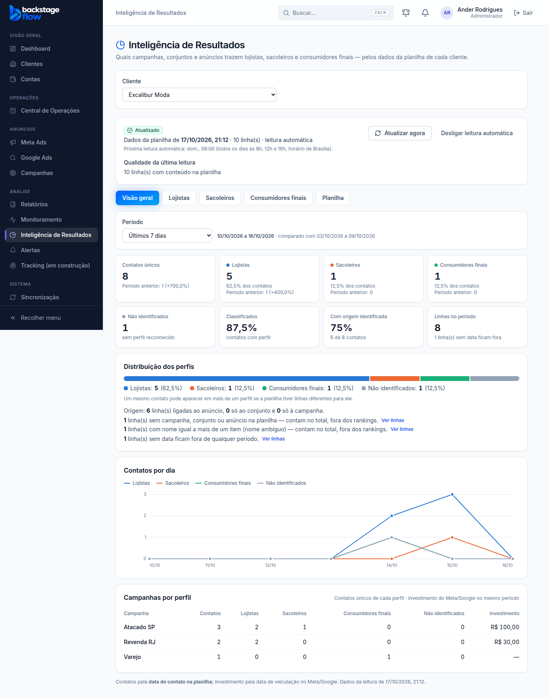
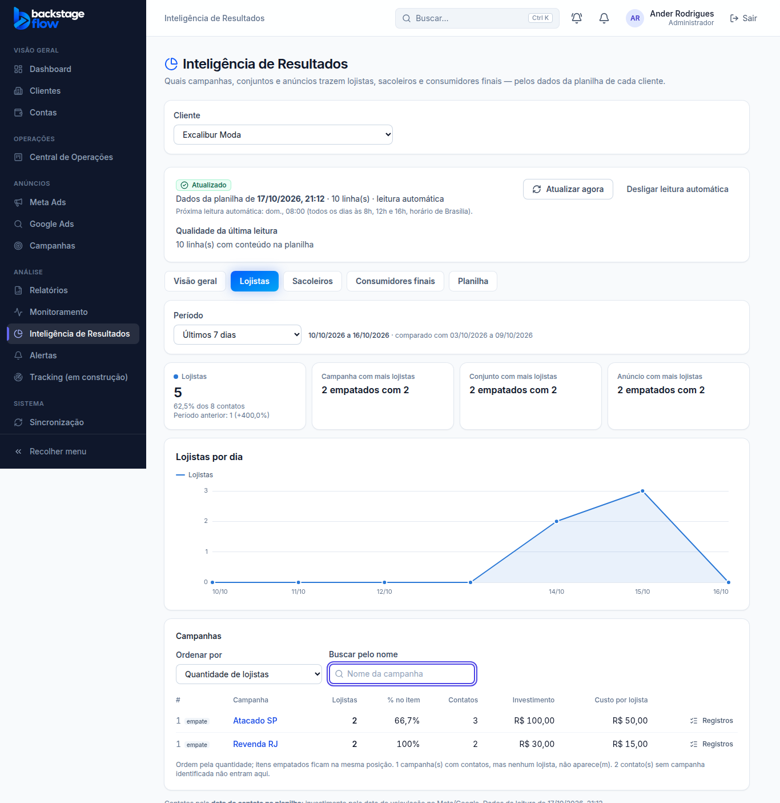
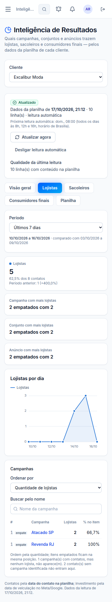

# Etapa 39.4 — A tela dos resultados (cards, perfis por dia, rankings, registros)

> **Status:** pronta (17/10/2026).
> **Ainda não testada com uma planilha real** (falta a chave do Google). Testada no navegador com dados simulados.

## O que ficou pronto
1. **Abas na página Inteligência de Resultados:** Visão geral · Lojistas · Sacoleiros · Consumidores finais · Planilha (a configuração que já existia).
2. **Período:** os mesmos do Dashboard (hoje, ontem, 7, 14 e 30 dias, mês atual, mês anterior, personalizado), com o **período anterior** para comparar.
3. **Visão geral:**
   - cards: contatos únicos, lojistas, sacoleiros, consumidores finais (com % e período anterior), não identificados, % classificados, % com origem identificada, linhas no período;
   - barra de distribuição dos perfis (quantidade e % escritas, não só cor);
   - **contatos por dia**, uma linha por perfil;
   - campanhas com os contatos de cada perfil e o investimento do período;
   - origem: quantas linhas ligadas ao anúncio, ao conjunto ou só à campanha (e quantas pelo nome); quantas sem origem, ambíguas, não encontradas ou sem data, cada uma com **"Ver linhas"**.
4. **Abas por perfil (Lojistas, Sacoleiros, Consumidores finais):**
   - total do perfil e comparação com o período anterior;
   - **campanha, conjunto e anúncio com mais** do perfil (empate é avisado: "2 empatados com 2");
   - gráfico do perfil por dia;
   - **ranking**: clique na campanha → conjuntos dela → anúncios. Caminho no topo para voltar;
   - ordenar por **quantidade**, **% do perfil no item** ou **custo por contato** (menor primeiro);
   - busca pelo nome; empates na mesma posição;
   - investimento e custo por contato na moeda da conta (sem investimento → "—");
   - **"Registros"** em cada linha do ranking.
5. **Registros:** as linhas da planilha que formam o número: nº da linha, data, perfil (e o valor escrito na planilha), onde foi ligada e como (ID ou nome). **Sem telefone, e-mail ou nome**; o nº da linha serve para achar o contato na planilha. 50 por página.
6. **Tudo fica no endereço da página** (cliente, aba, período, campanha/conjunto abertos, ordem, busca): dá para salvar ou mandar o link.
7. **Atalho na ficha do cliente:** botão "Inteligência de Resultados", que abre já no cliente.
8. **Depois de salvar ou cancelar a configuração**, a página abre na aba Planilha, com o resumo.

## Regras
- Contatos pela **data do contato na planilha**; investimento pela data de veiculação no Meta/Google (a tela avisa).
- Só aparecem no ranking itens com pelo menos um contato do perfil; a tela diz quantos ficaram de fora e quantos contatos não têm item identificado naquele nível.
- Nenhum número estimado: sem dado → "—".

## Quem pode
Administrador, gestor, operador e visualizador (clientes liberados). Cliente e Equipe da Central não veem o módulo. Configurar a planilha continua só com administrador e gestor.

## Banco
**Migração:** `supabase/migrations/20261017210259_ri_daily.sql` — função `ri_daily` (contatos únicos por dia e por perfil, com os mesmos recortes do ranking). **Nenhuma tabela nova.**

## Testes
- **SQL:** `supabase/tests/etapa39_4_contatos_por_dia.sql` — 4 verificações OK (dias, recorte por campanha, período inválido, cliente não vê).
- **Navegador:** `apps/web/e2e/results-dashboard.mjs` — 34 verificações (atalho, cards, comparação, distribuição, origem, gráfico, investimento só do período, registros sem dados pessoais, aba no endereço, empate, custo, busca, abrir campanha → conjunto → anúncio, voltar, período, aba Planilha, celular, visualizador, cliente).
- Os testes de navegador das fases 39.1 e 39.2 foram ajustados (resumo da configuração agora na aba Planilha) e passam.
- **Não testado:** planilha real e velocidade com milhares de linhas reais.

## Próxima fase
- **39.5:** aba Qualidade dos dados, exportação CSV/Excel por perfil e testes finais da etapa.
