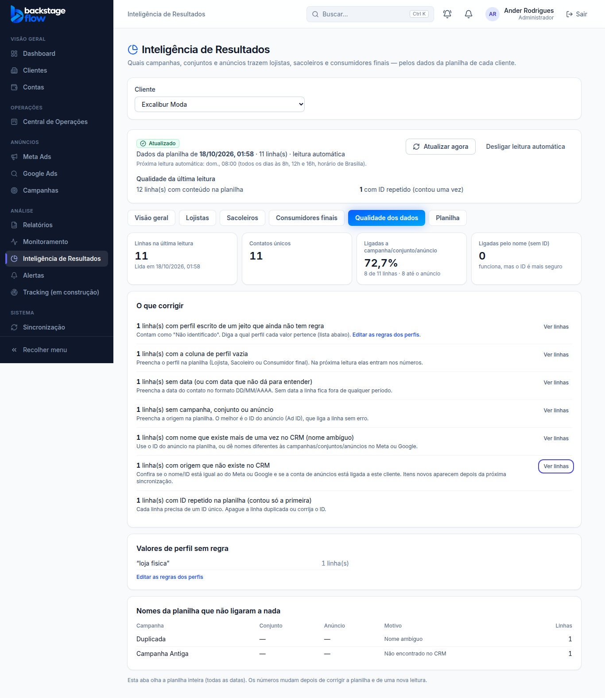

# Etapa 39.5 — Qualidade dos dados, exportação e fechamento da Etapa 39

> **Status:** pronta (18/10/2026). Com ela, a Etapa 39 fica completa **no código**.
> **Regra de conclusão do plano ainda pendente:** o módulo só é dado como pronto de verdade depois de uma leitura **real** de uma planilha sua (falta a chave do Google — ver `docs/PENDENCIAS.md`).

## O que ficou pronto
1. **Aba "Qualidade dos dados"** (olha a planilha inteira, todas as datas):
   - cards: linhas da última leitura, contatos únicos, % ligadas a campanha/conjunto/anúncio, ligadas pelo nome;
   - **"O que corrigir"**: cada problema com a quantidade de linhas, **o que fazer** e "Ver linhas":
     perfil sem regra · perfil vazio · sem data · sem origem · nome ambíguo · origem não encontrada no CRM · ID repetido · ID inválido · sem telefone/e-mail;
   - **valores de perfil sem regra** (ex.: "loja fisica"), com atalho **"Editar as regras dos perfis"** (administrador e gestor);
   - **nomes da planilha que não ligaram a nada**, com o motivo (não encontrado ou ambíguo);
   - aviso se alguma coluna configurada sumiu da planilha.
2. **Exportar CSV e Excel** em cada aba de resultados:
   - Visão geral → **todos os perfis** (uma coluna por perfil);
   - Lojistas / Sacoleiros / Consumidores finais → **o ranking daquele perfil** (posição, empate, contatos do perfil, %, contatos, investimento, moeda, custo por contato, linhas ligadas pelo nome);
   - abas do Excel: **Resumo, Campanhas, Conjuntos, Anúncios**; cabeçalho com cliente, período, perfil e a hora da leitura;
   - **sem dados pessoais** (nenhum telefone, e-mail ou nome); moedas nunca somadas (item com duas moedas fica sem total e a coluna Moeda diz quais).
3. **Registros de todas as datas** na aba Qualidade ("Ver linhas" não depende do período).

## Quem pode
Ver a qualidade e exportar: administrador, gestor, operador e visualizador (clientes liberados). Editar as regras dos perfis: administrador e gestor. Cliente e Equipe da Central: não.

## Banco
**Nenhuma tabela nova.**
- `20261018015305_ri_quality.sql`: função `ri_quality` (qualidade da última leitura inteira, sem dados pessoais).
- `20261018015615_ri_records_all_dates.sql`: `ri_records` aceita "sem período" (de e até vazios = todas as datas); só um dos dois preenchido continua recusado.

## Testes
- **SQL:** `supabase/tests/etapa39_5_qualidade.sql` — 9 verificações OK.
- **Unitários:** `apps/web/src/features/results/export.test.ts` (ranking com empate, custo, duas moedas, todos os perfis, nome do arquivo).
- **Navegador:** `apps/web/e2e/results-quality.mjs` — 27 verificações (CSV e Excel baixados e conferidos, sem dados pessoais, aba Qualidade, cada problema e o que fazer, valores sem regra, nomes que não ligaram, ver linhas, editar regras, celular, visualizador).
- **Conjunto completo de testes de navegador** no fim da fase (ver relatório).

## Resumo da Etapa 39 (Inteligência de Resultados)
| Fase | O que entregou |
|---|---|
| 39.1 | Conta de serviço do Google no cofre, planilha por cliente, assistente de colunas e perfis |
| 39.2 | Leitura 8h/12h/16h + "Atualizar agora", última leitura guardada (contato só em hash), falhas |
| 39.3 | Perfil pelas regras, ligação por ID ou nome único, contatos únicos, rankings no banco |
| 39.4 | Tela: cards, perfis por dia, ranking campanha → conjunto → anúncio, registros, atalho no cliente |
| 39.5 | Qualidade dos dados, exportação CSV/Excel, testes finais |

**Falta para usar de verdade (com o Ander):** criar a conta de serviço no Google, colar a chave em Integrações, compartilhar a planilha como Leitor, conectar a planilha do cliente e clicar em "Atualizar agora". A primeira leitura real é o teste final da etapa.
