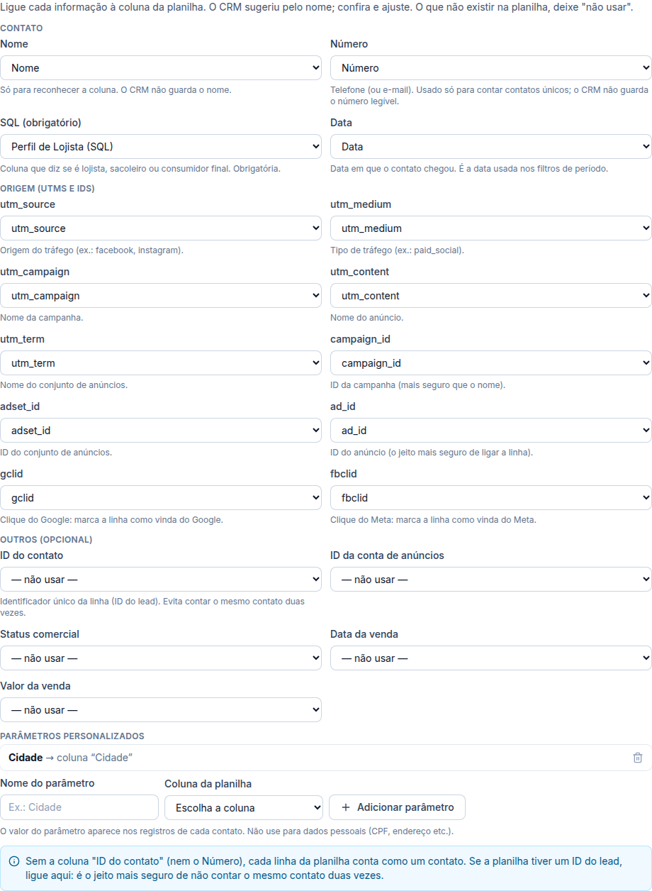

# Parâmetros da planilha refeitos (19/10/2026)

> Pedido do Ander: refazer os parâmetros que o CRM puxa da planilha (lista do documento enviado),
> com a opção de criar parâmetros personalizados. **O resto do funcionamento não mudou.**

## O que mudou na configuração da planilha
Em **Inteligência de Resultados → Planilha → Editar configuração**, passo "Colunas":

| Grupo | Parâmetros (você escolhe a coluna de cada um) |
|---|---|
| Contato | **Nome**, **Número**, **SQL** (obrigatório: lojista, sacoleiro ou consumidor final), **Data** |
| Origem (UTMs e IDs) | **utm_source**, **utm_medium**, **utm_campaign** (nome da campanha), **utm_content** (nome do anúncio), **utm_term** (nome do conjunto), **campaign_id**, **adset_id**, **ad_id**, **gclid**, **fbclid** |
| Outros (opcional) | ID do contato, ID da conta de anúncios, status, data e valor da venda |
| Parâmetros personalizados | botão **"+ Adicionar parâmetro"**: você dá um nome (ex.: Cidade) e escolhe a coluna. Até 20 por planilha. |

- O CRM reconhece sozinho as colunas com esses nomes (ex.: "Perfil de Lojista (SQL)", "utm_source", "fbclid"); você confere e ajusta.
- O antigo "Perfil comercial" agora se chama **SQL**.
- A configuração que já existia continua valendo; é só reabrir quando quiser escolher as colunas novas.

## Onde os parâmetros novos aparecem
- **Registros** (botão "Registros" do ranking e "Ver linhas" da Qualidade): nova coluna **Parâmetros** com utm_source, utm_medium, "Clique do Google/Meta" e os personalizados.
- **Resumo da planilha** (aba Planilha): mostra os personalizados.

## Dados pessoais (não mudou)
- O **Nome** só serve para reconhecer a coluna: **não é lido nem guardado**.
- O **Número** continua virando só a impressão digital (hash) para contar contatos únicos.
- **gclid/fbclid:** o CRM guarda só a marcação "veio do Google/Meta", não o código do clique.
- Parâmetros personalizados são guardados com a leitura (a tela avisa para não usar com CPF, endereço etc.).

## Banco e servidor
- Migração `20261019201248_ri_params.sql`: campos novos aceitos, parâmetros personalizados (`x:<nome>`, até 20), mensagem do SQL, função `ri_records_extra` (parâmetros dos registros). **Nenhuma tabela nova.**
- Edge Function `sheets` publicada (versão 3) com a leitura dos parâmetros novos. Conferido: sem login continua recusando (401).

## Testes
- **SQL:** `supabase/tests/parametros_planilha.sql` — 7 verificações OK.
- **Unitários:** reconhecimento dos parâmetros, personalizados, leitura sem nome (shared).
- **Navegador:** `apps/web/e2e/results-params.mjs` — 26 verificações (14 parâmetros reconhecidos, grupos, personalizado, salvar, leitura sem nome/número/código de clique, registros com os parâmetros). Teste da 39.1 ajustado aos nomes novos.
- **Não testado:** planilha real (falta a chave do Google).
