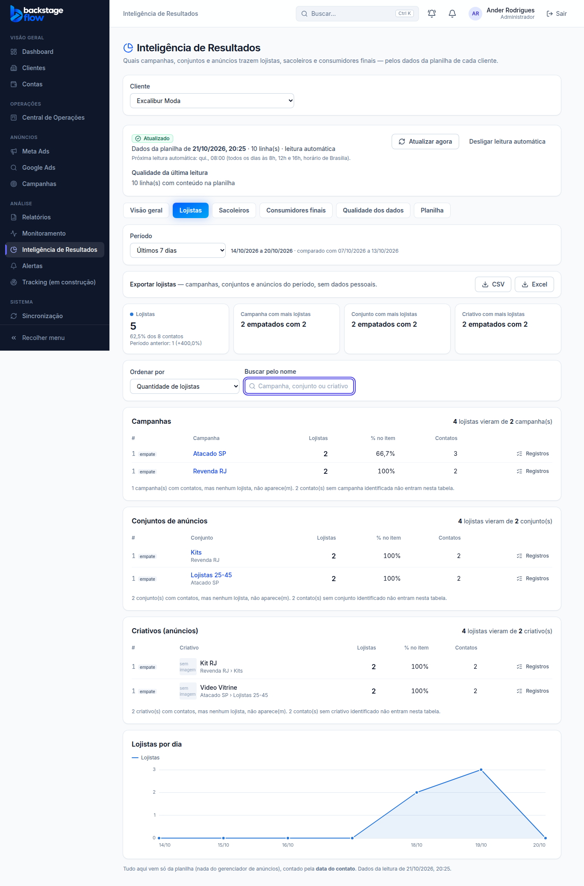

# Apresentação por perfil: campanhas, conjuntos e criativos de uma vez (21/10/2026)

> Pedido do Ander: ao clicar em Lojistas (ou outro perfil), ver **de cara** de quais campanhas, conjuntos e
> **criativos** vieram os contatos daquele perfil, com as quantidades — sem ter que clicar campanha → conjunto → anúncio.
> **Ponto de volta criado antes** (ver `docs/PONTO-DE-RESTAURACAO.md`, 21/10/2026).

## O que mudou na aba de cada perfil
1. **Três tabelas na mesma tela, sem precisar abrir nada:**
   - **Campanhas** que trouxeram o perfil;
   - **Conjuntos de anúncios** (com a campanha embaixo do nome);
   - **Criativos (anúncios)**, com a miniatura quando o Meta informa e "campanha › conjunto" embaixo do nome.
2. **Resumo em cada tabela:** "4 lojistas vieram de 2 criativo(s)".
3. **Colunas:** quantidade do perfil, % do perfil no item, contatos e o botão **Registros** (as linhas da planilha daquele item). Tudo contado na planilha (ver a correção abaixo).
4. **Clicar numa campanha** mostra só os conjuntos e criativos dela; **clicar num conjunto** mostra só os criativos dele. As campanhas continuam na tela, e um aviso "Mostrando só: Campanha …" com ✕ volta a mostrar tudo.
5. **Ordenar** (quantidade ou %) e **buscar pelo nome** valem para as três tabelas (a busca acha campanha, conjunto ou criativo).
6. Cada tabela mostra as 10 primeiras e tem "Ver todos".
7. A Visão geral e a exportação CSV/Excel mostram só os números da planilha.

## Regras
- **Só números da planilha** (data do contato). Nada do gerenciador de anúncios: sem leads, mensagens, investimento ou custo. A tela avisa isso embaixo.
- Do Meta/Google ficam só os **nomes** das campanhas, conjuntos e criativos (e a miniatura), para dar nome às linhas da planilha.

## Correção do mesmo dia: só a planilha (21/10/2026)
> Ander: "Nesse ponto da inteligência de dados, eu não quero que sejam puxados dados da BM. Eu quero os dados somente da
> planilha. Por exemplo, tem 50 nomes, 20 são sacoleiros, 20 são lojistas e 10 são consumidores finais. Eu quero essa
> divisão somente na quantidade. [...] Eu não quero nada do gerenciador. [...] a apresentação tá boa."

- Saíram da tela (abas de perfil e Visão geral) as colunas **Leads (Meta)**, **Mensagens (Meta)**, **Investimento** e **Custo por perfil**.
- Saiu a opção "Ordenar por custo" (um endereço antigo com `ordem=cost` volta para "quantidade").
- Saíram da exportação CSV/Excel as colunas Leads, Mensagens, Investimento, Moeda e Custo; o cabeçalho diz "Só números da planilha".
- A apresentação (três tabelas, resumo, filtros, busca, registros, gráfico) ficou igual.
- O banco não mudou: a função ainda calcula esses números, mas a tela e a exportação não os usam mais.

## Banco
- Migração `20261021192656_ri_meta_counts.sql`: a função de resultados passa a trazer leads e mensagens de cada item (hoje **não usados** pela tela, ver a correção acima). **Nenhuma tabela nova.**
- Ponto de volta do banco: `supabase/rollback/voltar_ri_apresentacao_2026_10_21.sql`.

## Testes
- SQL: `supabase/tests/ri_apresentacao_perfil.sql` (leads/mensagens por criativo; sem dado = vazio) — OK no banco real (desfeito).
- Navegador: `e2e/results-dashboard.mjs` — 42 verificações (três tabelas na mesma tela, resumo, criativo com campanha › conjunto, sem colunas do gerenciador, filtro por campanha e conjunto, busca nas três tabelas, registros do criativo, tirar o filtro). Demais testes do módulo ajustados e passando.
