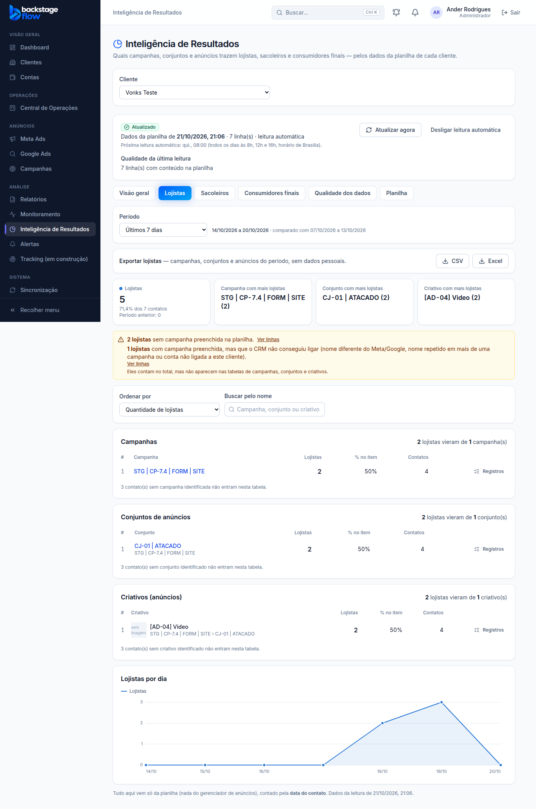

# Correção da conta: IDs da planilha e aviso "sem campanha" (21/10/2026)

> Ander: "Eu mando a planilha [...] e ele atribui a campanha, atribui ao conjunto de anúncios e atribui ao anúncio.
> Eu não estou entendendo por que não está puxando certo. [...] E se tiver algum perfil que não tenha nome de campanha,
> estiver em branco, deixa uma notificação [...] cinco lojistas ou cinco sacoleiros não estão atribuídos [a uma] campanha preenchida na planilha."
> **Ponto de volta criado antes** (ver `docs/PONTO-DE-RESTAURACAO.md`).

## O que estava errado (conferido nos dados reais)
1. **Vonks:** as colunas `utm_campaign`, `utm_term` e `utm_content` da planilha trazem o **ID** do Meta
   (ex.: 120249035297520625), mas estavam ligadas aos campos de **nome**. O CRM procurava uma campanha com
   esse "nome" e não achava. Resultado: só 36 de 4.952 linhas eram ligadas a uma campanha.
2. **Armored:** a coluna "ID:" se repete em quase todas as linhas (não é um ID único do contato). O leitor
   tratava as linhas como cópias e guardava só 2 de 949.
3. Linhas com campanha escrita na planilha que não existe no CRM apareciam como "nome ambíguo"
   (quando o nome do anúncio se repetia), o que confundia.

## O que mudou
- Um valor **só de números** (6 dígitos ou mais) numa coluna de nome agora vale como **ID** (campanha, conjunto ou anúncio).
- ID repetido só é cópia quando o **contato também é o mesmo**. ID igual com telefones diferentes conta normalmente.
- Campanha escrita na planilha que não existe no CRM agora aparece como **"origem não encontrada"**.
- **Aviso novo** (amarelo) na Visão geral e em cada aba de perfil:
  - "**N lojistas sem campanha preenchida na planilha**";
  - "**N lojistas com campanha preenchida, mas que o CRM não conseguiu ligar**" (nome diferente do Meta/Google, nome repetido ou conta não ligada ao cliente);
  - cada linha com o botão **Ver linhas** (mostra o número da linha na planilha, sem dados pessoais).

## Números reais depois da correção (21/10/2026)
| Cliente | Antes | Depois |
|---|---|---|
| Vonks (todas as datas) | 36 linhas ligadas | 1.328 ligadas (1.292 até o anúncio, pelo ID) |
| Vonks (últimos 30 dias) | quase nenhuma | 66 de 70 lojistas, 79 de 80 sacoleiros, 535 de 539 consumidores ligados |
| Armored | 2 linhas guardadas | 857 guardadas (94 cópias reais: mesmo ID e mesmo telefone); 397 ligadas à campanha |

**Ainda fora das tabelas (aparecem no aviso):**
- Vonks: 2.952 linhas antigas (2025) sem nenhuma UTM e 556 linhas `link_in_bio` (link da bio do Instagram, sem campanha).
- Armored: 441 linhas com nome de campanha que não existe no Meta como está escrito
  (ex.: a planilha diz "CP-36 … [LP]", mas no Meta o CP-36 é "[FORM]" e o CP-37 é "[LP]").
  Isso precisa ser acertado na planilha/UTM; o CRM não adivinha.

## Regras (sem mudança)
- A contagem continua sendo de **contatos únicos** (mesmo telefone conta uma vez) e só com dados da planilha.
- Nenhuma tabela nova. Nada é apagado.

## Banco e servidor
- Migrações `20261021205854_ri_ids_na_coluna_de_nome.sql` e `20261021210425_ri_campanha_nao_achada.sql`
  (funções `ri_rows`, `ri_results_impl` com `gaps`, `ri_records_impl` com os filtros `sem_campanha` e `campanha_nao_ligada`).
- As funções antigas ficam guardadas com o sufixo `_antes_2026_10_21`, sem acesso pelo site.
- Edge Function `sheets` versão 4 (regra do ID repetido). Leitura feita de novo às 18h02 (horário de Brasília) do dia 21/10.

## Testes
- SQL: `supabase/tests/ri_conta_ids_e_aviso.sql` — 4 verificações OK no banco real (só leitura).
- Unitário: `read.test.ts` (ID repetido com contatos diferentes não apaga linhas).
- Navegador: `e2e/results-gaps.mjs` (ID nas colunas de nome liga campanha/conjunto/criativo; aviso com contagem certa; "Ver linhas").

## Direção da lista (pedido do Ander, 21/10/2026)
> "Implemente o filtro nos resultados, por exemplo: da maior quantidade para a menor e vice-versa."

- Nas abas Lojistas, Sacoleiros e Consumidores finais, ao lado de "Ordenar por", há o campo **Direção**:
  **Da maior para a menor** (padrão) ou **Da menor para a maior**.
- Vale para as três tabelas (campanhas, conjuntos e criativos) e para quantidade ou %.
- A posição (#) não muda: o 1º continua sendo quem mais trouxe, mesmo com a lista virada.
- Fica no endereço da página (`direcao=menor`), então continua ao recarregar ou compartilhar o link.
- Testes: `ranking.test.ts` (lista virada, posição mantida) e `e2e/results-gaps.mjs` (troca de direção, endereço, recarregar).
