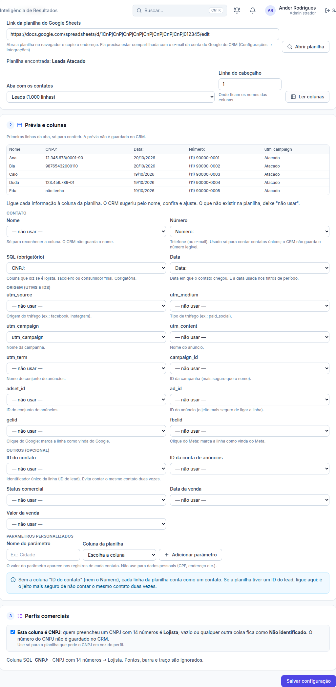

# Modo CNPJ: planilha que só pede o CNPJ (22/10/2026)

> Ander: "Eu tenho um cliente que na planilha dele [...] não faz a captação se é lojista, sacoleiro, cliente final.
> Só pede o CNPJ. Então, automaticamente, quando tem o CNPJ, significa que é um lojista."
> Respostas dele: CNPJ vazio = Não identificado; só vale CNPJ com 14 números; é um caso específico, só nessas condições.

## Como funciona
- No passo 3 da configuração da planilha há a opção **"Esta coluna é CNPJ"**.
  - Vem marcada sozinha quando o nome da coluna escolhida no SQL tem "CNPJ" (dá para desmarcar).
  - Com ela marcada, a tela não pede regras por valor.
- Na leitura:
  - **14 números** (pontos, barra, traço e espaços são ignorados) → **Lojista**;
  - **vazio** ou **qualquer outra coisa** ("000", "não tenho", CPF de 11 números) → **Não identificado**.
- **O número do CNPJ não é guardado.** A leitura grava só a marca `__cnpj__` (CNPJ válido) ou vazio.
- Só vale para a planilha que tiver a opção marcada. As outras continuam com as regras por valor.

## Onde fica guardado
- Nenhuma tabela nova e nenhuma migração. A opção é a regra `{"__cnpj__": "lojista"}` em `ri_sources.profile_rules`.
  A função que já classifica os perfis (`private.ri_rows`) usa essa regra sem mudança.

## Servidor
- Edge Function `sheets` publicada (versão 11): lê `profile_rules` junto com a configuração e liga o modo CNPJ.
  Depois da publicação, as 4 planilhas reais (Armored, Estilo de Ser, Florenc e Vonks) foram lidas sem erro.
- Observação: entre a versão 4 (publicada por esta sessão em 21/10) e a 11 houve publicações que não vieram desta
  sessão; a 11 foi feita a partir do código do GitHub.

## Testes
- Unitário (`read.test.ts`): 14 números com e sem pontuação = CNPJ; vazio, CPF, "000" e texto = sem perfil; o número não aparece na leitura; sem a opção, nada muda.
- Navegador (`e2e/results-cnpj.mjs`): opção marcada sozinha pela coluna "CNPJ:", regra salva, resumo, 2 lojistas e 3 não identificados, CNPJ não guardado, desmarcar volta às regras por valor.
