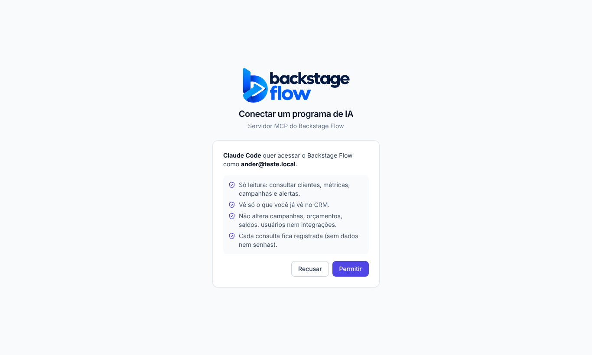

# Etapa 40 — Servidor MCP do Backstage Flow (só leitura)

**Data:** 26/10/2026. **Pedido do Ander:** permitir que um cliente de IA compatível com MCP (começando pelo Claude Code) se conecte ao Backstage Flow de forma controlada, com consultas autorizadas e sem operações perigosas.
**Decisões do Ander na auditoria:** cada pessoa conecta com o próprio login; o registro das chamadas fica 180 dias. (No pedido a etapa se chamava "38"; os números 38 e 39 já existiam, por isso virou **Etapa 40**.)

## 1. Arquitetura escolhida (e por quê)
```
Claude Code / Claude.ai ──HTTPS──▶ https://www.backstageflow.com.br/mcp   (o site, na Vercel, repassa para…)
                                   └▶ Edge Function "mcp" no Supabase (SDK oficial do MCP, HTTP "streamable", sem sessão)
                                        ├─ confere o login (Supabase Auth / OAuth 2.1) e o papel no banco, a cada chamada
                                        ├─ limite: 60 chamadas por minuto por pessoa; 20 s por consulta
                                        ├─ ferramenta de LEITURA → consulta que já existe no CRM, com o login da própria pessoa (RLS)
                                        └─ registro técnico da chamada (180 dias)
```
- **Remoto, não local.** O Ander não roda nada no computador; o mesmo endereço serve o Claude Code (terminal, web, desktop) e o Claude.ai. Um MCP local exigiria guardar senha/token no computador. Fica como possibilidade futura (mesmas consultas).
- **Sem acesso direto ao banco e sem chave administrativa para os dados.** As consultas usadas (`metrics_summary`, `dashboard_summary`, `monitor_alerts_query`, tabelas `clients`, `ad_accounts`, `campaigns`, `sync_runs`) são as do site e respeitam o RLS. A chave de serviço só confere o login, conta o limite e grava o registro.
- **Endereço no domínio do site.** O Supabase retira o cabeçalho `WWW-Authenticate` das respostas (conferido ao vivo). Pela regra do MCP, o cliente então procura o arquivo `/.well-known/oauth-protected-resource/mcp` no mesmo domínio do servidor — por isso o servidor fica em `www.backstageflow.com.br/mcp` e o site publica esse arquivo (`apps/web/public/.well-known/oauth-protected-resource/mcp`).
- **O CRM não depende do MCP.** É uma função separada; se ela cair, o site continua igual.

## 2. Ferramentas (todas só leitura, marcadas como `readOnlyHint`)
| Ferramenta | O que devolve | Quem vê |
|---|---|---|
| `backstage_status` | Sistema, versão e modo do MCP, banco no ar (tempo), última sincronização visível, horário (UTC e Brasília), quem está chamando | todos os papéis liberados |
| `backstage_capabilities` | Módulos do CRM liberados para a pessoa e as ferramentas MCP dela | todos |
| `backstage_list_clients` | Clientes liberados (nome, situação, fuso, demonstração) e contas vinculadas (nome, plataforma, moeda). Sem CNPJ/telefone/e-mail. Busca, situação, página (até 100) | quem vê o painel interno |
| `backstage_get_metrics` | Investimento, impressões, cliques, leads, mensagens, conversões e valor, CTR/CPC/CPM/custo por lead (só calculados com números reais), **uma linha por moeda**. Filtros: período (padrão 30 dias, máx. 400), clientes, plataformas, contas, campanhas (até 50 IDs) | quem vê o painel interno |
| `backstage_list_alerts` | Alertas do Monitoramento (gravidade, situação, cliente, conta, campanha, anúncio, métrica, variação, datas) | quem vê o Monitoramento |
| `backstage_get_campaign` | Uma campanha (status, objetivo, orçamento, lance, datas, cliente, conta) + números do período. "Informação não disponível pela API" quando falta | quem vê o painel interno |
| `backstage_mcp_health` | Chamadas, erros, limite atingido e tempo médio (1 a 168 h). A pessoa vê as próprias; o admin vê todas, com nomes nos erros | todos |

Recurso de leitura: **`backstage://guia`** (módulos, ferramentas da pessoa, regras e limites). Não existe recurso genérico de arquivo/tabela nem SQL.
Não existem (nesta versão): nada que exclua, altere, pause, publique, mude orçamento/saldo/permissão/integração, rode SQL ou comandos.

## 3. Quem pode
- Papéis **admin, gestor, operador, visualizador, equipe**: conectam com o próprio login e veem só o que já veem no CRM. A equipe (só Central) vê apenas status, módulos e saúde.
- **Cliente e vendedor**: bloqueados (403), e a tela de autorização não mostra "Permitir".
- Usuário desativado: bloqueado na hora (o papel e o "ativo" são lidos do banco em toda chamada).

## 4. Segurança
- Login só no cabeçalho `Authorization` (token na URL é recusado). Token conferido pelo Supabase a cada chamada.
- Validação de todos os campos (tipos, datas, UUID, limites); IDs enviados pela IA não furam o isolamento (o banco filtra).
- Erros em português, sem detalhe interno; falhas inesperadas vão para o registro de erros (já sem segredos).
- Limite de 60 chamadas/minuto por pessoa (reaproveita `rate_limit_hit`); corpo máximo 64 KB; 20 s por consulta.
- Nenhum token, senha ou parâmetro vai para o registro.

## 5. Tabela nova
**`mcp_call_log`** — registro técnico de cada chamada ao MCP.
- Campos: `created_at`, `user_id` (quem chamou), `tool` (ferramenta, ou "(limite)"), `ok`, `error_code` (ex.: INVALID_INPUT, NOT_FOUND, TIMEOUT, TOO_MANY_REQUESTS, INTERNAL), `duration_ms`, `oauth_client_id` (programa de IA autorizado).
- Sem parâmetros, dados ou tokens. Sem chave estrangeira (o registro não impede remover um usuário).
- Índices: por data; por pessoa + data.
- Acesso: a pessoa lê as próprias linhas; o admin lê todas; só o servidor grava.
- **Guardada 180 dias** (limpeza diária `mcp-log-purge`, 06:23 UTC). Decisão do Ander.

Funções novas: `mcp_log_call` (só servidor), `mcp_health` (resumo de saúde), `private.mcp_log_purge`.

## 6. Arquivos
- Banco: `supabase/migrations/20261026163410_mcp_registro.sql`, teste `supabase/tests/etapa40_mcp.sql`, volta `supabase/rollback/voltar_mcp_2026_10_26.sql`.
- Servidor: `supabase/functions/mcp/` — `index.ts` (ligação com o Supabase), `server.ts` (HTTP, login, limite, tempo, registro), `tools.ts` (ferramentas), `data.ts` (consultas existentes), `auth.ts` (login e papéis), `guide.ts` (recurso), `mcp_test.ts` (testes).
- Site: `apps/web/src/features/oauth/OAuthConsentPage.tsx` (tela `/oauth/consent`), rota em `app/router.tsx`, `vercel.json` (repasse `/mcp` e cabeçalhos do arquivo de descoberta), `public/.well-known/oauth-protected-resource/mcp`.
- Testes de navegador: `apps/web/e2e/mcp-consent.mjs`; simulador em `src/demo/mockBackend.js`.
- Dependências: `@modelcontextprotocol/sdk` **1.32.1** (oficial, só na Edge Function) e `zod` 4 (já usado). Nada novo no site.
- Variáveis: nenhuma nova obrigatória. Opcional `MCP_PUBLIC_URL` (padrão `https://www.backstageflow.com.br/mcp`). As demais já existem nas Edge Functions.

## 7. Testes feitos
- **Servidor (14 testes, com o cliente oficial do SDK):** conexão e nome/versão; 7 ferramentas só leitura e nenhuma de escrita; ferramentas por papel; status sem segredos; clientes sem dados pessoais; métricas por moeda sem indicador inventado; isolamento por ID; parâmetros inválidos; campanha não encontrada; erro interno sem vazar detalhe; tempo limite; sem login → 401 com endereço de descoberta; token na URL → 400; cliente/vendedor → 403; GET → 405; corpo grande → 413; limite → 429; registro sem dados/tokens.
- **Banco (5 blocos):** só o servidor grava; a pessoa vê só as próprias chamadas; o admin vê todas; sem login nada; isolamento de clientes/campanhas/números; limpeza de 180 dias.
- **Ao vivo, na função publicada (26/10/2026), com usuários de teste temporários** (visualizador com acesso só ao cliente Florenc, e um "cliente"), removidos no fim:
  1. sem login → 401; login inválido → 401; arquivo de descoberta → 200;
  2. `initialize` → servidor "backstage-flow" 1.0.0; `tools/list` → as 7 ferramentas, todas só leitura;
  3. status → banco funcionando, última sincronização real;
  4. clientes → só "Florenc" (1 de 30);
  5. métricas dos últimos 30 dias → R$ 4.497,78 / 534.785 impressões / 197 leads — **iguais ao banco**;
  6. métricas pedindo outro cliente (Cravina) pelo ID → vazio; campanha da Cravina → "não encontrada ou não liberada";
  7. campanha da Florenc → detalhes e números reais; alertas → 3 alertas reais da Florenc; saúde → as próprias chamadas;
  8. data inválida → recusada; usuário "cliente" → 403;
  9. 62 chamadas seguidas → 15 recusadas com 429 (limite funcionando); registro gravado sem dados.
- **Tela de autorização (9 verificações):** sem login vai ao login e volta; mostra programa e conta; Permitir devolve o código; Recusar devolve `access_denied`; já autorizado volta direto; pedido vencido/inválido só mostra aviso; cliente não vê "Permitir".
- **Não testado ainda:** o login OAuth completo com o Claude Code, porque o **OAuth Server do Supabase está desligado** (o Supabase responde "OAuth server is disabled"; só o Ander pode ligar no painel). Também não dá para clicar "Permitir" por você.



## 8. Como conectar (guia)
1. **Pré-requisitos:** usuário ativo no Backstage Flow (admin, gestor, operador, visualizador ou equipe); Claude Code instalado (ou conta no Claude.ai).
2. **Uma vez só, no Supabase (Ander):** Authentication → **OAuth Server** → ligar; *Authorization path* = `/oauth/consent`; ligar **Allow dynamic client registration**. (O Site URL já é `https://www.backstageflow.com.br`.)
3. **Registrar no Claude Code** (no terminal):
   ```bash
   claude mcp add --transport http --scope user backstage-flow https://www.backstageflow.com.br/mcp
   ```
   (`--scope user` vale para todos os projetos; sem ele, só para a pasta atual.)
4. **Conectar:** abra o Claude Code, digite `/mcp`, escolha **backstage-flow** → **Authenticate**. O navegador abre o login do Backstage Flow → entre → **Permitir**. Volte ao Claude Code.
5. **Verificar:** `claude mcp list` (deve aparecer "connected") e, no `/mcp`, as 7 ferramentas (ou 3, para o papel equipe).
6. **Consulta de teste:** peça "use o backstage_status" e depois "liste meus clientes no Backstage Flow".
7. **Claude.ai (opcional):** Configurações → Conectores → Adicionar conector personalizado → URL `https://www.backstageflow.com.br/mcp` → Conectar → login → Permitir.
8. **Erros comuns:**
   - "OAuth server is disabled" / o login não abre → passo 2 não foi feito.
   - "Login expirado ou inválido" → `/mcp` → backstage-flow → Re-authenticate.
   - "Seu tipo de usuário não pode usar o MCP" → papel cliente ou vendedor.
   - "Usuário desativado" → reative em Usuários.
   - "Muitas chamadas seguidas" → espere 1 minuto.
   - "Tempo limite excedido" → período ou filtro menor.
   - "Serviço interno indisponível" → tente de novo; o detalhe fica em Logs (admin).
9. **Desconectar:** `claude mcp remove backstage-flow`. Para cortar todos os acessos de uma vez: desligar o OAuth Server no Supabase.

## 9. Manutenção
- Nova ferramenta: só leitura nesta versão; criar em `tools.ts` usando uma consulta existente, com teste em `mcp_test.ts`, e publicar a função `mcp` (empacotar como as demais).
- Ferramentas de escrita: etapa separada (permissões próprias, confirmação humana, auditoria e volta).
- Acompanhamento: ferramenta `backstage_mcp_health` ou a tabela `mcp_call_log`; erros inesperados em Logs (`MCP_TOOL_FAILED`, `MCP_AUTH_FAILED`, `MCP_TRANSPORT_FAILED`).

## 10. Como voltar
`supabase/rollback/voltar_mcp_2026_10_26.sql` (para a limpeza e tira as permissões; nada é apagado) + desligar o OAuth Server + reverter os commits da Etapa 40. Ver `docs/PONTO-DE-RESTAURACAO.md`.
