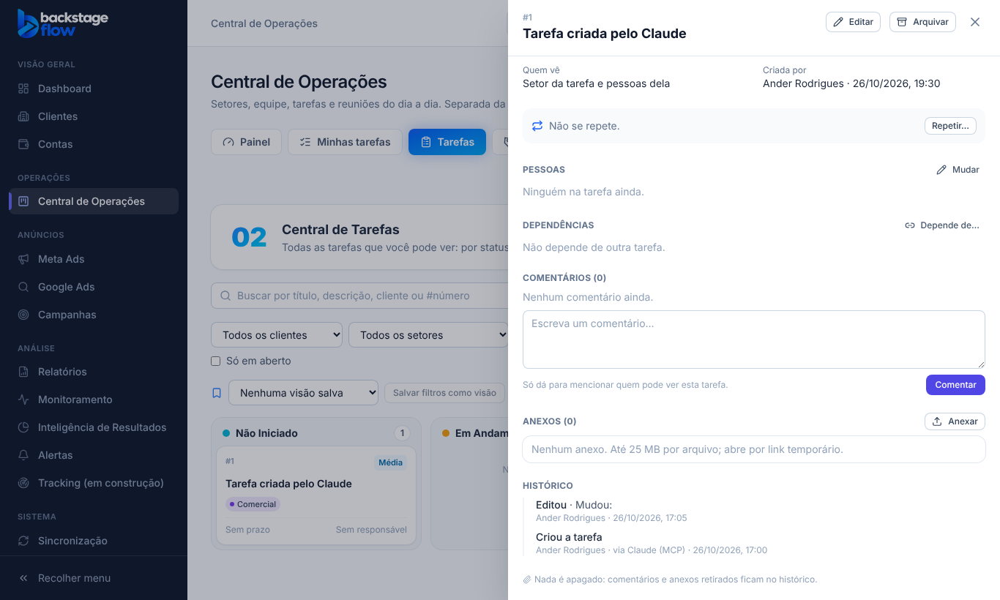

# Etapa 40.3 — MCP no Monitoramento e no onboarding dos clientes + "feito pelo MCP" no histórico

**Data:** 26/10/2026. **Pedido do Ander:** "A e B". A = o MCP mexer em mais partes do CRM; B = o histórico mostrar o que foi feito pelo Claude. Ele respondeu "pode" ao plano, com as recomendações:
- 40.3 = B + Monitoramento + Clientes (onboarding);
- 40.4 = Comercial + Reuniões;
- os contatos dos leads ficam escondidos da IA.

## 1. O que mudou
- O servidor MCP passou para a **versão 1.2.0**, com 41 ferramentas para o administrador (26 delas mudam algo).
- Agora ele também:
  - trata os alertas do Monitoramento de Desempenho;
  - cuida das regras de alerta;
  - acompanha o onboarding dos clientes na Central.
- Tudo com as mesmas ações e permissões do site.

## 2. Ferramentas novas — Monitoramento
| Ferramenta | O que faz | Quem pode |
|---|---|---|
| `backstage_get_alert` | Abre um alerta: dados, histórico e **versão** | ver Monitoramento |
| `backstage_alert_assignees` | Pessoas que podem receber o alerta | tratar alertas |
| `backstage_alert_set_status` | Visualizado, em análise, aguardando ação ou ignorado | tratar alertas |
| `backstage_alert_comment` | Comenta no alerta | tratar alertas |
| `backstage_alert_action` | Registra uma providência tomada (não mexe no anúncio) | tratar alertas |
| `backstage_alert_assign` | Define o responsável | tratar alertas |
| `backstage_alert_resolve` | Resolve o alerta, com nota | tratar alertas |
| `backstage_alert_to_task` | Cria uma tarefa na Central a partir do alerta | tratar alertas |
| `backstage_list_alert_rules` | Lista as regras | ver Monitoramento |
| `backstage_save_alert_rule` | Cria ou edita uma regra | editar regras |
| `backstage_archive_alert_rule` | Arquiva uma regra (dá para desfazer) | editar regras |
| `backstage_set_min_severity` | Gravidade mínima que gera alerta | administrador do Monitoramento |

## 3. Ferramentas novas — Clientes (onboarding na Central)
| Ferramenta | O que faz | Quem pode |
|---|---|---|
| `backstage_list_onboarding` | Quadro de clientes por etapa do onboarding | quem acessa a Central |
| `backstage_get_client_ops` | Abre o cliente na Central: etapa, responsável (AM), histórico e versão | quem acessa a Central |
| `backstage_client_start` | Coloca o cliente no onboarding | gerenciar clientes na Central |
| `backstage_client_move_stage` | Muda a etapa | quem move cartões, o AM ou o administrador |
| `backstage_client_set_am` | Define o responsável (AM) | gerenciar clientes na Central |
| `backstage_client_add_note` | Anotação no histórico do cliente | editar histórico |

`backstage_central_reference` agora lista também as etapas do onboarding.

## 4. "Feito pelo MCP" no histórico (parte B)
- **No banco:** quando o pedido vem do MCP, a origem é marcada como `mcp`. Isso vale em quatro lugares:
  - na linha do tempo das tarefas e dos clientes (`ops_activity`);
  - na dos leads (`ops_lead_events`);
  - no histórico dos alertas (`monitor_alert_events`, campo `origem`);
  - no registro de auditoria (`audit_logs`, campo `origem`).
- **Como o banco sabe:** o login do Claude é por OAuth (o token traz o programa autorizado). O servidor MCP também envia um sinal próprio.
- **O que o sinal faz e não faz:** ele só muda a etiqueta. Não dá nenhuma permissão.
- **Na tela:** a pessoa aparece como **"Ander Rodrigues · via Claude (MCP)"**. Isso vale no histórico da tarefa, do cliente, do lead, da reunião e no detalhe do alerta. O que foi feito na tela continua como antes.
- **Histórico antigo:** fica igual.

## 5. O que continua proibido
- Apagar qualquer coisa.
- Mexer no cadastro dos clientes, em campanhas, orçamentos, saldos, usuários, permissões ou integrações.
- Mexer no Meta ou no Google.
- Usar SQL livre.
- Comercial e Reuniões ficam para a 40.4.

## 6. Tabelas
**Nenhuma tabela nova.** A migração `20261026211847_mcp_origem.sql`:
- aceita o valor `mcp` na origem de `ops_activity` e `ops_lead_events`;
- cria 1 função (`private.request_from_mcp`);
- cria 4 gatilhos que marcam a origem. Eles **não apagam nem mudam** nada além da etiqueta, no momento da gravação.

O que fica guardado e por quanto tempo não muda: o histórico é permanente, e o registro do MCP é guardado por 180 dias.

## 7. Testes
- **Unitários das Edge Functions:** 160 passaram, incluindo os 21 do MCP.
- **Testes de tela e tipos:** `typecheck`, `lint`, `npm test` (244 compartilhados + site), `check:functions` e `check:secrets` passaram.
- **SQL:** `supabase/tests/etapa40_3_mcp_origem.sql` (4 OK).
- **Navegador:** `e2e/mcp-origin.mjs` (3 verificações) novo. Conjunto completo: 69 roteiros, 1.953 verificações, nenhuma falha.
- **Ao vivo, com um administrador temporário:**
  - a lista mostrou 41 ferramentas;
  - criou a tarefa #62, que ficou com origem `mcp`;
  - abriu e comentou o alerta 1413, e o comentário ficou com `origem: mcp`;
  - o quadro de onboarding, o cliente e as regras foram lidos.
  - Depois, a tarefa, o comentário, o usuário e os registros de teste foram removidos.
- **Não testado ao vivo:** resolver um alerta real, mudar a gravidade mínima e mover um cliente real de etapa. Para não alterar dados reais, esses só foram cobertos pelos testes do servidor.
- **Avisos de segurança do Supabase:** só os antigos e conhecidos.

## 8. Arquivos
- **Servidor:** `supabase/functions/mcp/crm_tools.ts` (novo), `server.ts`, `tools.ts`, `data.ts`, `guide.ts`, `ops_tools.ts`, `index.ts` e `mcp_test.ts`.
- **Banco:** `supabase/migrations/20261026211847_mcp_origem.sql` e `supabase/tests/etapa40_3_mcp_origem.sql`. O roteiro de volta (`supabase/rollback/voltar_mcp_2026_10_26.sql`) agora desliga os gatilhos.
- **Site:**
  - `apps/web/src/features/operations/origin.ts` (novo);
  - `TaskDetail.tsx`, `ClientOps.tsx`, `Leads.tsx`, `Meetings.tsx`, `monitoring/alertDetail.tsx`;
  - `e2e/mcp-origin.mjs` (novo).

## 9. Para o Ander
- **Reconecte o MCP** no Claude para ele enxergar as ferramentas novas. Em geral basta reiniciar o Claude; se não aparecerem, use `/mcp` e reconecte.
- **Pedidos de exemplo:**
  - "resolva o alerta X com a nota …";
  - "crie uma tarefa a partir do alerta Y";
  - "mova o cliente Z para a próxima etapa do onboarding".
