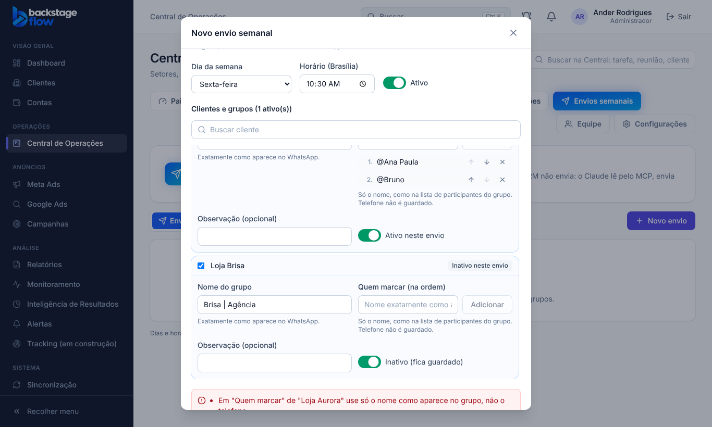
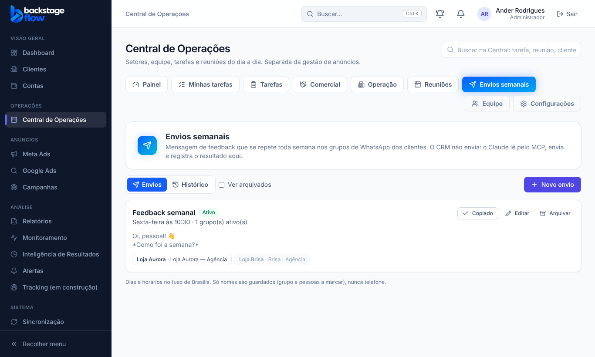
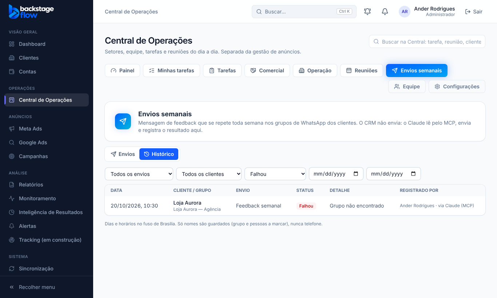

# Etapa 41.1 — Envios semanais (banco, tela e histórico)

**Data:** 27/10/2026.

**Pedido do Ander:** um módulo novo na Central para configurar uma mensagem de feedback que se repete toda semana nos grupos de WhatsApp dos clientes.
- **O CRM não envia nada:** ele só guarda a configuração e o histórico.
- **Quem envia** é um agente externo (Claude), que lê pelo MCP. As ferramentas do MCP vêm na 41.2.

**Respostas do Ander:**
- 1A: quem configura é o administrador mais quem tiver a permissão nova "Envios semanais";
- 2A: o MCP vai dizer "toca hoje" e "já enviado nesta semana".

## 1. O que mudou
- **Aba nova** na Central de Operações: **Envios semanais** (`/operacoes/envios`), no visual azul da Central. **O menu lateral não mudou.**
- **Permissão nova** da Central: **"Envios semanais: configurar mensagens para grupos e ver o histórico"** (`ops.envios`).
  - O administrador sempre tem.
  - Para outras pessoas, marque em Central → Equipe.
  - Quem não tem a permissão não vê a aba, e o banco recusa as ações.

## 2. Tela
- **Lista de envios:**
  - nome, dia e horário, "Ativo"/"Pausado"/"Arquivado" e "Hoje" quando o dia é hoje;
  - os grupos de cada envio, com "enviado nesta semana" quando já foi;
  - botões **Copiar comando**, **Editar** e **Arquivar**, e o filtro **Ver arquivados**.
- **Novo envio / Editar:**
  - **Nome e mensagem:** a mensagem tem pré-visualização no estilo do WhatsApp (quebras de linha, emojis, *negrito*, _itálico_, ~riscado~).
  - **Dia e horário:** dia da semana e horário (Brasília), mais o interruptor ativo/pausado.
  - **Clientes:** lista dos clientes, com caixa de marcar e busca. Ao marcar um cliente aparecem:
    - **Nome do grupo**;
    - **Quem marcar**: vários nomes, na ordem, com setas para mudar a ordem;
    - **Observação**;
    - o interruptor **ativo neste envio**.
- **Copiar comando:** monta o texto para colar no Claude:
  - a frase pedida ("Envie esta mensagem nos grupos abaixo e marque as pessoas indicadas em uma segunda mensagem logo depois");
  - a mensagem exata;
  - os grupos ativos, com quem marcar na ordem.
- **Histórico:** data, cliente e grupo, envio, status (Enviado, Falhou ou Pulado), detalhe e quem registrou ("via Claude (MCP)" quando foi o agente).
  - Filtros por envio, cliente, status e período.

## 3. Regras (iguais na tela e no banco)
- **Obrigatórios:** mensagem; dia e horário; pelo menos um cliente **ativo**; nome do grupo em cada cliente marcado.
- **Só nomes, nunca telefone:** em "Quem marcar", um nome com 8 dígitos ou mais é recusado. Limite de 20 pessoas por grupo.
- **Nada é apagado:**
  - envio = **arquivar** (dá para desarquivar);
  - cliente desmarcado = a linha fica guardada como "tirado" e volta se você marcar de novo.
- **Duas pessoas editando ao mesmo tempo:** a segunda recebe "Alguém alterou este envio antes de você".
- **Fuso:** dia e horário no fuso de Brasília. "Esta semana" começa na segunda-feira às 00:00.

## 4. Tabelas novas
### `ops_envios` — cada envio semanal
- **Para quê:** guardar a mensagem e quando ela deve ser enviada.
- **Campos:** `nome`, `mensagem` (até 5.000 letras, com quebras e emojis), `dia_semana` (0 = domingo … 6 = sábado), `horario`, `ativo`, `arquivado_em`, `versao`, `criado_por`, `atualizado_por`, `created_at`, `updated_at`.
- **Guardado:** para sempre. Não se apaga, só se arquiva.

### `ops_envio_clientes` — os grupos de cada envio
- **Para quê:** dizer em qual grupo de cada cliente a mensagem vai e quem marcar.
- **Campos:** `envio_id` (→ `ops_envios`), `cliente_id` (→ `clients`), `nome_grupo`, `contatos_marcar` (lista de nomes na ordem, até 20), `ativo`, `observacao`, `removido_em`.
- **Ligações e índice:** um cliente aparece uma vez por envio (único: envio + cliente); índice por cliente.
- **Guardado:** para sempre. Tirar do envio só marca `removido_em`.

### `ops_envio_execucoes` — o histórico
- **Para quê:** registrar o que aconteceu em cada grupo.
- **Campos:** `envio_id`, `cliente_id`, `executado_em`, `status` (enviado, falhou ou pulado), `detalhe` (até 1.000 letras), `registrado_por`, `origem` ("manual" ou "mcp").
- **Índices:** por envio + data, por cliente + data e por data.
- **Guardado:** **para sempre** (é histórico).

**Segurança:**
- RLS ligado nas três tabelas: só quem tem `ops.envios` lê.
- Gravar só pelas funções: `ops_envio_list`, `_get`, `_save`, `_archive`, `_execucao_add` e `_historico`. São funções finas que chamam `private.*_impl`, e estas conferem a permissão no banco.
- Salvar e arquivar ficam no registro de auditoria.

## 5. O que fica para a 41.2
- **Ferramentas do MCP:**
  - `backstage_list_envios`, com "toca hoje" e "já enviado nesta semana";
  - `backstage_get_envio`;
  - `backstage_registrar_execucao_envio`.
- **O banco já está pronto para elas:** as execuções registradas pelo MCP já ficam marcadas "mcp".
- **Na tela:** o "Copiar comando" passa a incluir o ID do envio e o pedido para registrar o resultado pelo MCP.

## 6. Testes
- **Banco:** `supabase/tests/etapa41_envios_semanais.sql` (7 verificações OK). Cobre:
  - as validações: mensagem, cliente ativo, grupo e telefone;
  - a ordem dos nomes;
  - a lista só de ativos;
  - o conflito de versão;
  - cliente tirado sem apagar;
  - a execução recusada para cliente fora do envio;
  - a origem "mcp" e o "já enviado nesta semana";
  - o arquivar;
  - a auditoria;
  - quem não tem permissão.
- **Regras compartilhadas:** `packages/shared/src/operations/envios.test.ts` (validação do formulário, comando copiado, pré-visualização).
- **Navegador:** `apps/web/e2e/ops-envios.mjs` (18 verificações). Os testes antigos que conferem a lista de abas da Central foram atualizados.
- **Avisos de segurança do Supabase:** só os antigos e conhecidos.

## 7. Arquivos
- **Banco:**
  - `supabase/migrations/20261027175421_envios_semanais.sql`;
  - `supabase/tests/etapa41_envios_semanais.sql`;
  - `supabase/rollback/voltar_envios_semanais_2026_10_27.sql`.
- **Regras compartilhadas:** `packages/shared/src/operations/envios.ts` (+ teste) e `permissions.ts` (permissão nova).
- **Site:**
  - `features/operations/EnviosPage.tsx` e `enviosApi.ts`;
  - `OpsLayout.tsx` (aba) e `app/router.tsx` (rota);
  - `components/ui/switch.tsx` (o interruptor que já existia, agora reaproveitável);
  - simulador `demo/mockOpsEnvios.js`.

## 8. Como publicar
- **Banco:** já aplicado no Supabase (a migração no ar é idêntica ao arquivo).
- **Site:** a Vercel publica sozinha quando o commit chega ao GitHub.
- **Nada para o Ander fazer**, a não ser marcar a permissão "Envios semanais" para quem mais deve usar o módulo (Central → Equipe).
