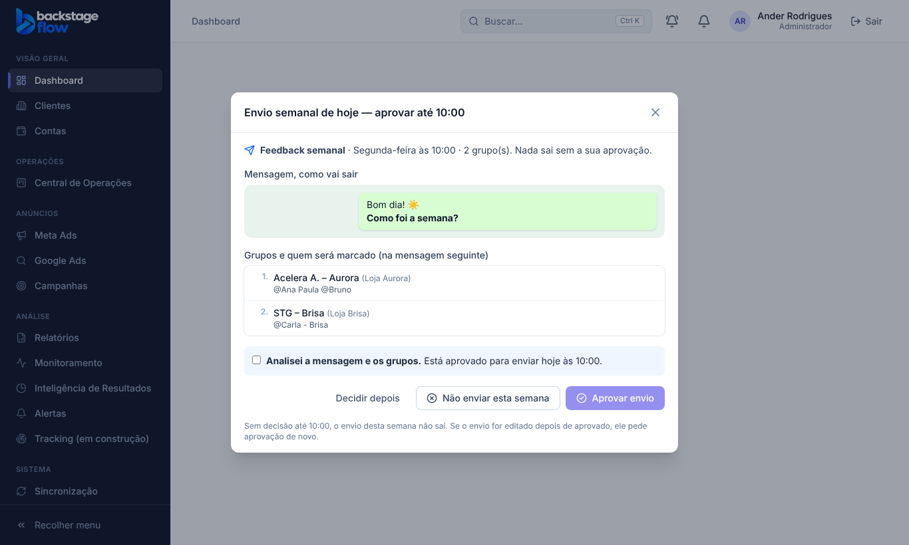

# Etapa 41.2 — Aprovação semanal, ferramentas do MCP e tarefa agendada

**Data:** 27/10/2026.

**Pedido do Ander:** deixar o envio agendado, mas, antes de enviar, abrir um pop-up perguntando se ele analisou tudo e se aprova. Só depois da aprovação o envio acontece. Ele também perguntou como o envio vai ser feito sem gastar tokens à toa.

**Respostas:** "pode fazer", com as recomendações:
- 1a: sem aprovação até o horário, o envio da semana não sai;
- 2a: o pop-up aparece no próprio dia, a partir das 7h.

## 1. Como funciona, do começo ao fim
1. Você configura o envio na aba **Envios semanais**: mensagem, dia, horário e grupos.
2. **No dia, das 7h até o horário** (Brasília), o CRM abre um pop-up em qualquer tela:
   - mostra a mensagem como vai sair, os grupos e quem será marcado em cada um;
   - você marca **"Analisei a mensagem e os grupos"** e clica em **Aprovar envio**, ou em **Não enviar esta semana**;
   - **Decidir depois** esconde o pop-up por 30 minutos.
3. **No horário**, a tarefa agendada do Claude no seu computador pergunta ao CRM o que está liberado (`backstage_list_envios` com `liberados_agora`).
   - **Se nada foi aprovado:** ela para na hora, sem abrir o navegador.
   - **Se foi aprovado:** ela envia em cada grupo pelo WhatsApp Web (a mensagem e, logo depois, a mensagem com as marcações) e registra o resultado de cada grupo.
4. **O resultado** aparece na aba **Histórico**, com a decisão de cada semana em "Aprovações semanais".

## 2. Regras da aprovação
- **Nada sai sem aprovação:** o MCP só entrega ao Claude o envio aprovado **nesta semana**, **na versão aprovada**, e **depois do horário**.
- **Editou depois de aprovar?** O envio pede aprovação de novo.
- **Ninguém decidiu até o horário:** o envio da semana não sai, e o sistema registra **"Sem resposta (não saiu)"**. A conferência roda a cada 15 minutos.
- **Depois do horário** não dá mais para decidir.
- **Aprovar é só na tela do CRM:** o MCP não tem ferramenta para aprovar.
- **Dupla trava no banco:** "enviado" registrado pelo MCP é recusado se o envio não foi aprovado.
- **Grupo que já recebeu nesta semana** é pulado. Assim, rodar de novo não envia duas vezes.

## 3. Ferramentas novas do MCP (servidor 1.4.0)
| Ferramenta | O que faz |
|---|---|
| `backstage_list_envios` | Envios ativos com mensagem, dia, horário, situação de hoje e, por grupo, o nome exato e quem marcar na ordem. Com `liberados_agora = true`, devolve só o que está aprovado e no horário, e só os grupos que ainda não receberam (econômico) |
| `backstage_get_envio` | Um envio completo pelo ID, inclusive os grupos pausados |
| `backstage_registrar_execucao_envio` | Registra por grupo: enviado, falhou ou pulado, com um detalhe |

- **Quem vê:** só quem tem a permissão "Envios semanais".
- **`backstage_capabilities`** passou a listar o módulo "Envios semanais (grupos de WhatsApp)".

## 4. Tabela nova
### `ops_envio_aprovacoes` — a decisão de cada semana
- **Para quê:** guardar se o envio foi aprovado, recusado ou ficou sem resposta em cada semana.
- **Campos:** `envio_id` (→ `ops_envios`), `semana` (a segunda-feira, Brasília), `decisao` (aprovado, recusado ou sem_resposta), `versao_envio` (a versão aprovada), `decidido_por`, `decidido_em`, `origem` (manual ou sistema).
- **Índices:** uma decisão por envio por semana (único); índice por semana.
- **Guardada:** **para sempre**.
- **Segurança:** RLS ligado; só quem tem a permissão lê; gravar só pelas funções `ops_envio_decidir` (que confere a versão e o horário) e `private.envio_fechar_sem_resposta` (cron `envios-sem-resposta`, a cada 15 minutos).

## 5. Como deixar a tarefa agendada no seu computador
Fica tudo no **app do Claude no seu computador**:
1. **Confira o que precisa estar ligado:**
   - o **conector do Backstage Flow** (o MCP que você já usa);
   - o **Claude no Chrome**, para operar o WhatsApp Web;
   - o **WhatsApp Web** logado no Chrome.
2. **Crie uma tarefa agendada** no app do Claude:
   - **dia e horário:** os mesmos do envio, uns **5 minutos depois** (ex.: envio às 9h00 → tarefa segunda às 9h05);
   - **instrução:** clique em **"Instrução da tarefa agendada"** na aba Envios semanais e cole. A instrução é curta e sempre a mesma: não precisa explicar nada de novo a cada semana.
3. **Na hora do envio,** deixe o computador ligado, o app do Claude aberto e o WhatsApp Web conectado.

**Sobre os tokens:** sem aprovação, a tarefa faz uma consulta pequena e para. Com aprovação, gasta o necessário para operar o navegador grupo por grupo, uma vez por semana.

## 6. Testes
- **Banco:**
  - `supabase/tests/etapa41_2_envios_aprovacao.sql`: 6 verificações OK (esperando aprovação, pop-up, "enviado" recusado sem aprovação, conflito de versão, edição invalida a aprovação, pode enviar no horário, decidir depois do horário recusado, recusado, sem resposta fechado pelo sistema, histórico);
  - o teste da 41.1 foi ajustado para a regra nova: 7 verificações OK.
- **Servidor (Deno):** 165 testes passaram, incluindo 2 novos (só o liberado, grupos pendentes na ordem, registrar, recusa sem aprovação, sem ferramenta de aprovar, sem permissão).
- **Regras compartilhadas:** 257 testes, incluindo a instrução da tarefa agendada.
- **Navegador:** `apps/web/e2e/ops-envios-aprovacao.mjs` (19 verificações, com o relógio do simulador numa segunda-feira) e `ops-envios.mjs` (18) passaram. O teste de desempenho aceita uma chamada a mais (a consulta do pop-up).
- **Ao vivo, função `mcp` v6, com um administrador temporário:**
  - o envio aprovado veio em "liberado agora", com o grupo e quem marcar na ordem;
  - "enviado" foi registrado;
  - no envio sem aprovação, "enviado" foi **recusado**;
  - `backstage_capabilities` mostrou o módulo;
  - depois, tudo foi apagado.
- **Não testado:** o envio real pelo WhatsApp Web, que depende do seu computador e da tarefa agendada.

## 7. Arquivos
- **Banco:**
  - `supabase/migrations/20261027194937_envios_aprovacao.sql`;
  - `supabase/tests/etapa41_2_envios_aprovacao.sql`;
  - o roteiro de volta `voltar_envios_semanais_2026_10_27.sql` foi atualizado.
- **Servidor:** `supabase/functions/mcp/envios_tools.ts` (novo), `data.ts`, `server.ts`, `tools.ts`, `guide.ts`, `mcp_test.ts`.
- **Site:**
  - `EnvioApproval.tsx` (pop-up) e `WhatsAppPreview.tsx` (novos);
  - `EnviosPage.tsx` (situação de hoje, Revisar e aprovar, Aprovações semanais, Instrução da tarefa agendada), `enviosApi.ts`, `AppLayout.tsx`;
  - simulador `mockOpsEnvios.js`.
- **Regras compartilhadas:** `packages/shared/src/operations/envios.ts` (`ENVIO_AGENT_INSTRUCTION`).
