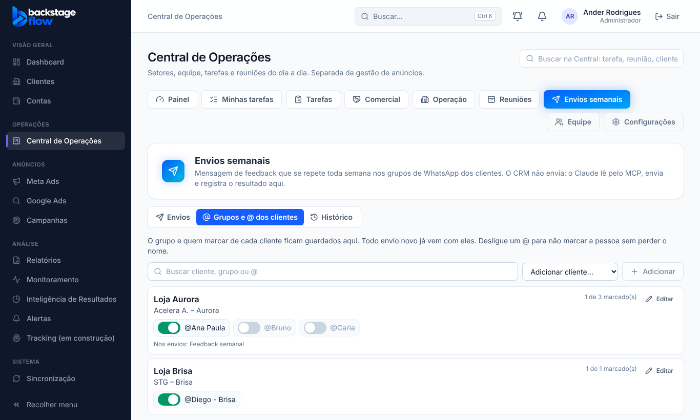

# Etapa 41.3 — Grupo e @ padrão de cada cliente, com ligar/desligar

**Data:** 27/10/2026.

**Pedido do Ander:** "quero que os @ estejam sempre nas atividades de novos envios, e que tenha um ligar que eu possa adicionar e retirar de cada cliente". Aprovado com "pode".

## 1. Como funciona
1. **Cada cliente guarda o seu padrão:** o nome do grupo e quem marcar, na ordem.
2. **Começou pronto:** os 25 grupos e os 35 @ que já estavam no envio "Feedback semanal" viraram o padrão de cada cliente.
3. **Envio novo:** ao marcar um cliente, o nome do grupo e os @ entram sozinhos.
4. **Botão de ligar e desligar em cada @:**
   - **ligado:** a pessoa é marcada;
   - **desligado:** o nome fica guardado (riscado), mas a pessoa não é marcada. Para voltar a marcar, é só ligar.
5. **Nova parte "Grupos e @ dos clientes"** na aba Envios semanais:
   - mostra todos os clientes com grupo e @;
   - o botão de cada @ salva na hora;
   - **Editar** troca o nome do grupo, a ordem e as pessoas;
   - **Adicionar cliente** cria o padrão de um cliente novo;
   - dá para buscar por cliente, grupo ou @.

## 2. Regras
- **Salvar um envio** grava o grupo e os @ de cada cliente como o padrão dele.
- **Salvar o padrão** (ou ligar e desligar um @) vale também para os envios em que o cliente está. Arquivados ficam como estavam.
- **Envio já aprovado hoje:** se o padrão muda, ele pede a aprovação de novo, porque mudou quem será marcado.
- **O Claude (MCP), o pop-up de aprovação e o "Copiar comando"** usam só os @ ligados.
- **Só nomes:** telefone é recusado, e o limite é de 20 pessoas por grupo (os desligados contam).
- **Nada é apagado:** desligar não apaga o nome, e cada mudança do padrão fica registrada no histórico do sistema (só quantidades, sem os nomes).

## 3. Tabela nova e campo novo
### `ops_envio_padroes` — grupo e @ padrão de cada cliente
- **Para quê:** preencher os envios e ser o lugar único para ligar e desligar os @.
- **Campos:**
  - `cliente_id` (→ `clients`, um por cliente);
  - `nome_grupo`;
  - `contatos_marcar` (todos os nomes, na ordem);
  - `contatos_desligados` (os nomes desligados);
  - `atualizado_por`, `created_at`, `updated_at`.
- **Índices:** a chave é o próprio cliente (um padrão por cliente).
- **Guardada:** **para sempre**, enquanto o cliente existir; cada mudança é registrada em `audit_logs` (`ops.envio.padrao`).
- **Segurança:** RLS ligado; só quem tem a permissão "Envios semanais" lê; grava só pelas funções `ops_envio_padrao_save` e `ops_envio_save`.

### Campo novo `ops_envio_clientes.contatos_desligados`
Quem está desligado em cada grupo de cada envio.

## 4. Funções
| Função | O que faz |
|---|---|
| `ops_envio_padroes()` | Lista os padrões, com os envios em que cada cliente está |
| `ops_envio_padrao_save(cliente, {nome_grupo, contatos_marcar, contatos_desligados})` | Salva o padrão e leva aos envios não arquivados (devolve quantos mudaram) |
| `ops_envio_save` (atualizada) | Aceita `contatos_desligados` e grava o padrão de cada cliente |
| `private.envio_json` (atualizada) | `contatos_marcar` traz só os ligados; `contatos` traz todos, com ligado ou desligado |

## 5. Testes
- **Banco:**
  - `supabase/tests/etapa41_3_envios_padroes.sql`: 6 verificações OK (só os ligados no envio, padrão gravado, padrão levado ao envio com versão nova, salvar igual não mexe, arquivado fica como estava, validações, registro, sem permissão);
  - os testes da 41.1 (7) e da 41.2 (6) passaram de novo.
- **Regras compartilhadas:** 3 testes novos (260 no total).
- **Navegador:** `apps/web/e2e/ops-envios-padroes.mjs` (14 verificações). Os de 41.1 e 41.2 continuam passando.
- **Dados reais conferidos:** o envio "Feedback semanal" tem 25 grupos e 35 @, todos ligados, e 25 padrões criados.
- **MCP:** não mudou de código. Ele já lê `contatos_marcar`, que agora traz só os ligados. Não foi publicado de novo, e o teste ao vivo do MCP não foi refeito nesta fase.

## 6. Arquivos
- **Banco:**
  - `supabase/migrations/20261027225456_envios_padroes.sql`;
  - `supabase/tests/etapa41_3_envios_padroes.sql`;
  - o roteiro de volta `voltar_envios_semanais_2026_10_27.sql` foi atualizado.
- **Site:** `EnviosPage.tsx` (Grupos e @ dos clientes, botão em cada @, preenchimento automático) e `enviosApi.ts`; simulador `mockOpsEnvios.js`; teste `e2e/ops-envios-padroes.mjs`.
- **Regras compartilhadas:** `packages/shared/src/operations/envios.ts` (`contatosLigados`, `cleanDesligados`).
