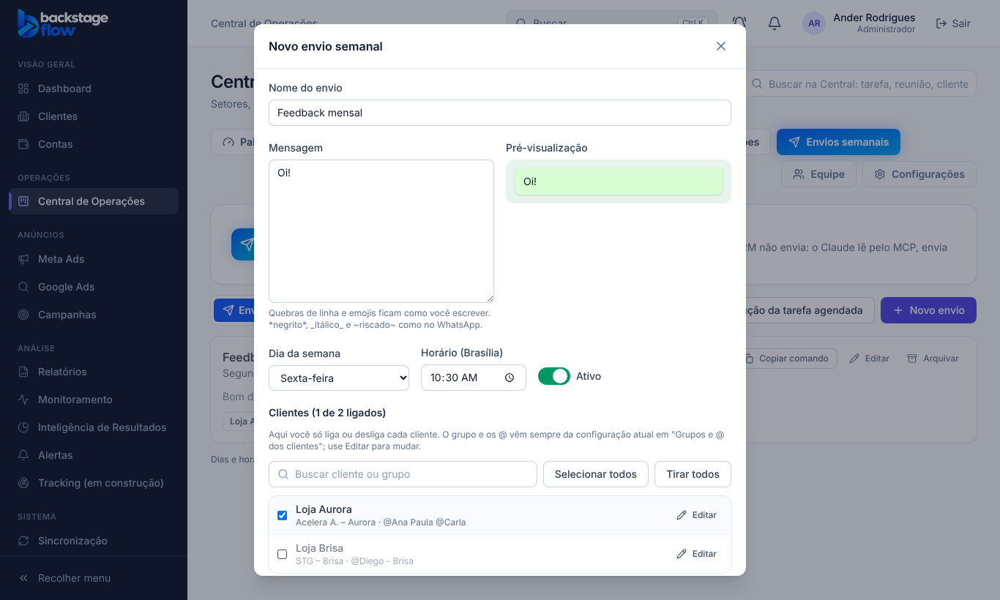

# Etapa 41.4 — No envio, só ligar e desligar clientes (sempre com a última configuração)

**Data:** 27/10/2026.

**Pedido do Ander:** cada envio criado deve puxar sempre a última configuração. Os nomes das empresas e os @ ficam separados, num lugar próprio. Ao criar um envio novo, ele puxa a lista toda, e ali só se liga e desliga cada cliente; a edição do conteúdo fica em outro lugar. Aprovado com "pode fazer".

## 1. Como ficou
1. **Conteúdo de cada empresa:** grupo e @ ficam só em **"Grupos e @ dos clientes"** (da 41.3).
2. **Envio novo:** já abre com **todas as empresas que têm grupo salvo, ligadas**.
3. **No envio, só a listinha:**
   - uma caixinha por empresa;
   - os botões **Selecionar todos** e **Tirar todos**;
   - busca;
   - o contador "N de M ligados".
4. **Cada linha mostra, só para conferir,** o nome do grupo e os @ ligados. Não há campos para editar ali.
5. **Editar**, em cada linha, abre a configuração daquela empresa: a mesma janela de "Grupos e @". O que você salva ali vale para todos os envios.
6. **Sempre a última configuração:** o envio lê o grupo e os @ atuais da empresa na hora. Envio arquivado também mostra a configuração atual quando é aberto.
7. **Empresa desligada num envio que já existe** fica guardada como desligada; não é apagada.
8. **Empresa nova em "Grupos e @"** aparece desligada nos envios que já existem e ligada nos envios novos.

## 2. Regras
- **Empresa com grupo salvo:** o envio usa sempre o grupo e os @ de "Grupos e @", e o que vier no pedido é ignorado.
- **Empresa antiga sem grupo salvo** (não há nenhuma hoje): continua usando o que está no envio, e isso vira o grupo salvo dela.
- **O campo "Observação" por empresa saiu da tela.** O que já existia fica guardado.
- **Continua valendo:**
  - pelo menos uma empresa ligada;
  - aprovação de novo quando o grupo ou os @ mudam;
  - o Claude (MCP) recebe só os @ ligados.

## 3. Banco
Não há tabela nova.
- **`private.envio_json`** passou a ler o grupo e os @ de `ops_envio_padroes` quando existem, e devolve também `tem_padrao`.
- **`ops_envio_save_impl`:**
  - para empresa com grupo salvo, grava o padrão no envio e só decide quem está ligado;
  - mantém a observação já gravada quando o pedido não a manda.

## 4. Dados reais
O envio "Feedback semanal" está com **24 empresas** (34 @ ligados), quarta-feira às 08:30, conforme você salvou pela tela às 20:06 de 27/10. A Prata e Pérola saiu do envio nessa edição, mas continua em "Grupos e @". Para voltar, é só marcá-la no envio.

## 5. Testes
- **Banco:**
  - `supabase/tests/etapa41_4_envios_config_atual.sql`: 3 verificações OK (usa o grupo salvo, empresa sem grupo salvo, sempre a última configuração mesmo arquivado, desligar guarda);
  - os testes da 41.1 (7), 41.2 (6) e 41.3 (6) passaram de novo;
  - os da 41.1 e da 41.3 agora usam empresas sem grupo salvo, porque as que têm grupo salvo ignoram o grupo e os @ enviados.
- **Navegador:**
  - `ops-envios.mjs` reescrito para o fluxo novo: grupo em "Grupos e @", depois o envio;
  - `ops-envios-padroes.mjs` testa a lista toda ligada, Selecionar e Tirar todos, Editar pela lista, a última configuração e o comando só com os @ ligados;
  - `ops-envios-aprovacao.mjs` passou.
- **MCP:** sem mudança de código.

## 6. Arquivos
- **Banco:** `supabase/migrations/20261027232244_envios_config_atual.sql` e `supabase/tests/etapa41_4_envios_config_atual.sql` (os testes 41.1 e 41.3 foram ajustados).
- **Site:** `EnviosPage.tsx` (formulário do envio), simulador `mockOpsEnvios.js` e os testes de navegador.
