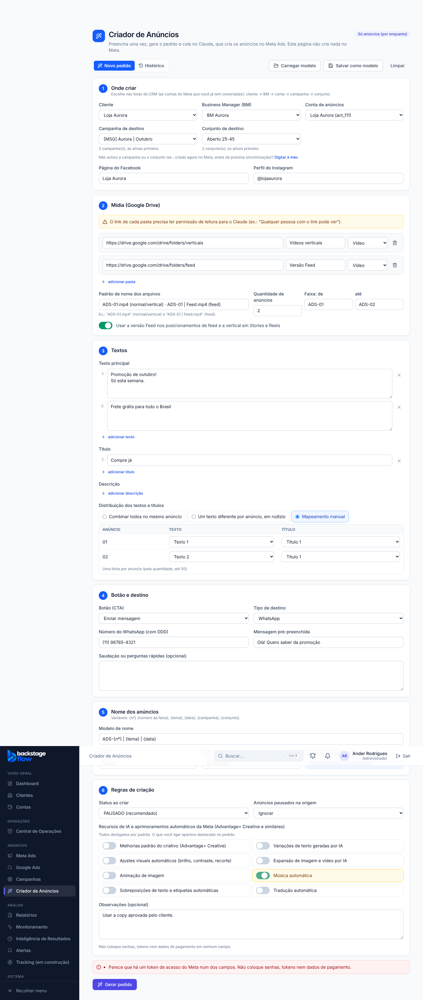
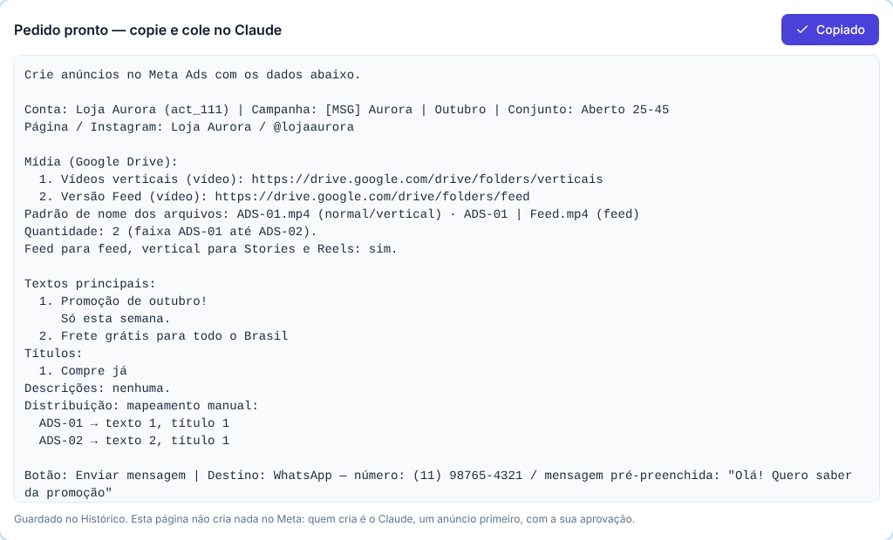
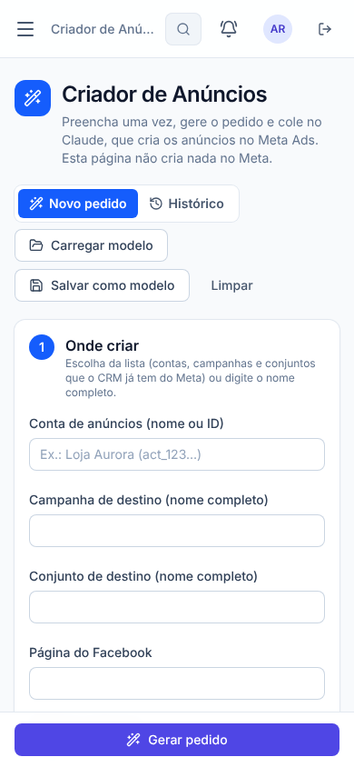
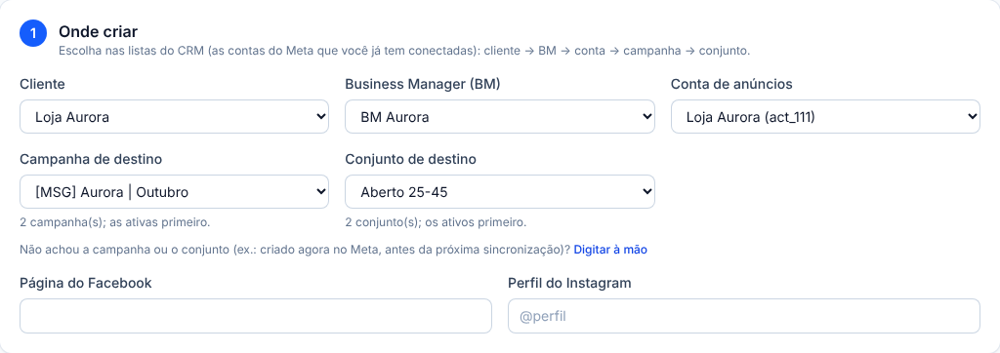

# Etapa 42 — Criador de Anúncios

**Data:** 28/10/2026.

**Pedido do Ander:** uma página que monta um PEDIDO em texto, pronto para colar no Claude, que cria os anúncios no Meta Ads. A página não cria nada no Meta. Por enquanto só anúncios, em campanhas e conjuntos que já existem; a estrutura fica pronta para campanhas e conjuntos.

**Respostas:** "A / A".
- Quem usa: administrador, gestor e operador.
- Modelos e histórico são da equipe; cada pedido mostra quem gerou.

## 1. Como usar
1. **Abra o menu Anúncios → Criador de Anúncios.**
2. **Preencha as 6 seções.**
   - Em "Onde criar", escolha a conta, a campanha e o conjunto na lista que o CRM já tem do Meta, ou digite o nome completo.
3. **Clique em Gerar pedido** e depois em **Copiar**.
4. **Cole no Claude** (com o conector do Meta). Ele cria um anúncio primeiro, mostra o resultado e espera a sua aprovação antes dos demais.
5. **Para reaproveitar:**
   - **Salvar como modelo / Carregar modelo:** os dados de um cliente ou de um tipo de campanha;
   - **Histórico → Duplicar:** o mesmo pedido em outra campanha ou conjunto (troque só o que mudou e gere de novo);
   - **Histórico → Copiar de novo:** o mesmo texto outra vez.



## 2. Seções do formulário
1. **Onde criar:** conta, campanha, conjunto, página do Facebook e perfil do Instagram.
2. **Mídia (Google Drive):**
   - pastas repetíveis, cada uma com link, rótulo e tipo (vídeo ou imagem);
   - padrão de nome dos arquivos;
   - quantidade e faixa (ex.: ADS-01 até ADS-14), com aviso se a faixa não bater com a quantidade;
   - opção "Feed nos posicionamentos de feed e vertical em Stories e Reels" (ligada por padrão);
   - aviso fixo da permissão de leitura para o Claude.
3. **Textos:** textos principais (mínimo 1), títulos e descrições.
   - Com mais de um texto ou título, escolha a distribuição: combinar, rodízio ou mapeamento manual, este com a tabela anúncio → texto/título.
4. **Botão e destino:**
   - botão (CTA) e destino WhatsApp, Formulário instantâneo ou Site;
   - os campos de cada destino aparecem conforme a escolha.
5. **Nome dos anúncios:** modelo com {nº}, {tema}, {data}, {campanha} e {conjunto}, com a prévia do primeiro nome.
6. **Regras:**
   - status ao criar PAUSADO por padrão (ATIVO aparece destacado no pedido);
   - 8 recursos de IA e aprimoramentos automáticos da Meta, todos DESLIGADOS por padrão (o que for ligado aparece destacado);
   - pausados na origem: incluir ou ignorar;
   - observações.



## 3. Regras
- **Para gerar o pedido** é preciso: conta, campanha, conjunto, pelo menos uma pasta (com link https://) e um texto.
- **Nada de senha, token, chave ou número de cartão** em nenhum campo. A tela avisa e o banco recusa.
- **Cada pedido gerado fica no Histórico** (é guardado quando você clica em Gerar).
- **O formulário fica como rascunho no seu navegador:** se fechar a página, ele volta como estava.

## 4. Quem pode
- **Podem usar:** administrador, gestor e operador.
- **Não veem a página:** visualizador, equipe, vendedor e cliente.
- **Permissão nova:** "Usar o Criador de Anúncios" (`ads.builder`), que aparece na tela de Papéis e permissões.
- **O banco confere a permissão** em todas as funções e na leitura das tabelas.

## 5. Tabelas novas
### `ads_builder_modelos` — modelos da equipe
- **Para quê:** guardar os dados do formulário com um nome, para reutilizar.
- **Campos:** `nome`, `dados` (o formulário), `criado_por`, `atualizado_por`, `arquivado_em`, datas.
- **Índices:** nome único entre os modelos não arquivados (sem diferença de maiúsculas). Salvar com um nome que já existe substitui o modelo, e a tela avisa antes.
- **Guardada:** para sempre. "Arquivar" só tira da lista; nada é apagado. Cada salvar ou arquivar fica registrado em `audit_logs`.

### `ads_builder_pedidos` — histórico dos pedidos gerados
- **Para quê:** copiar de novo e duplicar pedidos anteriores.
- **Campos:**
  - `tipo` (hoje só "anuncios"; preparado para "campanha" e "conjunto");
  - `conta`, `campanha`, `conjunto`;
  - `dados` (o formulário) e `texto` (o pedido gerado);
  - `origem_pedido_id` (de qual pedido foi duplicado);
  - `criado_por`, `created_at`.
- **Índices:** por data (mais recentes primeiro).
- **Guardada:** para sempre (histórico).

**Segurança das duas tabelas:**
- RLS ligado; só administrador, gestor e operador leem;
- gravar só pelas funções `ads_builder_modelo_save`, `ads_builder_modelo_archive` e `ads_builder_pedido_add`, que conferem a permissão e recusam senhas, tokens e cartões.

## 6. Testes
- **Regras compartilhadas:** `packages/shared/src/ads/builder.test.ts`, 11 testes:
  - validação e segredos (token, senha, cartão; telefone e link do Drive são aceitos);
  - aviso da faixa e nome com variáveis;
  - pedido no formato pedido, com IA ou ATIVO destacados;
  - rodízio, mapeamento, site e formulário;
  - modelo antigo completado com os padrões.
- **Banco:** `supabase/tests/etapa42_criador_anuncios.sql`, 4 verificações OK:
  - modelos (mesmo nome substitui, arquivar não apaga);
  - pedidos (a origem do duplicado e a busca);
  - validações e segredos recusados (token, senha, cartão, tipo futuro);
  - sem permissão não lê nem grava, e o RLS esconde as tabelas.
- **Navegador:** `apps/web/e2e/ads-builder.mjs`.
  - **Computador:** validação, sugestões do CRM, mídia, textos e mapeamento, prévia do nome, token recusado, IA destacada, Copiar, histórico, modelos, Duplicar e Copiar de novo.
  - **Celular:** sem rolagem para os lados e botão "Gerar pedido" fixo embaixo.
  - **Visualizador:** não vê o item e não entra pela URL.
- **Permissões:** `permissions.mjs` atualizado (23 permissões e a rota nova).
- **Menu:** os testes da ordem do menu foram atualizados com o item novo, aprovado nesta etapa.
- **Não testado:** colar o pedido no Claude e criar anúncios reais no Meta; isso é feito por você.



## 7. Arquivos
- **Banco:** `supabase/migrations/20261028180743_criador_anuncios.sql`, `supabase/tests/etapa42_criador_anuncios.sql`.
- **Regras compartilhadas:** `packages/shared/src/ads/builder.ts` (formulário, padrões, validação, segredos, nome, pedido) e a permissão `ads.builder` em `constants/permissions.ts`.
- **Site:**
  - `apps/web/src/features/ads-builder/AdsBuilderPage.tsx` e `api.ts`;
  - menu (`navigation.ts`) e rota (`router.tsx`);
  - simulador `demo/mockAdsBuilder.js`.
- **Testes:** `e2e/ads-builder.mjs`, `e2e/permissions.mjs`, `navigation.test.ts` e `architecture.test.ts`.

## 8. Rollback
Para tirar a página do ar sem apagar nada, revogar o acesso às funções:

```sql
revoke execute on function public.ads_builder_modelos(), public.ads_builder_modelo_save(uuid, text, jsonb), public.ads_builder_modelo_archive(uuid),
  public.ads_builder_pedido_add(jsonb, text, bigint), public.ads_builder_pedidos(jsonb) from authenticated;
revoke select on table public.ads_builder_modelos, public.ads_builder_pedidos from authenticated;
```

Depois, tirar o item do menu.

## 42.1 — Escolher cliente, BM, conta, campanha e conjunto nas listas (28/10)
**Pedido do Ander:** aproveitar as contas que o CRM já tem conectadas. Ele escolhe o cliente, a BM, a conta e o conjunto; depois preenche os anúncios.

- **"Onde criar" virou uma escolha em cascata:** Cliente → Business Manager (BM) → Conta de anúncios → Campanha → Conjunto.
  - As listas vêm do CRM: são as 31 contas do Meta conectadas, todas com a BM registrada, e as campanhas e conjuntos sincronizados.
  - Só aparecem os clientes ativos (os encerrados ficam de fora).
  - Cliente com uma só BM e uma só conta já vem com tudo escolhido.
  - Trocar o cliente, a BM ou a conta limpa o que vem depois.
  - Campanhas e conjuntos ativos aparecem primeiro; os pausados ou encerrados vêm marcados.
- **O pedido leva também** "Cliente: … | BM: …" e o **ID do Meta** da campanha e do conjunto, assim o Claude acha exatamente onde criar.
- **"Digitar à mão":** para campanha ou conjunto criados agora no Meta, antes da próxima sincronização. Mantém o que já estava escolhido.
- **Duplicar do histórico** volta com as listas preenchidas: troque só o conjunto ou a campanha.
- **Sem mudança no banco.** Os campos novos (cliente, BM e IDs) ficam dentro dos dados do pedido e do modelo.
- **Testes:**
  - regras: +1 (cliente, BM e IDs no pedido), 12 no total;
  - navegador: BMs do cliente, conta só depois da BM, campanhas com as ativas primeiro, limpar ao trocar o cliente, ID no pedido, duplicar trocando o conjunto pela lista, digitar à mão.


