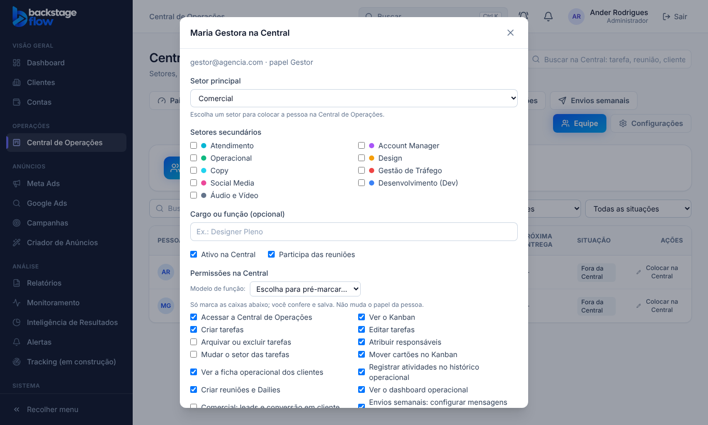

# 43.3 (fase 2) — Modelos de função na Central

Feito em 07/11/2026, seguindo a recomendação "sim" da pergunta 1.

## O que você ganhou
Em **Central → Equipe → editar uma pessoa**, ao lado das permissões há **"Modelo de função"**: **Gestor de tráfego**, **Operação** e **Comercial**. Escolher um modelo **só pré-marca as caixas**; você ajusta o que quiser e clica em **Salvar**. A lista dos 4 modelos (inclui o Administrador, só informativo) também aparece em **Configurações → Papéis e permissões**.

| Modelo | Papel sugerido | O que marca |
|---|---|---|
| Gestor de tráfego | Gestor | acesso, Kanban, criar/editar/atribuir tarefas, mover cartões, ficha dos clientes, histórico, reuniões, painel, **envios semanais** |
| Operação | Equipe | acesso, Kanban, criar/editar tarefas, mover cartões, ficha dos clientes, histórico, reuniões |
| Comercial | Equipe | acesso, Kanban, criar/editar tarefas, mover cartões, **leads e conversão**, ficha dos clientes, reuniões |
| Administrador | Administrador | todas (só informativo; o papel Administrador já tem tudo) |

## Regras
- **Não muda o papel do sistema** (isso continua na aba Usuários) e **não mexe no banco**: usa a mesma gravação de permissões de sempre, e o banco continua conferindo cada permissão.
- **Nenhum modelo marca "Arquivar ou excluir tarefas"**: essa fica sempre à mão.
- Setores, equipe e configurações da Central continuam só do Administrador.
- Nenhuma tabela nova.

## Testes
Unitários (3 casos: os 4 modelos só com permissões que existem, quem tem leads e envios, nada de arquivar) e de navegador `e2e/ops-modelos-funcao.mjs` (8 verificações: modelos oferecidos, marcar e trocar o conjunto, ajuste fino à mão, salva exatamente o que ficou marcado, tela com os 4 modelos). Testes de equipe, permissões e organização continuam passando. **Não testado:** no celular.

