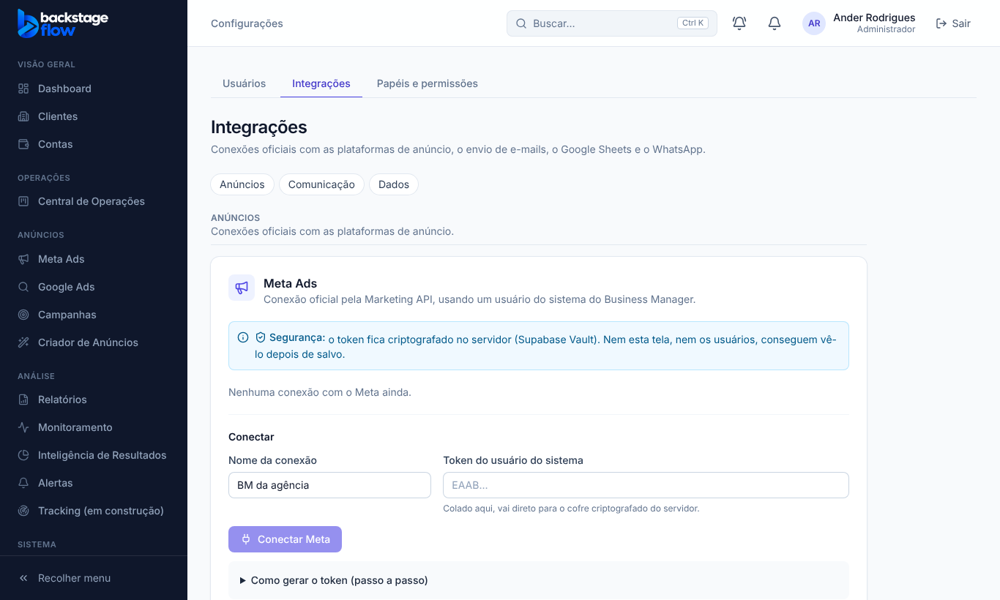
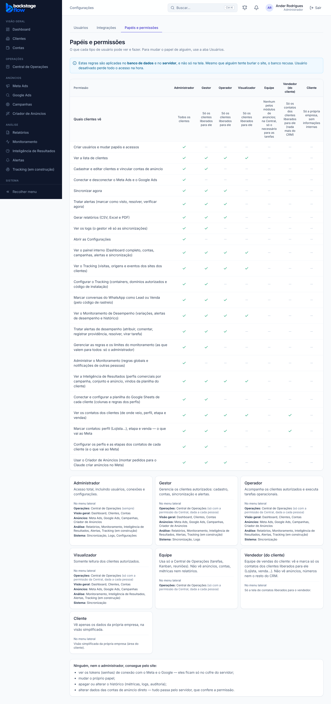

# 43.3 (fase 1) — Integrações em seções e "o que cada papel vê" 

Feito em 07/11/2026. Você disse "pode" sem responder as duas perguntas; segui as **recomendações**: começar por **B (Integrações)** e **D (mapa em Papéis e permissões)**, que **não mexem na ordem do menu** nem tiram função. Os **modelos de permissão por função** (pergunta 1) ficam para a próxima fase, com o seu "pode".

## O que mudou para você
- **Configurações → Integrações** agora tem um índice no topo e três seções: **Anúncios** (Meta, Google), **Comunicação** (e-mail, WhatsApp oficial, WhatsApp não oficial, avisos no WhatsApp) e **Dados** (Google Sheets). São os mesmos cartões, só organizados.
- **Configurações → Papéis e permissões:** cada papel ganhou "No menu lateral", listando os itens que ele vê, gerado do mesmo código do menu (não pode ficar desatualizado). Equipe mostra "Central só com a permissão, dada a cada pessoa"; cliente e vendedor mostram a visão deles.

## Não mudou
Menu lateral (ordem e itens), permissões, banco, qualquer função. Nenhuma tabela nova.

## Testes
Teste unitário do mapa do menu (4 casos, incluindo que a ordem dos grupos continua a mesma); teste de navegador `e2e/organizacao.mjs` (admin, visualizador, equipe, cliente; seções; sem erro no console); os de permissões, conexão e avisos do WhatsApp continuam passando. **Não testado:** no celular.

