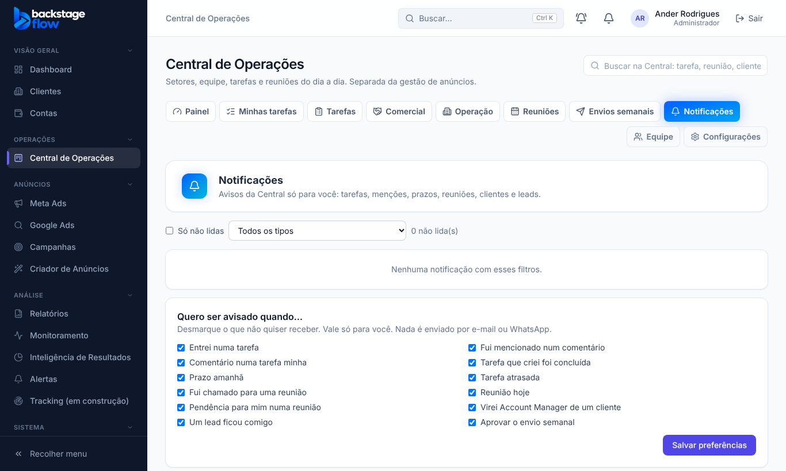

# 43.4 — Aba "Notificações" na Central (07/11/2026)

**Problema (relatado pelo Ander):** o passo "Central → Notificações → Ativar neste aparelho" não aparecia. Motivo: a tela só existia atrás do sininho ("Ver todas e preferências"); não havia aba. Meu passo a passo estava incompleto.

**O que mudou:** a Central ganhou a aba **Notificações** (entre "Envios semanais" e "Equipe"), visível para quem acessa a Central. Ela abre o cartão **"Aviso no computador e no celular"** (ativar neste aparelho, enviar teste, desativar) e as preferências. O sininho continua funcionando como antes. Para caber, deixei as abas um pouco mais compactas (menos espaço entre elas).

**Não mudou:** permissões, banco e o menu lateral. Nenhuma tabela nova.

**Testes:** novo `e2e/ops-notificacoes-aba.mjs`; atualizei a lista de abas esperadas nos testes da Central (equipe, clientes, comercial, reuniões); rodei todos os `ops-*`, monitoramento, menu e organização: passaram. Um teste de arrastar do Kanban (`ops-clients`) falhava quando as abas ficavam largas demais; resolvido deixando-as compactas.
**Não testado:** a ativação real no aparelho (depende do navegador e do celular do Ander).

