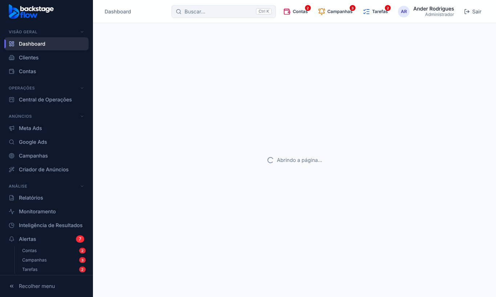
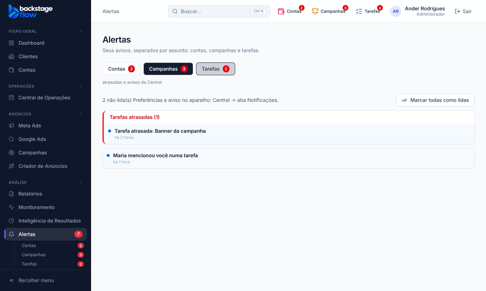

# 43.5 — Três sininhos identificados e Alertas em 3 abas (07/11/2026)

Pedido do Ander: ter os **3 tipos de aviso separados e identificados** (campanhas com problema, tarefas atrasadas/Central, alertas das contas), tanto **no topo** quanto **no menu** (o número vermelho de Alertas, que ele gosta), e ver os 3 dentro de **Alertas**. Respostas dele: o "alerta de baixo" é o item Alertas do menu com o número vermelho; na aba de tarefas, seguir a recomendação (tudo da Central, atrasadas em destaque).

## O que mudou
- **Topo: 3 sininhos**, cada um com ícone, cor, nome e número vermelho próprios (em telas grandes aparece o nome ao lado):
  - **Contas** (carteira): sem saldo, saldo baixo, pagamento, conta restrita, erros de conexão. Abre uma lista com os alertas mais graves.
  - **Campanhas** (sino amarelo): os avisos do Monitoramento (o sino que já existia, agora identificado).
  - **Tarefas** (lista azul): tarefas atrasadas, menções, reuniões, envios para aprovar (o sino da Central que já existia, agora identificado). Tem os atalhos "Ver em Alertas" e "Ver todas e preferências".
- **Menu lateral:** continua **um único item "Alertas"**, mas o número vermelho agora é a **soma dos 3**, e logo abaixo aparecem **Contas, Campanhas e Tarefas**, cada uma com o seu número (clique leva à aba). Nenhum item novo no menu.
- **Tela Alertas em 3 abas** (`/alertas?aba=...`): **Contas** (a tela de alertas de sempre, com filtros e "Verificar agora"), **Campanhas** (os avisos do Monitoramento, com "marcar todos como lidos") e **Tarefas** (tudo da Central; as **atrasadas ficam num bloco vermelho no topo**). Quem não tem acesso ao Monitoramento ou à Central não vê a aba correspondente.

## Marcar como visto/lido (pedido depois da primeira versão)
- **Campanhas** e **Tarefas**: já tinham "Marcar todos como lidos" (no sininho e na aba).
- **Contas**: novo **"Marcar todos como vistos"** no sininho Contas e na aba Contas (aparece só para quem pode gerenciar alertas e só quando há alertas novos). Passa os alertas de "aberto" para "visto"; **nada é resolvido nem apagado**, e o histórico fica.

## Regras
- Cada assunto continua vindo da sua própria fonte e com as suas próprias preferências (Monitoramento e Central não foram misturados no banco). Só a **visualização** ficou junta.
- Nada de banco novo, nenhuma tabela nova, permissões iguais às de antes.

## Testes
Novo `e2e/alertas-tres.mjs` (14 verificações, inclui o "Marcar todos como vistos"): números dos 3 sininhos, nomes nos rótulos, total no menu (2 + 3 + 2 = 7), 3 contadores separados, lista do sininho Contas, abas Campanhas e Tarefas (atrasadas no topo), aba Contas igual à de sempre, visualizador sem a aba Tarefas, sem erro no console. Ajustei os testes de alertas, design e responsivo (o botão novo no menu e um rótulo). **Não testado:** no celular e com dados reais do seu CRM.

