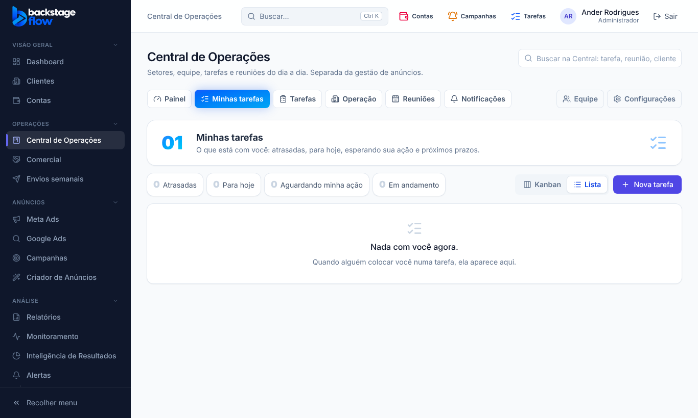

# 43.6 — Comercial e Envios semanais separados da Central (07/11/2026)

Pedido do Ander: tirar o **Comercial** de dentro da Central de Operações e também separar **Envios semanais**, ficando **três menus**: Central de Operações, Comercial e Envios semanais, sem quebrar nada que depende deles.

## O que mudou para você
- No menu lateral, grupo **Operações**, agora há **três itens**: **Central de Operações**, **Comercial** e **Envios semanais** (nessa ordem). Cada um aparece só para quem tem a permissão correspondente (a da Central, "Comercial" e "Envios semanais"); o administrador vê os três.
- As **abas da Central** ficaram: Painel, Minhas tarefas, Tarefas, Operação, Reuniões, Notificações e (admin) Equipe e Configurações. **Comercial e Envios semanais saíram das abas.**
- Cada módulo abre no seu próprio endereço: **/comercial** e **/envios**, com o mesmo conteúdo de antes (leads e funil; envios, grupos, histórico, aprovação e WhatsApp conectado).

## Para não quebrar nada
- Os **endereços antigos continuam funcionando**: `/operacoes/comercial` e `/operacoes/envios` levam ao novo, mantendo filtros e âncoras (`?ver=config`, `?lead=...`). Assim funcionam os avisos do sino, o e-mail e o aviso no aparelho, o histórico, a busca da Central e o Claude (MCP).
- **Permissões, banco, tabelas e regras: nada mudou.** A Central continua exigindo "Acessar a Central" (quem tem "Comercial" ou "Envios semanais" mas não tem acesso à Central não vê os itens, como antes).
- Painel, Hoje (pré-visualização) e Configurações do comercial apontam para os endereços novos.

## Não mudou de propósito
O menu de pessoas, as permissões por pessoa e os modelos de função (Gestor de tráfego, Operação, Comercial) continuam na Central → Equipe. Se você decidir separar mais algum módulo, o caminho está pronto (um item no menu + um endereço, com o antigo redirecionando).

## Testes
Unitários do menu (ordem, quem vê o quê) e novo `e2e/ops-separados.mjs` (8 verificações: ordem no menu, abas da Central sem os dois, títulos, item marcado só no módulo aberto, links antigos com filtros, gestor sem a permissão não vê). Atualizei os testes de Comercial, Envios, equipe, menu e design. **Não testado:** no celular e com um clique em aviso real (testado com o simulador).

