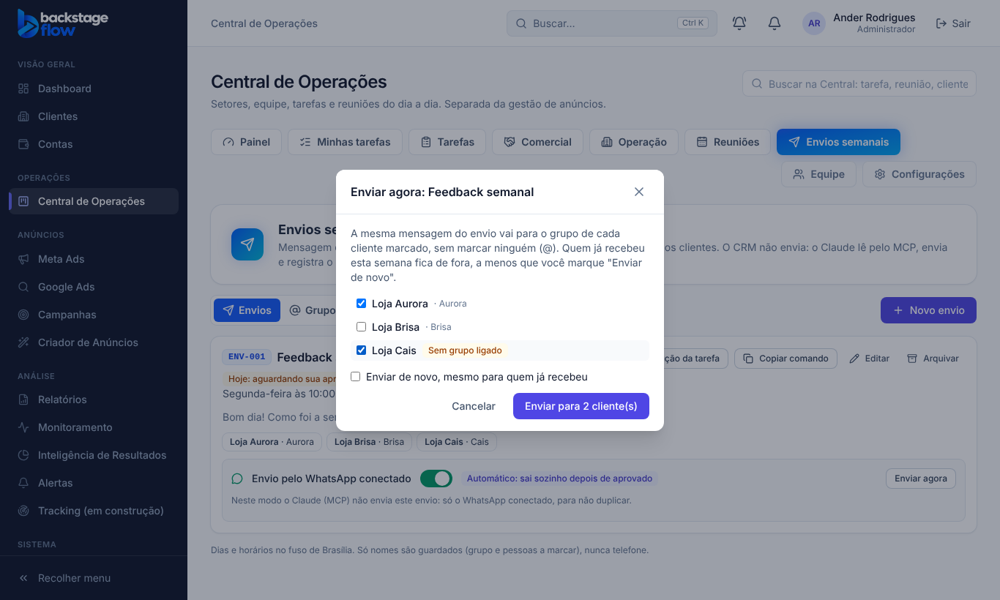
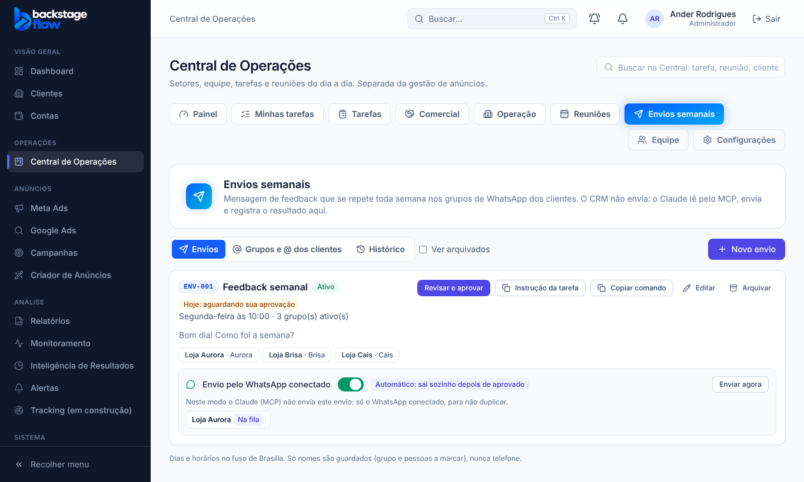

# 44.3 — Disparos pelo WhatsApp conectado (sem marcar @)

Feito em 07/11/2026. **Testado só com servidor simulado: ainda não existe o servidor real do WhatsApp (falta o Ander contratar e instalar, ver `44.1-SERVIDOR-PASSO-A-PASSO.md`).**

## O que muda para você
- Em **Envios**, cada envio ganha uma faixa "Envio pelo WhatsApp conectado" (só aparece com o WhatsApp conectado e a trava ligada em Integrações).
  - **Enviar sozinho** (só administrador): depois que você aprova o envio da semana, ele sai sozinho, na hora, para o grupo de cada cliente.
  - **Enviar agora**: escolhe os clientes e a mensagem vai para o grupo de cada um (sem Claude no navegador).
  - Cada cliente mostra: Na fila, Enviando, Enviado, Falhou ou Pulado (com o motivo).
- A mensagem **não marca ninguém (@)**. A decisão A/B/C sobre marcar continua aberta.

## Regras e travas
- **Anti-duplicidade:** se o envio está no automático, o Claude (MCP) deixa de enxergá-lo como "liberado" e não consegue registrar "enviado" nele.
- Só sai com a trava geral ligada e o WhatsApp conectado. Desligou, parou.
- No máximo **60 mensagens por dia**, com pausa mínima de **45 s** entre elas (o servidor manda ~1 por minuto, com atraso aleatório de 1,2 a 3,5 s).
- Falha temporária: tenta mais uma vez; depois marca "Falhou".
- Automático só envia se a aprovação ainda vale e até **3 horas** depois do horário.
- Cliente sem grupo ligado é "Pulado" (aparece uma vez), nunca é inventado.
- Quem pode: ligar o automático = administrador; "Enviar agora" e ver resultados = quem tem a permissão Envios semanais.

## Tabelas novas
- **`wa_envio_config`**: marca quais envios estão no automático. Campos: `envio_id` (chave, liga ao envio), `automatico`, `updated_by`, `updated_at`. Guardada permanentemente (uma linha por envio).
- **`wa_disparos`**: cada mensagem a mandar (fila e resultado). Campos: `envio_id`, `cliente_id`, `grupo_id` (@g.us), `semana`, `origem` (automático/manual), `status`, `tentativas`, `versao_envio`, `detalhe`, `criado_por`, datas. Índices: único por envio+cliente enquanto pendente/enviando, fila por data, semana, cliente, criador. Não guarda o texto da mensagem nem telefone. Guardada permanentemente (histórico).
- O histórico do envio ganhou a origem "WhatsApp conectado (automático)".

## Peças
- Banco: `20261107005045_wa_disparos.sql`; função `wa-send` (cron a cada minuto, senha interna); tela `WaDisparos.tsx`.
- Testes: SQL `supabase/tests/etapa44_3_wa_disparos.sql` (6 verificações, rodado no banco real e desfeito), `wa-send/logic_test.ts`, navegador `e2e/wa-disparos.mjs`.

