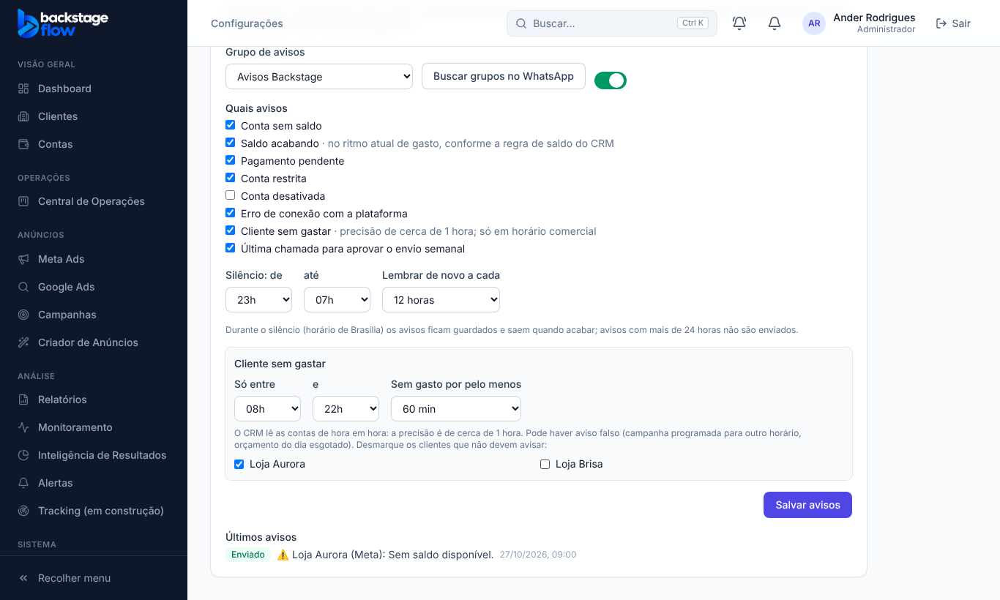

# 45.3 — Tela dos avisos no WhatsApp

Feito em 07/11/2026. Fica em **Configurações → Integrações**, logo abaixo da conexão do WhatsApp. **Só o administrador** vê e muda. Nenhum botão novo no menu.

## O que você faz na tela
1. **Grupo de avisos:** clica em "Buscar grupos no WhatsApp" (precisa do WhatsApp conectado e da trava ligada) e escolhe o grupo que você criou só para você.
2. **Quais avisos:** marca os tipos: sem saldo, saldo acabando, pagamento pendente, conta restrita, conta desativada, erro de conexão, **cliente sem gastar** e última chamada de aprovação do envio.
3. **Silêncio:** de que horas até que horas nada é enviado (padrão 22h às 7h; fica guardado e sai depois). **Lembrar de novo a cada** 3, 6, 12, 24 ou 48 horas.
4. **Cliente sem gastar** (aparece quando o tipo está marcado): janela do dia (padrão 8h às 22h), tempo sem gasto (30 a 180 min) e a lista de clientes — desmarque quem não deve avisar.
5. **Ligar avisos no WhatsApp** e **Salvar avisos**. Ligar sem escolher o grupo é recusado.
6. Embaixo: os **últimos 8 avisos** com Na fila, Enviado, Falhou ou Pulado.

## Regras
- Os avisos de sino, aparelho e e-mail continuam como sempre; isto só soma o WhatsApp.
- Sem WhatsApp conectado e trava ligada, os avisos ficam guardados e nada é enviado (a tela avisa).
- "Sem gasto" tem precisão de cerca de 1 hora e pode dar aviso falso (explicado na tela).
- Nenhuma tabela nova (usa as da 45.1 e 45.2).

## Testes
Navegador `e2e/wa-avisos.mjs` (9 verificações, servidor simulado): começa desligado, mostra últimos avisos, janela do sem gasto só com o tipo marcado, recusa ligar sem grupo, salva grupo/tipos/silêncio, silencia cliente, salva a janela, sem erro no console, gestor não vê. Os testes de navegador da 44.1, 44.2 e 44.3 continuam passando.
**Não testado:** com WhatsApp real (sem servidor) nem com a lista real de grupos.

