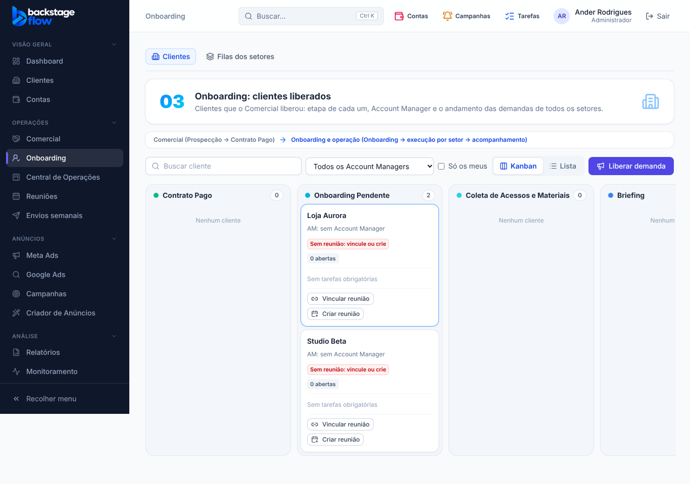
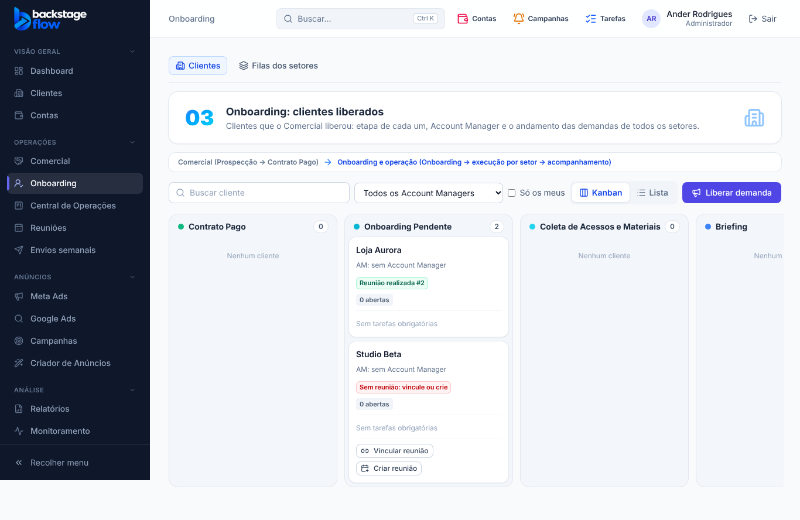

# 47.1 — Onboarding Pendente exige reunião realizada (07/11/2026)

## Regra
- Todo cliente em **Onboarding Pendente** precisa ter **uma reunião de onboarding vinculada**.
- Ele **só avança** (arrastar, mudar etapa, avanço automático ou Claude/MCP) quando essa reunião está **"Realizada"**. **Voltar** de etapa continua livre.
- Vale também para os **2 clientes que já estavam** na coluna (resposta do Ander: "sim").

## Na tela (Onboarding → Kanban)
- Selo no cartão: 🔴 **Sem reunião** · 🟡 **Reunião marcada para dd/mm** (ou "falta registrar" se a data já passou) · 🟢 **Reunião realizada**.
- Botões só na coluna Onboarding Pendente: **Vincular reunião** (lista as reuniões do cliente primeiro; reunião sem cliente passa a ser dele), **Criar reunião** (abre já com tipo "Reunião com cliente", cliente travado e título "Onboarding — Cliente"; ao agendar, vincula sozinha), **Trocar reunião** e **Desvincular**.
- Com a reunião realizada os botões somem e o cliente pode avançar.
- Se tentar avançar sem a reunião realizada, o banco recusa: *"Vincule uma reunião de onboarding a este cliente e marque-a como 'Realizada' antes de avançar."*

## Avisos (tipo novo "Reunião de onboarding de um cliente", pode ser silenciado em Notificações)
- **Ao entrar** na coluna: "Vincule uma reunião de onboarding a {cliente}".
- **Reunião realizada:** "{cliente} pode avançar". **Cancelada:** volta a faltar reunião.
- **Lembrete diário nos dias úteis às 9h (Brasília)** enquanto faltar a reunião (sem vínculo, cancelada, ou marcada que já passou sem registro). Reunião marcada para o futuro não cobra.
- Quem recebe: o **Account Manager** do cliente e os **administradores** (quem fez a ação não é avisado). Aparece no sino "Tarefas e Central" e em Alertas → Tarefas.
- Ao aplicar a migração saiu um lembrete para os 2 clientes que já estavam na coluna.

## Quem pode vincular
Quem já pode mover o cliente: administrador, Account Manager do cliente e quem tem a permissão de clientes + mover cartões. "Criar reunião" exige também "Criar reuniões e Dailies".

## Banco
- **Sem tabela nova.** Campo novo `onboarding_meeting_id` (reunião, com índice) em `ops_client_ops` — guardado enquanto o cliente existir no fluxo; histórico de vincular/desvincular fica no histórico operacional (permanente).
- Tipo de aviso `cliente.reuniao`. Funções: `ops_client_meeting_link`, `ops_client_meeting_unlink`; regra em `ops_client_stage_move_impl` e no gatilho de avanço automático; agendador `ops-onboarding-reuniao` (seg–sex 12h UTC = 9h Brasília).
- Migração: `supabase/migrations/20261107061037_onboarding_exige_reuniao.sql`.

## Testes
- SQL `supabase/tests/etapa47_1_onboarding_reuniao.sql`: 8 verificações OK (bloqueio, só agendada não libera, validações do vínculo, quadro, realizada libera e avisa, voltar livre, desvincular, cancelada avisa, lembrete sem duplicar).
- Navegador `onboarding-reuniao.mjs` (16 verificações) + `ops-clients`, `ops-commercial`, `ops-notifications`, `ops-notificacoes-aba`, `ops-meetings`, `ops-dashboard`, `ops-team` sem falhas. Unitários, Edge Functions, `check:secrets` OK; advisors sem novidades.
- **Não testado:** envio real do aviso no aparelho/WhatsApp para esse tipo novo; o lembrete das 9h só roda de verdade no próximo dia útil.
