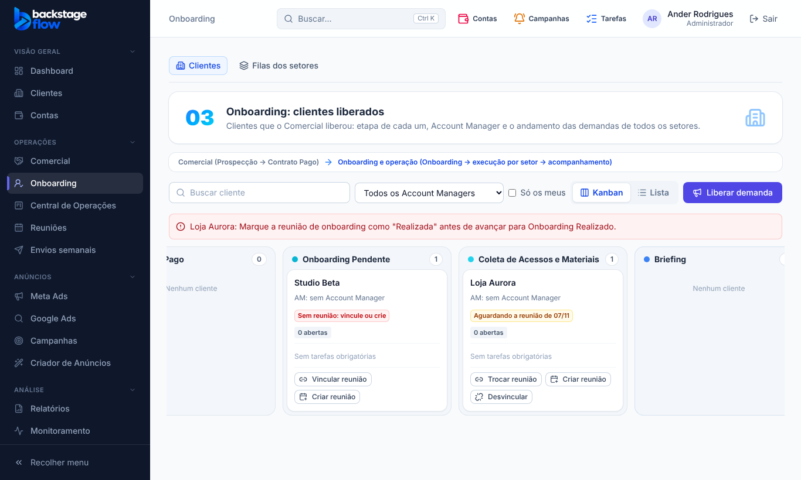
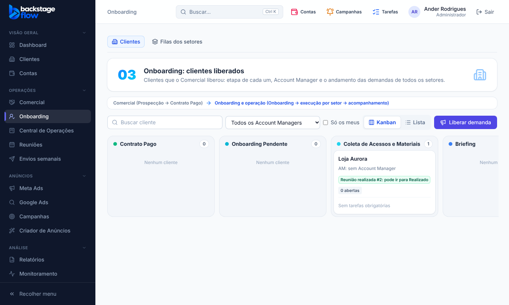

# 47.2 — Onboarding por etapas ligadas à reunião (07/11/2026)

Muda a regra da 47.1 a pedido do Ander. As colunas do Kanban de Onboarding são: **Pendente → Agendado → Realizado → Cancelado**.

## Regras (no banco; valem para arrastar, botão de etapa, avanço automático e Claude/MCP)
1. **Pendente → Agendado:** só com uma reunião **agendada** vinculada ao cliente.
2. **Agendado → Realizado:** só com a reunião vinculada **Realizada** (ata e presença registradas).
3. **Cancelar o onboarding:** ao cancelar a reunião marcando **"Cliente não fará mais onboarding"**, o cliente vai **sozinho** para **Onboarding Cancelado** (registrado no histórico como Sistema). É o único caminho para Cancelado: arrastar na mão é recusado.
4. Cancelar por **outro motivo** (remarcar): se o cliente estava em Agendado, **volta para Pendente**; em Pendente continua lá. Em ambos há aviso e é preciso vincular outra reunião.
5. **Desvincular** a reunião de um cliente em Agendado também o devolve a Pendente. Em Realizado a reunião não pode ser desvinculada.
6. **Voltar** de etapa continua livre. Valem para os 2 clientes que já estavam em Pendente (confirmado pelo Ander).

## Na tela
- Selo no cartão (Pendente e Agendado): 🔴 sem reunião · 🟡 marcada ("pode ir para Agendado" / "Aguardando a reunião de dd/mm" / "falta registrar como Realizada") · 🟢 realizada ("pode ir para Realizado").
- Botões Vincular / Criar / Trocar / Desvincular continuam (somem quando a reunião está realizada).
- **Cancelar reunião** (Reuniões): em reunião que tem cliente aparece "Por que cancelar?": *Outro motivo* ou *Cliente não fará mais onboarding* (motivo texto vira opcional).

## Avisos e lembrete
- Entrada em Pendente sem reunião agendada: "Vincule uma reunião de onboarding a {cliente}".
- Reunião realizada: "pode ir para Onboarding Realizado". Cancelada: aviso (e volta a Pendente se estava em Agendado). Cliente desistiu: "Onboarding cancelado: {cliente}".
- Lembrete seg–sex 9h (Brasília), agora com mensagem certa por etapa: falta reunião (Pendente), reunião marcada → mover para Agendado, reunião passou sem registro (Agendado), realizada → mover para Realizado.

## Banco
- **Sem tabela nova.** Campo novo `cancel_kind` em `ops_meetings` (`outro` | `cliente_desistiu`; fica com a reunião, que nunca é apagada). Funções novas: `ops_meeting_cancel_kind` (a antiga `ops_meeting_cancel` continua), `ops_onboarding_gate_msg`, `ops_onboarding_mover`. Regras reescritas em `ops_client_stage_move_impl`, avanço automático, desvincular, gatilhos de aviso, lembrete e quadro.
- Migração `supabase/migrations/20261107062944_onboarding_etapas_reuniao.sql`.

## Testes
- SQL `supabase/tests/etapa47_2_onboarding_etapas.sql`: 7 verificações OK (bloqueios por etapa, Agendado/Realizado, Cancelado só pelo cancelamento, voltar para Pendente, desvincular, lembrete sem duplicar). O teste da 47.1 foi substituído por este.
- Navegador `onboarding-reuniao.mjs` (17 verificações) + `ops-clients`, `ops-commercial`, `ops-notifications`, `ops-meetings`, `ops-dashboard` OK; unitários 275, Edge Functions 189, `check:secrets` e advisors sem novidades.
- **Não testado:** o caminho "desvincular em Agendado volta para Pendente" só no simulador/leitura (não no teste SQL); envio real do aviso no aparelho; o lembrete das 9h no próximo dia útil.
