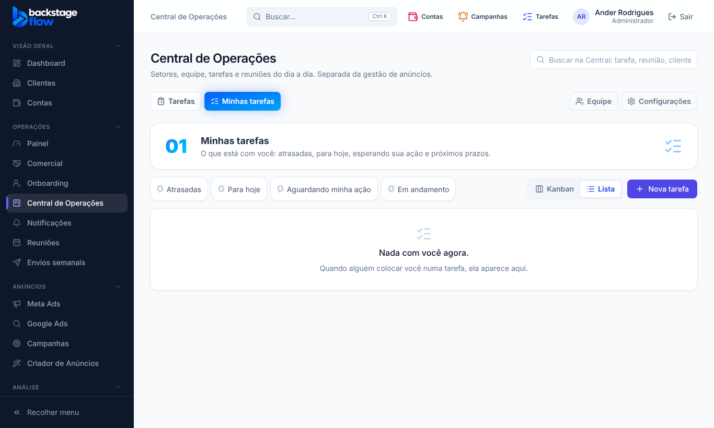

# 49.1 — Painel e Notificações com menu próprio (07/11/2026)

## Pedido do Ander
Tirar **Painel** de dentro da Central de Operações e colocá-lo **antes de Comercial**; colocar **Notificações** logo **abaixo de Central de Operações**, porque cada pessoa escolhe os seus avisos.

## Ordem do menu (grupo Operações)
**Painel · Comercial · Onboarding · Central de Operações · Notificações · Reuniões · Envios semanais**

## O que mudou
- **Painel** (`/painel`): mesma tela de antes (tudo do dia, de todos, com filtros por setor e pessoa). Aparece para quem tem "Ver o painel". Quem não tem, não vê o item.
- **Notificações** (`/notificacoes`): mesma tela (preferências de aviso e aparelhos de cada login). Aparece para quem tem acesso à Central.
- A **Central de Operações** ficou com as abas: Tarefas, Minhas tarefas e, para o admin, Equipe e Configurações. Ela agora abre em **Minhas tarefas**.
- Os endereços antigos (`/operacoes/painel`, `/operacoes/notificacoes`) continuam funcionando e levam aos novos. O atalho do Dashboard e o link do sino foram ajustados.
- Sem mudança de banco, de permissões ou de regras.

## Testes
Unitários (menu fixado em teste, ordem nova aprovada) e navegador: `ops-dashboard`, `ops-team`, `ops-separados`, `ops-notificacoes-aba`, `ops-due-reminder`, `ops-notifications`, `ops-clients`, `ops-meetings`, `ops-commercial`, `permissions` OK. **Não testado:** celular.
