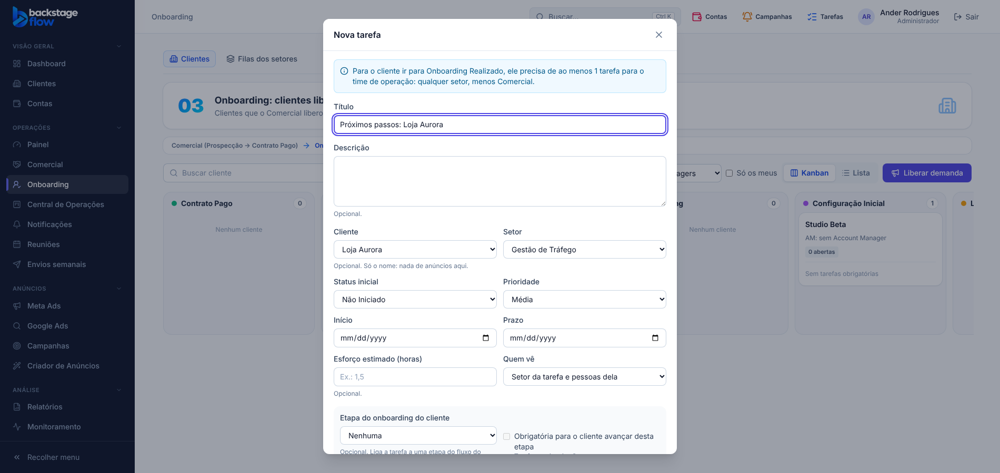

# 49.4 — Onboarding Realizado exige tarefa para o time de operação (07/11/2026)

Pedido do Ander: para o cliente passar de **Onboarding Agendado** para **Onboarding Realizado**, além da reunião **Realizada**, ele precisa ter **pelo menos 1 tarefa para o time de operação**, com os próximos passos que vão ser passados ao cliente.

## Regra agora
- **Agendado → Realizado:** reunião de onboarding **Realizada** + **ao menos 1 tarefa** ligada ao cliente que:
  - seja de **qualquer setor, menos Comercial** (decisão do Ander; não existe setor "Operação" ativo);
  - **não** esteja cancelada nem arquivada. Tarefa **finalizada conta** (decisão do Ander).
- Sem a tarefa, o banco recusa: *"Crie pelo menos uma tarefa para o time de operação (qualquer setor, menos Comercial) com os próximos passos do cliente antes de avançar para Onboarding Realizado."*
- Vale para arrastar na tela, para o avanço automático e para o MCP (todos passam pela mesma regra do banco).
- **Pendente → Agendado** (reunião agendada) e **Cancelado livre** (49.3): sem mudança. Voltar de etapa segue livre.
- O Comercial é reconhecido **pelo nome do setor** ("Comercial"). Se o setor for renomeado, a regra precisa ser ajustada.

## Na tela
- Selo do cartão: com a reunião realizada e sem tarefa, fica **amarelo**: "Reunião realizada #N: falta 1 tarefa para a operação". Com a tarefa, fica **verde**: "pode ir para Realizado".
- Botão **"Criar tarefa para a operação"** no cartão (para quem pode criar tarefas): abre a Nova tarefa já com o cliente, o título "Próximos passos: {cliente}" e o aviso da regra. O setor vem preenchido com o setor da pessoa, a não ser que seja o Comercial.

## Avisos
- Ao marcar a reunião como Realizada: se ainda não há tarefa, o aviso é "Reunião realizada: crie a tarefa da operação de {cliente}"; se já há, continua "… pode ir para Onboarding Realizado".
- O lembrete diário (seg–sex 9h) também pede a tarefa quando ela falta.

## Banco / tabelas
Sem tabela nova. Função nova `private.ops_onboarding_tem_tarefa_operacao(cliente)` (interna, sem acesso pelo site). Reescritas: `ops_onboarding_gate_msg`, `ops_client_board_impl` (campo novo `ops_task_ok` no cartão), `ops_onboarding_entrada_tg`, `ops_onboarding_reuniao_status_tg`, `ops_onboarding_reuniao_lembrar`. Migração `supabase/migrations/20261107120844_onboarding_exige_tarefa_operacao.sql`.

## Situação real no dia da mudança
- **Abraço de Algodão** estava em Onboarding Agendado com a reunião realizada e **sem tarefa**: fica parado até alguém criar a tarefa da operação.
- **teste** está em Onboarding Pendente (já tem tarefa de Account Manager).

## Testes
- SQL `supabase/tests/etapa49_4_onboarding_tarefa_operacao.sql`: **9 verificações OK** no banco real (transação desfeita), incluindo: tarefa do Comercial, cancelada e arquivada não contam; finalizada conta; quadro, avisos e lembrete.
- SQL 47.2 atualizado (o passo "vai para Realizado" agora cria a tarefa): **8 verificações OK**.
- Navegador `onboarding-reuniao` (**24 OK**, 7 novas da 49.4), `ops-clients` (35), `ops-separados` (13), `ops-tasks` (37), `ops-meetings` (31).
- Tipos, lint, unitários (web 179, shared 275) e `check:secrets` OK. Avisos de segurança do Supabase: só os antigos e aceitos.
